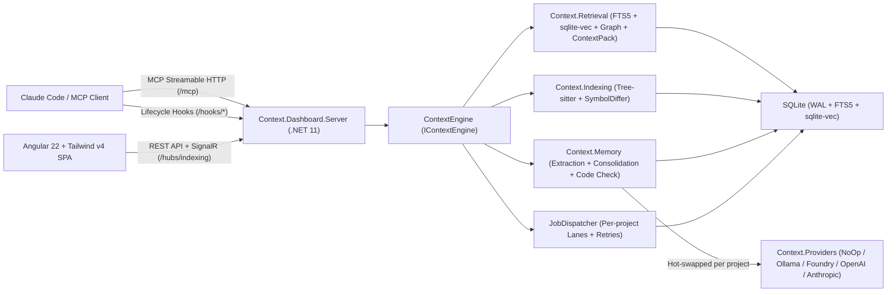

# Context Platform

[Project landing](https://dellik95.github.io/context-platform/) · [Portfolio](https://dellik95.github.io/portfolio/) · [Qandivo](https://dellik95.github.io/portfolio/qandivo/) · [Kadex UI component library](https://dellik95.github.io/portfolio/kadex-ui/)

**Language / Мова:** English | [Українська (посібник)](docs/uk/USER_GUIDE.md) · **Live Product Showcase:** [dellik95.github.io/context-platform](https://dellik95.github.io/context-platform/)

**Local-first long-term memory, hybrid code search, and call-graph impact analysis for AI coding agents (Claude Code / MCP).**

Context Platform indexes your repository locally using **SQLite (FTS5 + `sqlite-vec`)** and **Tree-sitter**, remembers architectural decisions across sessions, and exposes 13 targeted MCP tools plus lifecycle hooks so Claude Code spends tokens answering questions instead of re-reading dozens of files from scratch.

---

## Key Capabilities

- **Token-budgeted retrieval (`context_search`, `code_search`):** combines SQLite FTS5 (BM25 + CamelCase/snake_case splitting), `sqlite-vec` vector search, and code-graph neighbors into a strict `TokenBudget`, while `McpSavingsTracker` deduplicates repeat reads to estimate realistic token savings.
- **Tree-sitter AST & Blast Radius (`graph_impact`):** parses `C#`, `TypeScript`, `TSX`, `JavaScript`, and `Python` without needing an LLM, mapping callers, interface/base implementers, and covering tests across files.
- **Multi-tier session memory:** captures session checkpoints across `/compact` boundaries, extracts structured facts, merges duplicates online and in batch consolidation, and checks referenced symbols against real code.
- **Modern Angular 22 + Tailwind CSS v4 dashboard:** live job queue charts, interactive `vis-network` dependency graph, memory consolidation preview, session checkpoints, and runtime provider switching (`NoOp`, `Ollama`, `Foundry Local`, `OpenAI`, `Anthropic`).
- **Private & local by default:** runs out of the box in offline `noop` mode backed by a single SQLite WAL database with per-project bearer-token isolation.

---

## High-Level Architecture



---

## Dashboard Screenshots

| Project Overview, Jobs & Hooks | Interactive Code Graph & Blast Radius |
| :---: | :---: |
|  |  |

---

## Quick Start

### Option 1: Run Locally (.NET 11 + Angular 22)

**Requirements:** `.NET SDK 11.0.100+` (`global.json`), `Node.js 22+`, `npm 11+`.

1. **Install and build the frontend client:**
   ```bash
   git clone https://github.com/dellik95/context-platform.git
   cd context-platform/apps/host/Context.Dashboard/context.dashboard.client
   npm ci
   npm run build
   ```
2. **Start the server in development mode (`SpaProxy` starts `ng serve` automatically):**
   ```bash
   cd ../Context.Dashboard.Server
   dotnet run
   ```
   Or build a standalone production bundle:
   ```bash
   dotnet publish apps/host/Context.Dashboard/Context.Dashboard.Server -c Release -o ./publish/host
   cp -r apps/host/Context.Dashboard/context.dashboard.client/dist/dashboard/browser/* ./publish/host/wwwroot/
   dotnet exec ./publish/host/Context.Dashboard.Server.dll
   ```
3. **Open the dashboard:** [http://127.0.0.1:47923](http://127.0.0.1:47923)
   On localhost (`127.0.0.1`), the UI bootstraps its admin token automatically without a login screen.

### Option 2: Docker Compose (with optional Redis)

```bash
export CONTEXT_PLATFORM_ADMIN_TOKEN="$(openssl rand -base64 32)"
docker compose up -d --build
```

The container mounts your repository read-only at `/workspace:ro` and persists SQLite data, logs, and backups in the `context-data` volume. See [deploy/README.md](deploy/README.md) for `systemd` / Windows Service scripts.

---

## Connect Claude Code

Create a project in the dashboard, open **Settings**, and click **Register Claude Code integration** (or call `POST /api/projects/{id}/claude/install`). It backs up existing files and writes:

- `.mcp.json` — MCP server config with a project-scoped bearer token;
- `.claude/settings.json` & `.claude/hooks/*.ps1` / `*.sh` — `SessionStart`, `UserPromptSubmit`, `PostToolUse`, `PostCompact`, `Stop`, `SessionEnd` hooks;
- `.claude/skills/context-memory/SKILL.md` — guidance telling Claude when to use MCP search and graph tools.

---

## Environment Variables

| Variable | Default | Purpose |
| :--- | :--- | :--- |
| `CONTEXT_PLATFORM_PORT` | `47923` | Listening port for `Context.Dashboard.Server` |
| `CONTEXT_PLATFORM_BIND_HOST` | `127.0.0.1` (`0.0.0.0` in Docker) | Host bind interface |
| `CONTEXT_PLATFORM_DATA_DIR` | Binary directory | Folder for `context.db`, logs, and backups |
| `CONTEXT_PLATFORM_ROOT` | Nearest `.git` root | Default project root for CLI/host |
| `CONTEXT_PLATFORM_ADMIN_TOKEN` | Auto on `127.0.0.1` | Admin bearer token for project & folder-picker APIs |
| `CONTEXT_PLATFORM_REDIS` | `null` | Optional Redis connection string for multi-host signals |
| `CONTEXT_EMBEDDING_PROVIDER` | `noop` | Default embedding provider (`noop`, `ollama`, `foundry`, `openai`) |
| `CONTEXT_LLM_PROVIDER` | `noop` | Default chat provider (`noop`, `ollama`, `foundry`, `anthropic`) |
| `CONTEXT_OLLAMA_BASE_URL` | `http://localhost:11434` | Ollama server URL |
| `CONTEXT_OLLAMA_EMBEDDING_MODEL` | `embeddinggemma` | Default Ollama embedding model |
| `CONTEXT_OLLAMA_CHAT_MODEL` | `qwen2.5-coder:1.5b` | Default Ollama chat model |
| `CONTEXT_FOUNDRY_BASE_URL` | `http://127.0.0.1:5273/v1` | Microsoft Foundry Local endpoint |
| `CONTEXT_OPENAI_API_KEY` | `null` | OpenAI API key (`text-embedding-3-small`) |
| `CONTEXT_ANTHROPIC_API_KEY` | `null` | Anthropic API key (`claude-3-5-sonnet-20241022`) |

> Provider choices, model names, and URLs can also be changed per project in the **Settings** tab at runtime with no restart.

---

## Documentation

| Topic | English | Українська |
| :--- | :--- | :--- |
| **User Guide & Setup** | [docs/en/USER_GUIDE.md](docs/en/USER_GUIDE.md) | [docs/uk/USER_GUIDE.md](docs/uk/USER_GUIDE.md) |
| **System Architecture** | [docs/en/ARCHITECTURE.md](docs/en/ARCHITECTURE.md) | [docs/uk/ARCHITECTURE.md](docs/uk/ARCHITECTURE.md) |
| **Features, Quality & Honest Analysis** | [docs/en/FEATURES.md](docs/en/FEATURES.md) | [docs/uk/FEATURES.md](docs/uk/FEATURES.md) |
| **Deployment Scripts & Roadmap** | [deploy/README.md](deploy/README.md) · [ROADMAP.md](ROADMAP.md) | — |
