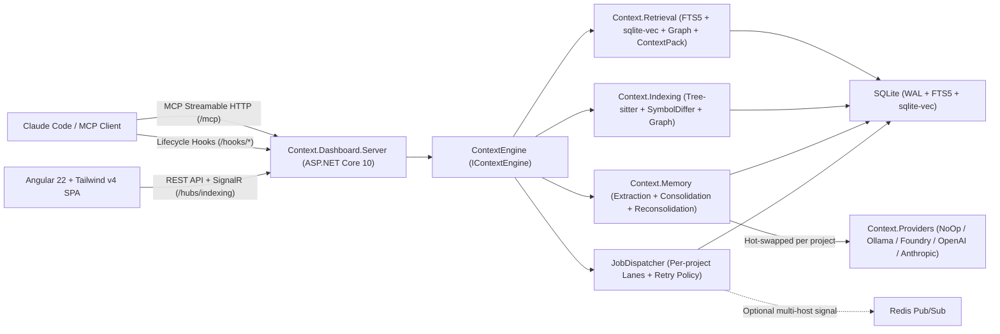
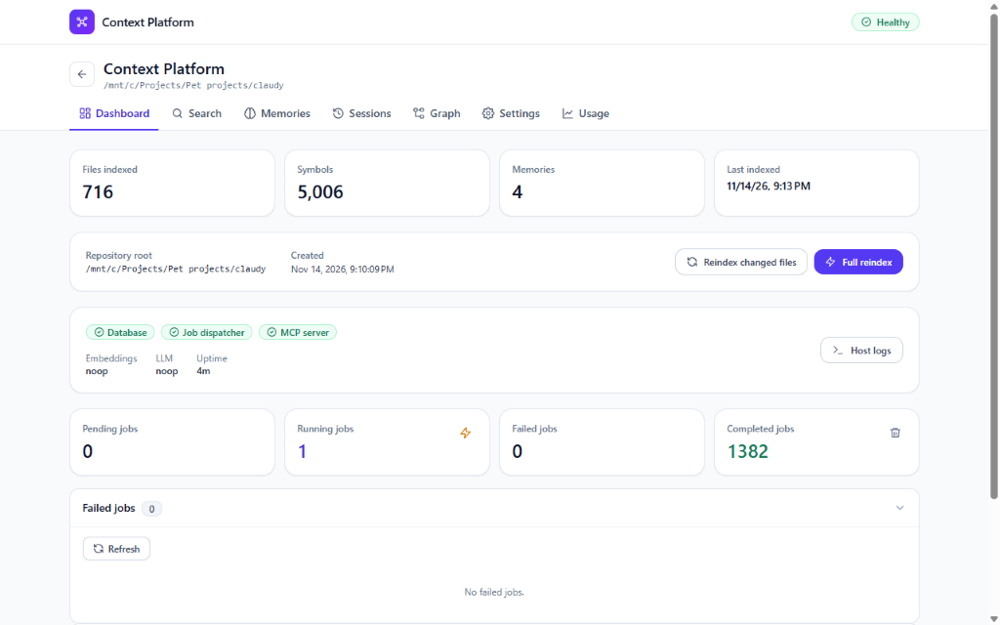
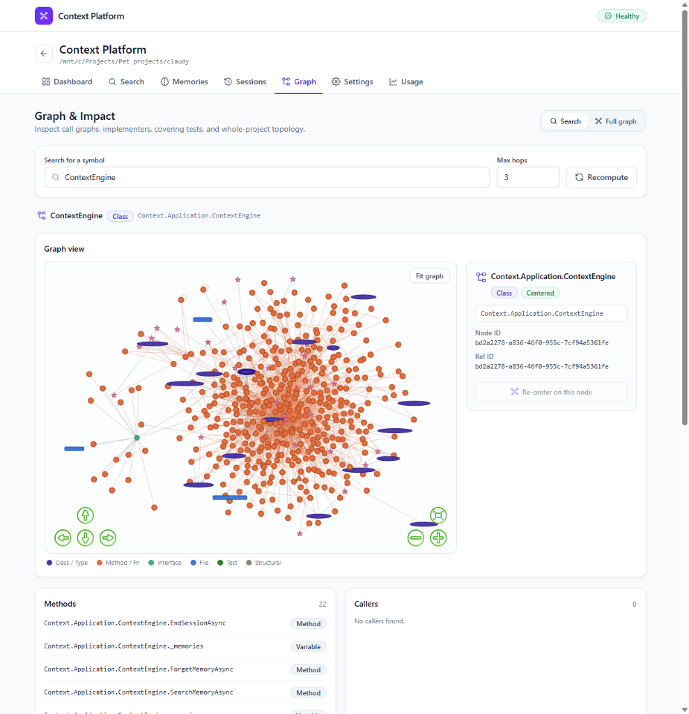

# Context Platform

**Локальна платформа довготривалої інженерної памʼяті, гібридного пошуку по коду (RAG) та аналізу графу викликів для AI-агентів (Claude Code / MCP).**

Context Platform допомагає Claude Code та іншим MCP-сумісним агентам миттєво орієнтуватися в кодовій базі, розуміти радіус ураження змін (*blast radius*) і памʼятати архітектурні рішення між сесіями — витрачаючи мінімум токенів замість повторного читання десятків файлів із нуля.

---

## Чому Context Platform?

- **Економія токенів та вимірювана вигода:** Цільовий контекст через `context_search` і `code_search` із бюджетом токенів, включно з підрахунком оціненої економії (`SavedTokens`) відносно читання цілих файлів.
- **Гібридний пошук + AST + граф коду:** Поєднання FTS5 (BM25), векторного ANN-індексу `sqlite-vec` та близькості по графу символів на базі **Tree-sitter** (`C#`, `TypeScript`, `TSX`, `JavaScript`, `Python`).
- **Автономна багаторівнева памʼять:** Автоматичне витягування фактів, рішень та обмежень із хуків Claude Code, онлайн-злиття дублікатів, періодична реконсолідація та верифікація фактів по реальному коду.
- **Мультипроєктний вебдашборд без зайвих залежностей:** Сучасний UI на **Angular 22 + Tailwind CSS v4** із live-оновленнями через **SignalR**, інтерактивним графом (`vis-network`) і керуванням чергами завдань.
- **100% локально за замовчуванням (`local-first`):** Один файл SQLite (WAL + FTS5 + `sqlite-vec`) та офлайн-режим `noop` out-of-the-box, з можливістю миттєвого перемикання на **Ollama**, **Foundry Local**, **OpenAI** або **Anthropic**.

---

## Загальна архітектура



---

## Інтерфейс у дії

| Огляд проєкту, черга завдань та хуки | Інтерактивний граф коду та Blast Radius |
| :---: | :---: |
|  |  |

---

## Швидкий старт

### Варіант 1: Локальний запуск (.NET 10 + Angular 22)

**Передумови:** `.NET SDK 10.0.100+` (`global.json`), `Node.js 22+` та `npm 11+`.

1. **Клонуйте репозиторій та зберіть SPA-клієнт:**
   ```bash
   git clone https://github.com/dellik95/context-platform.git
   cd context-platform/apps/host/Context.Dashboard/context.dashboard.client
   npm ci
   npm run build
   ```

2. **Режим розробки (ASP.NET Core SpaProxy автоматично піднімає `ng serve`):**
   ```bash
   cd ../Context.Dashboard.Server
   dotnet run
   ```
   Або підготуйте production-збірку з копіюванням SPA у `wwwroot/`:
   ```bash
   # Із кореня репозиторію
   dotnet publish apps/host/Context.Dashboard/Context.Dashboard.Server -c Release -o ./publish/host
   cp -r apps/host/Context.Dashboard/context.dashboard.client/dist/dashboard/browser ./publish/host/wwwroot
   dotnet exec ./publish/host/Context.Dashboard.Server.dll
   ```

3. **Відкрийте дашборд:** [http://127.0.0.1:47923](http://127.0.0.1:47923)
   На локальній петлі (`127.0.0.1`) дашборд автоматично отримує admin-токен через loopback-endpoint `/api/auth/admin-token`.

### Варіант 2: Docker Compose (з опціональним Redis)

```bash
# Створіть .env або експортуйте обовʼязковий адмін-токен
export CONTEXT_PLATFORM_ADMIN_TOKEN="$(openssl rand -base64 32)"
docker compose up -d --build
```

Контейнер монтує поточну теку проєкту в режимі лише читання (`/workspace:ro`) і зберігає SQLite БД, логи та резервні копії у named volume `context-data` (`/data/context-platform`). Детальніше про мережеву взаємодію з хостовим Ollama та production-розгортання див. у [deploy/README.md](deploy/README.md) та [Посібнику користувача](docs/uk/USER_GUIDE.md).

---

## Підключення до Claude Code

Після створення проєкту в дашборді натисніть **Register Claude Code integration** у вкладці **Settings** (або викличте `POST /api/projects/{id}/claude/install`). Інсталятор безпечно створить резервну копію і налаштує:

- `.mcp.json` — підключення до `/mcp` із персональним проєктним Bearer-токеном;
- `.claude/settings.json` та `.claude/hooks/*.ps1` / `*.sh` — хуки `SessionStart`, `UserPromptSubmit`, `PostToolUse`, `PostCompact`, `Stop`, `SessionEnd`;
- `.claude/skills/context-memory/SKILL.md` — інструкція-скіл для агента щодо пріоритетного використання `context_search`, `memory_search`, `graph_impact` тощо.

---

## Основні змінні середовища

| Змінна | За замовчуванням | Опис |
| :--- | :--- | :--- |
| `CONTEXT_PLATFORM_PORT` | `47923` | TCP-порт хоста `Context.Dashboard.Server` |
| `CONTEXT_PLATFORM_BIND_HOST` | `127.0.0.1` (`0.0.0.0` у контейнері) | Інтерфейс прослуховування Kestrel |
| `CONTEXT_PLATFORM_DATA_DIR` | Директорія бінарника | Каталог для `context.db`, `logs/` та `backups/` |
| `CONTEXT_PLATFORM_ROOT` | Найближчий `.git`-корінь | Коренева директорія за замовчуванням для CLI/хоста |
| `CONTEXT_PLATFORM_ADMIN_TOKEN` | Авто на `127.0.0.1` | Адмін-токен для `POST/GET /api/projects` та `/api/fs/browse` |
| `CONTEXT_PLATFORM_REDIS` | `null` | Рядок підключення Redis (`host:6379`) для сигналу між репліками |
| `CONTEXT_EMBEDDING_PROVIDER` | `noop` | Стартовий провайдер ембедингів (`noop`, `ollama`, `foundry`, `openai`) |
| `CONTEXT_LLM_PROVIDER` | `noop` | Стартовий LLM-провайдер (`noop`, `ollama`, `foundry`, `anthropic`) |
| `CONTEXT_OLLAMA_BASE_URL` | `http://localhost:11434` | URL сервера Ollama |
| `CONTEXT_OLLAMA_EMBEDDING_MODEL` | `embeddinggemma` | Модель ембедингів Ollama |
| `CONTEXT_OLLAMA_CHAT_MODEL` | `qwen2.5-coder:1.5b` | Чат-модель Ollama для саммарі та витягування памʼяті |
| `CONTEXT_FOUNDRY_BASE_URL` | `http://127.0.0.1:5273/v1` | URL Microsoft Foundry Local |
| `CONTEXT_OPENAI_API_KEY` | `null` | Хостовий API-ключ OpenAI (`text-embedding-3-small`) |
| `CONTEXT_ANTHROPIC_API_KEY` | `null` | Хостовий API-ключ Anthropic (`claude-3-5-sonnet-20241022`) |

> Усі параметри вибору провайдера (`EmbeddingProvider`, `LlmProvider`, моделі та URL для `ollama`/`foundry`) також перевизначаються на рівні окремого проєкту через UI вкладки **Settings** і застосовуються **миттєво без перезапуску сервера**.

---

## Документація

- 📘 **[Посібник користувача (USER_GUIDE.md)](docs/uk/USER_GUIDE.md)** — покрокове встановлення, огляд усіх вкладок дашборду зі скриншотами, інтеграція з Claude Code, типові сценарії та усунення неполадок.
- 🏗️ **[Архітектура системи (ARCHITECTURE.md)](docs/uk/ARCHITECTURE.md)** — шари проєкту, декомпозиція backend-координаторів, UI-система на Tailwind CSS v4, SQLite + `sqlite-vec`, черга завдань `JobDispatcher`, SignalR та модель безпеки з діаграмами.
- ⚙️ **[Головні можливості та алгоритми (FEATURES.md)](docs/uk/FEATURES.md)** — формула гібридного скорингу, бюджетування `ContextPackBuilder`, Tree-sitter AST & `SymbolDiffer`, цикл памʼяті та реконсолідація з перевіркою по коду, телеметрія економії токенів.
- 📐 **[Cross-Cutting Contracts (CONTRACTS.md)](docs/architecture/CONTRACTS.md)** — доменні сутності, інтерфейси та контракти між проєктами (англійською).
- 🗺️ **[Roadmap (ROADMAP.md)](ROADMAP.md)** — статус реалізованих і запланованих фіч (англійською).
- 🚀 **[Service Deployment (deploy/README.md)](deploy/README.md)** — інсталяція у `systemd` та Windows Service (англійською).
