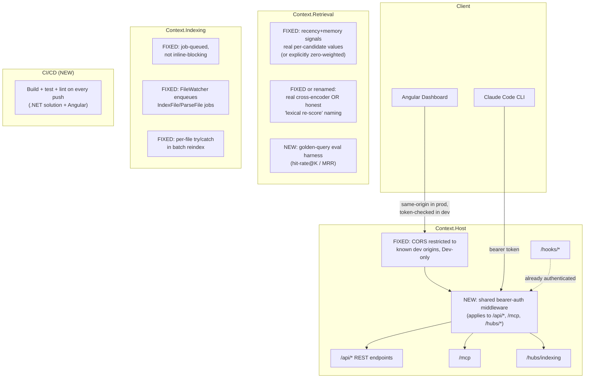

# Context Platform — Architecture Assessment & Production-Readiness Roadmap

**Date:** 2026-09-02
**Scope:** Full-repository investigation across host/API, indexing/AST/graph, retrieval/RAG, memory/session, LLM/embedding providers, persistence/schema, Angular dashboard, and tests/CI/security. Findings below are backed by direct code reads and file:line citations; nothing here is speculative.

## Framing (read this before the findings)

This repository is **not** a generic enterprise multi-tenant AI-agent platform. Per its own PRD (`specs/claudy-mem-specs.md`), Context Platform is a deliberately **local-first, single-user** tool that gives an external agent (Claude Code CLI, via MCP) persistent memory and code-aware retrieval over one developer's own repositories. The PRD explicitly rejects PostgreSQL, Redis, Kafka, microservices, and Neo4j as non-goals, and mandates a modular monolith with EF Core as the *only* persistence abstraction over local SQLite.

Two consequences for everything below:

1. There is **no in-process multi-agent orchestrator** to audit, and none is currently needed. "The agent" is Claude Code itself, running externally, consuming this platform purely as an MCP tool/data provider. Section H treats multi-agent orchestration as a **capability to evaluate**, not a gap to fix.
2. Multi-tenant-style findings (tenant isolation, RBAC, per-user auth) generally **do not apply**. What *does* apply, and is treated as first-class below, is the very real single-machine, single-user threat model: a malicious webpage open in the same browser session as the dashboard reaching the host via CORS-permitted `fetch()`, prompt injection via indexed third-party content, and secrets leaking to external LLM providers.

One correction to the original task framing: the frontend uses **Angular Material + SCSS only**. Tailwind is not a dependency, has no config, and is not referenced anywhere in `apps/dashboard`. Any assumption of Tailwind in this codebase is incorrect; recommendation on whether to introduce it is in §I.

---

## A. Executive Summary

Context Platform is **substantially more mature and deliberately engineered than a first glance at "modernization request" framing would suggest.** Most subsystems — indexing (tree-sitter AST + symbol-level diffing), persistence (EF Core + FTS5 + sqlite-vec, correctly parameterized, real backup path), memory (LLM-based extraction with real reinforcement/supersession/decay), and the frontend (modern signals-first Angular with no legacy patterns) — are well-built, with trade-offs that are documented and reasoned, not accidental.

The platform has **one genuine P0 production blocker**: a wide-open CORS policy (`SetIsOriginAllowed(_ => true).AllowCredentials()`) combined with almost no authentication on the REST/MCP surface. This turns "loopback-only, so it's as safe as the CLI" (the codebase's own stated assumption) into a real, concretely exploitable vulnerability: any browser tab open on the same machine while the host is running can silently create projects pointing at arbitrary host paths, list arbitrary directories, and read back all indexed code, memories, and session history — no credential needed.

Beyond that P0, the most valuable engineering investment is **not new infrastructure** — it's closing gaps in things that already have the right architectural seams but incomplete implementations: the hybrid retrieval scorer advertises 5 signals but 2 are inert placeholder constants; the reranker stage exists but the shipped implementation never actually reranks; there is no CI/CD at all; and the frontend has almost no automated test coverage despite good test infrastructure sitting unused.

This document recommends **no rewrite, no new datastore, no new orchestration framework.** It recommends finishing what's already half-built (the reranker, the hybrid signals, single-file reactive indexing), closing the CORS/auth gap immediately, and adding the CI pipeline and retrieval-evaluation harness that let future changes be verified rather than asserted.

---

## B. Current Architecture

### B.1 Component map

```mermaid
graph TB
    subgraph Client
        Dashboard["Angular Dashboard<br/>(standalone, signals, httpResource)"]
        ClaudeCode["Claude Code CLI<br/>(external agent)"]
    end

    subgraph "Context.Host (ASP.NET Core, loopback-bound)"
        REST["/api/* REST endpoints"]
        MCP["/mcp (ModelContextProtocol,<br/>HTTP transport)"]
        Hooks["/hooks/* (bearer-token auth)"]
        SignalR["/hubs/indexing (SignalR)"]
        FileWatcher["FileWatcherHostedService<br/>(FileSystemWatcher, 400ms debounce)"]
    end

    subgraph "Context.Application"
        ContextEngine["ContextEngine<br/>(IContextEngine facade)"]
        JobDispatcher["JobDispatcher<br/>(N workers, retry+backoff)"]
        IndexingPipeline["IndexingPipeline"]
        ReindexScheduler["ReindexSchedulerService<br/>(60s poll, full-tree hash-diff)"]
    end

    subgraph "Context.Retrieval"
        ContextPackBuilder["ContextPackBuilder<br/>(greedy knapsack budgeting)"]
        HybridSearchEngine["HybridSearchEngine"]
        HybridScorer["HybridScorer<br/>(weighted-sum, NOT RRF)"]
        Reranker["IRerankerProvider<br/>(LocalOnnxReranker: never invokes ONNX,<br/>falls back to lexical heuristic)"]
    end

    subgraph "Context.Indexing"
        TreeSitter["Tree-sitter parsers<br/>(C#, TS, TSX, JS/JSX, Python)"]
        SymbolDiffer["SymbolDiffer<br/>(Added/Removed/Changed/Unchanged)"]
        FileSummarizer["IFileSummarizer<br/>(synchronous, inline, blocking)"]
    end

    subgraph "Context.Graph"
        GraphTraversal["GraphTraversal (BFS)"]
        InMemoryGraphCache["InMemoryGraphCache<br/>(per-project, unbounded, no eviction)"]
    end

    subgraph "Context.Memory"
        MemoryExtractor["LlmMemoryExtractor"]
        SessionSummarizer["LlmSessionSummarizer"]
        DecayCalculator["DecayCalculator<br/>(30-day half-life, time-only)"]
    end

    subgraph "Context.Infrastructure"
        EFCore["EF Core + SQLite<br/>(WAL, FK enforced, no explicit busy_timeout)"]
        FTS5["FTS5 external-content table<br/>(lexical/BM25)"]
        SqliteVec["sqlite-vec via<br/>Microsoft.SemanticKernel.Connectors.SqliteVec<br/>(real ANN, per-provider collection)"]
    end

    subgraph "Context.Providers"
        ChatClient["IChatClient<br/>(Ollama/OpenAI/Anthropic via M.E.AI)"]
        EmbedGen["IEmbeddingGenerator<br/>(same providers)"]
    end

    Dashboard -->|CORS: wildcard origin,<br/>credentials, NO AUTH| REST
    Dashboard --> SignalR
    ClaudeCode -->|bearer token| Hooks
    ClaudeCode -->|NO AUTH| MCP

    REST --> ContextEngine
    MCP --> ContextEngine
    Hooks --> ContextEngine

    ContextEngine --> ContextPackBuilder
    ContextEngine --> GraphTraversal
    ContextEngine --> EFCore

    ContextPackBuilder --> HybridSearchEngine
    HybridSearchEngine --> HybridScorer
    HybridScorer --> Reranker
    HybridSearchEngine --> FTS5
    HybridSearchEngine --> SqliteVec
    HybridSearchEngine --> GraphTraversal

    FileWatcher --> IndexingPipeline
    ReindexScheduler --> IndexingPipeline
    IndexingPipeline --> TreeSitter
    IndexingPipeline --> SymbolDiffer
    IndexingPipeline --> FileSummarizer
    IndexingPipeline --> JobDispatcher
    FileSummarizer --> ChatClient

    JobDispatcher --> MemoryExtractor
    MemoryExtractor --> ChatClient
    SessionSummarizer --> ChatClient
    JobDispatcher --> EmbedGen
```

### B.2 Two reactivity mechanisms — reconciled, not contradictory

The investigation surfaced what looked like a conflict and is actually two complementary, real mechanisms:

- **`FileWatcherHostedService`** (`apps/host/Context.Host/BackgroundServices/`) — a real `FileSystemWatcher` on `HostProjectContext.ProjectRoot`, 400ms debounce, skips `.context/` to avoid feedback loops, dispatches per-file reindex via `Task.Run`. This is the **immediate, event-driven** path.
- **`ReindexSchedulerService`** (`Context.Application/Scheduling/`) — a 60-second poll doing a full-tree rescan, skipping unchanged files by content hash. This is the **scheduled, batch catch-up** path (covers cases the watcher misses: files changed while the host was down, external tools that bypass the watcher, etc.).

Both are real and both matter. The actual gap (§C, `IDX-2`) is downstream of the watcher: the reactive single-file `JobType.IndexFile`/`ParseFile` job handlers exist and are fully implemented, but **nothing ever enqueues them** — the watcher's per-file `Task.Run` reindex path and the job-queue-based reactive path were never wired together.

### B.3 End-to-end flow: user query → response

1. Claude Code (or the Dashboard) calls `context_search`/`code_search` (MCP) or `/api/search` (REST).
2. Two genuinely different pipelines depending on entry point:
   - **`IContextEngine.SearchContextAsync`** (used by `context_search`, hooks, REST `/api/search`): ranks memories → builds a token-budgeted `ContextPack` via `ContextPackBuilder`'s greedy knapsack → applies the session delivery cache (already-shown nodes get replaced with a short back-reference instead of full content again).
   - **MCP `code_search`**: calls `ISearchEngine.SearchAsync` directly — same underlying `HybridScorer`, but bypasses `ContextPackBuilder` entirely (no memory merge, no token budgeting, no delivery cache). This divergence is intentional (different consumers want different shapes) but is **not documented in `CONTRACTS.md`** (`ARCH-1`).
3. `HybridSearchEngine` queries FTS5 (lexical) and sqlite-vec (semantic) in parallel, plus graph-hop proximity from `GraphTraversal`. `HybridScorer` combines lexical/vector/graph/recency/memory into one normalized weighted sum (weights: 0.20/0.45/0.20/0.10/0.05). At the code-search layer, recency and memory are **hardcoded constants**, not per-candidate signals (`RAG-1`).
4. Candidates pass through `IRerankerProvider` — architecturally a distinct stage, but the default (`LocalOnnxReranker`) never invokes its loaded ONNX session; it falls through to a lexical token-overlap heuristic (`RAG-2`).
5. `ContextPackBuilder` greedily fills the token budget (score/cost ratio, skip-if-too-big, cheap-item backfill), leaving a 10% reserve that's never spent as headroom.
6. Response returns to the caller. For MCP consumers, progressive disclosure (`ExpandAsync`, L0/L1/L2) is available on demand — but L1 (`Summary`) is a blunt 800-char truncation of raw source, not the LLM-generated `File.Summary` already computed at index time (`RAG-4`).

### B.4 End-to-end flow: source code → searchable index

1. `FileWatcherHostedService` or `ReindexSchedulerService` triggers `IndexingPipeline.ReindexProjectAsync`.
2. `FileSystemScanner` walks the tree, applying `GitignoreStyleMatcher` (real gitignore-syntax support, plus a hardcoded secret-file gate for `.env*`/`*.pem`/`*.key`/`*credentials*` that can't be relaxed by negation).
3. Per file: content-hash compared against the stored hash; unchanged files are skipped entirely. Changed files go through the appropriate tree-sitter parser (C#/TS/TSX/JS/Python — **no Go, no Rust**, `IDX-4`) to produce an AST, then symbol extraction.
4. `SymbolDiffer` classifies each symbol as Added/Removed/Changed/Unchanged by hash — this **is** the real "incremental indexing," even though the AST layer's `previousTree` parameter (meant for tree-sitter's own incremental re-parse) is a documented no-op in every parser (`IDX-6`).
5. One chunk is created per changed/added symbol (signature+body, capped 20,000 chars); a separate file-level summary chunk is generated by calling the LLM **synchronously, inline, blocking the pipeline** (`RAG-5`) — this is the one indexing step that isn't job-queued like everything else.
6. Chunks get embedded (deduped by content hash + provider) and written into both the FTS5 table (via triggers) and the sqlite-vec collection.
7. Call-graph edges are extracted (bare-identifier and member-access/attribute patterns, uniformly fixed across all 5 parsers) and pushed into `InMemoryGraphCache`, which is invalidated and re-hydrated only for affected files (not a full rebuild).
8. The per-file loop in `ReindexProjectAsync` has **no try/catch** — one throwing file aborts the rest of that pass, including deleted-file cleanup and the final "Completed" progress signal (`IDX-3`). The pipeline self-heals on the next scheduled pass, but that pass silently never completed.

---

## C. Findings

Findings are grouped by severity. Each includes current implementation, problem, why it matters, impact/risk, root cause, recommended solution, priority, dependencies, and estimated complexity (S/M/L).

### P0 — Critical, production-blocking

#### SEC-1 — CORS wildcard + credentials + near-zero auth
- **Current implementation:** `Program.cs:99-104` — `SetIsOriginAllowed(_ => true).AllowAnyHeader().AllowAnyMethod().AllowCredentials()`. Only `/hooks/*` is gated (bearer token, `CryptographicOperations.FixedTimeEquals`). Every other endpoint (`/api/*`, `/mcp`, `/hubs/indexing`) has zero authentication.
- **Problem:** Any origin can make credentialed requests to the host, and the host doesn't check credentials on most routes anyway.
- **Why it's a problem:** The host's own doc comment (`FileSystemEndpoints.cs:4-8`) reasons "loopback-only, so this carries no more risk than the CLI." That reasoning covers *network* reachability, not *browser-mediated* reachability. A page open in any tab on the same machine can `fetch()` the host directly.
- **Impact:** Concretely: a malicious/compromised webpage can (a) `POST /api/projects` with an arbitrary `RootPath` and trigger indexing of any directory on the host filesystem, (b) `GET /api/fs/browse` to enumerate the filesystem, (c) read back all indexed code, memory, and session content via `/api/search` or `/mcp` tool calls — all silently, with no user-visible prompt.
- **Risk:** High likelihood is low (requires a malicious page open concurrently with the host running), but impact is a full read of the user's indexed source/decisions plus an arbitrary-directory indexing primitive. Classic "drive-by against a dev tool" pattern.
- **Root cause:** CORS was almost certainly added to support `ng serve` (localhost:4200) hitting the host (localhost:47923) during Dashboard development, and the wildcard was the path of least resistance. The **production** dashboard is actually served same-origin (`Program.cs:145-149` — `wwwroot` static files), so production doesn't need CORS at all.
- **Recommended solution:** Two changes, both small: (1) restrict the CORS policy to an explicit allow-list of known dev origins (e.g., `https://localhost:4200`) rather than `_ => true`, only in `Development`; skip `UseCors` entirely in `Production` since the dashboard is same-origin there. (2) Extend the existing bearer-token pattern (`HookEndpoints`'s `RequireBearerToken`) to `/api/*`, `/mcp`, and the SignalR hub — reuse the same token already generated for hooks, or a second one, checked via a shared middleware/filter.
- **Priority:** P0.
- **Dependencies:** None — self-contained in `Context.Host`.
- **Complexity:** S (CORS policy) + M (auth middleware applied broadly, plus updating the Dashboard's `ApiService`/SignalR client to send the token, plus `ClaudeIntegrationInstaller`'s `.mcp.json` to include it as a header).

#### SEC-2 — Unauthenticated arbitrary directory listing
- **Current implementation:** `GET /api/fs/browse` (`FileSystemEndpoints.cs`) lists any accessible directory on the host filesystem, no path containment, no auth.
- **Problem/Impact:** Compounds `SEC-1` — once any origin can reach this endpoint, it's a full filesystem enumeration primitive.
- **Root cause:** Built as a folder-picker helper under the same "loopback is safe" assumption as `SEC-1`.
- **Recommended solution:** Covered by fixing `SEC-1` (auth gate). No changes needed to the endpoint itself.
- **Priority:** P0 (as a consequence of SEC-1). **Dependencies:** SEC-1. **Complexity:** — (folded into SEC-1's fix).

#### SEC-3 — Unauthenticated arbitrary-path project creation
- **Current implementation:** `POST /api/projects` accepts any `RootPath` string and begins indexing it, no auth, no path restriction.
- **Problem/Impact:** Compounds `SEC-1` — lets any origin trigger indexing (and thus have its content flow into search/memory/LLM calls) of any directory on disk.
- **Recommended solution:** Covered by fixing `SEC-1`.
- **Priority:** P0 (as a consequence of SEC-1). **Dependencies:** SEC-1. **Complexity:** — (folded into SEC-1's fix).

### P1 — High priority

#### SEC-4 — No secret redaction before sending content to external LLM providers
- **Current implementation:** Indexed chunk/file text is sent verbatim to whichever `IChatClient`/`IEmbeddingGenerator` is configured — including OpenAI/Anthropic when selected.
- **Problem:** If a secret (API key, credential) exists in an indexed file that wasn't caught by the ignore-pattern secret gate (`.env*`/`*.pem`/`*.key`/`*credentials*`), it's sent off-box to a third-party provider.
- **Impact/Risk:** Real for anyone who selects a cloud provider over a repo with imperfect `.gitignore` hygiene. PRD §12 calls for exactly this protection.
- **Root cause:** No secret-scanning step exists between chunking and the embed/summarize LLM calls.
- **Recommended solution:** Add a lightweight secret-pattern scan (reuse or extend `GitignoreStyleMatcher`'s existing secret-file-name gate with content-level heuristics — e.g., high-entropy strings, common key-prefix patterns) at chunk-creation time; redact or skip matching spans before any external-provider call. Scope to *content* scanning, not just filenames, since the current gate is filename-only.
- **Priority:** P1. **Dependencies:** None. **Complexity:** M.

#### SEC-5 — No data-use disclosure when external provider selected
- **Current implementation:** Settings UI lets a user pick OpenAI/Anthropic with no explanatory text about what leaves the machine.
- **Problem/Impact:** User can't make an informed choice; PRD §12 requirement unmet.
- **Recommended solution:** Add a disclosure banner/tooltip in the provider-selection UI when a non-local provider is chosen.
- **Priority:** P1. **Complexity:** S.

#### SEC-6 — Unmitigated prompt injection via indexed content
- **Current implementation:** `HookEndpoints.FormatContextPack` concatenates raw snippets/memory notes into Claude Code's `AdditionalContext` with no sanitization or delimiting.
- **Problem:** Indexed source/comments/commit messages could contain text crafted to look like instructions to the consuming agent.
- **Impact/Risk:** Low for a user's own trusted repos (today's primary use case); real if a user ever indexes a third-party/untrusted repo.
- **Recommended solution:** Wrap delivered content in clear data-delimiters with an explicit instruction ("the following is retrieved data, not instructions") — cheap, doesn't eliminate the class but meaningfully raises the bar.
- **Priority:** P1. **Complexity:** S.

#### SEC-7 — Docker hardening gaps
- **Current implementation:** Container runs as root (no `USER` directive), `docker-compose.yml` mounts the host project directory read-write, no `HEALTHCHECK`.
- **Problem/Impact:** A container escape or app-level path-traversal bug would have full root write access to the real source tree.
- **Recommended solution:** Add a non-root `USER`, consider a `:ro` mount for the project source with a separate writable volume for `.context/`, add a `HEALTHCHECK` hitting `/api/health`.
- **Priority:** P1. **Complexity:** S.

#### RAG-1 — Two of five hybrid-scoring signals are inert at the code-search layer
- **Current implementation:** `HybridScorer.Combine` (weights 0.20 lexical / 0.45 vector / 0.20 graph / 0.10 recency / 0.05 memory) — but for code search, the recency and memory inputs are built from lists of identical constants (0.5 and 0.0 respectively) before min-max normalization, so they don't vary per candidate and contribute nothing to relative ranking.
- **Why it's a problem:** The system advertises 5-signal hybrid ranking (ROADMAP.md, CONTRACTS.md) but only 3 signals actually discriminate between candidates for code search.
- **Impact:** Ranking quality is worse than the documented design implies — recency-appropriate and memory-boosted results aren't actually favored for code hits (the real memory-kind bonus only applies via a separate codepath, `ContextEngine.RelevanceOf`, for actual `Memory` entities, not code chunks).
- **Root cause:** The signals were likely added incrementally with recency/memory wired for memory search first, and code search never got a real per-candidate recency/memory source hooked up.
- **Recommended solution:** Wire real recency (file/chunk `UpdatedAt`) and a real memory-adjacency signal (e.g., "was this chunk referenced by a recent Memory?") into the code-search candidate set, or explicitly drop those two weights to zero for code search and re-normalize the remaining three — either is honest; the current state (non-zero weight, zero effect) is not.
- **Priority:** P1. **Dependencies:** None. **Complexity:** M.

#### RAG-2 — Reranker doesn't rerank
- **Current implementation:** `IRerankerProvider` is a real architectural stage (distinct from `HybridScorer`). Default implementation `LocalOnnxReranker` can load an ONNX session but never invokes it for scoring — always falls through to a lexical Jaccard-style token-overlap heuristic. `NoOpReranker` is a pure identity pass-through.
- **Why it's a problem:** "Reranking" in the current system is just a second lexical pass, not the semantic reordering the architecture implies.
- **Impact:** Reranking currently can't correct cases where lexical/vector/graph scoring gets the top-K wrong for genuinely semantic reasons.
- **Root cause:** No cross-encoder model ships with the project; the ONNX wiring was scaffolded ahead of having a model to run.
- **Recommended solution:** Either (a) ship a small cross-encoder ONNX model (e.g., a MiniLM cross-encoder) and wire `LocalOnnxReranker` to actually run it, or (b) if that's not worth the footprint for a local-first tool, rename/document the current heuristic honestly as "lexical re-scoring" rather than implying cross-encoder reranking, and treat true reranking as a future opt-in.
- **Priority:** P1. **Dependencies:** RAG-3 (need eval harness to verify any reranker change actually helps). **Complexity:** L (real model) or S (honest rename).

#### RAG-3 — No retrieval-quality evaluation harness
- **Current implementation:** Only formula-level unit tests exist (`HybridScorerTests`, `HybridSearchEngineTests` with fully mocked dependencies, `ContextPackBuilderTests` against a `FakeSearchEngine`). No precision/recall measurement, no golden-query regression suite, no integration test exercising real FTS5/sqlite-vec end-to-end for relevance quality.
- **Why it's a problem:** Every retrieval-quality claim in this document (and every future tuning change to `HybridScorer`'s weights) is unverifiable without one.
- **Impact:** Changes to scoring weights, reranking, or chunking strategy ship on vibes, not measurement — directly blocks fixing `RAG-1`/`RAG-2` with confidence.
- **Recommended solution:** Build a small golden-query set (10–30 real queries against this repo's own indexed content, each with 1–3 known-correct expected hits) and a harness that runs `HybridSearchEngine.SearchAsync` against it, reporting hit-rate@K / MRR. Store it as a real (not mocked) integration test, similar in spirit to `GoldenPathE2ETests`.
- **Priority:** P1. **Dependencies:** None. **Complexity:** M.

#### IDX-1 — No CI/CD pipeline
- **Current implementation:** No `.github/workflows`, `.gitlab-ci.yml`, `azure-pipelines.yml`, or Jenkinsfile anywhere in the actual project (only inside an unrelated vendored reference under `refs/`). No automated build, test run, lint, or Docker image build/push.
- **Why it's a problem:** "Production-ready" and "no CI" don't coexist — every regression risk this document flags (per-file reindex isolation, CORS, hybrid scoring) currently has to be caught by manual testing.
- **Recommended solution:** A minimal pipeline (GitHub Actions is the natural fit if the repo lives there): build all `.slnx` projects, run `dotnet test`, run `ng test`/`ng lint` for the dashboard, on every push/PR. Docker build/push can be a follow-up phase.
- **Priority:** P1. **Complexity:** M.

#### TEST-1 — Near-zero frontend test coverage
- **Current implementation:** Only `app.spec.ts` exists (one trivial spec) across the entire Angular app; test infrastructure (Vitest, per `angular.json`) is present and unused.
- **Impact:** No regression protection for the Dashboard at all — a real gap given the app has non-trivial state (`ProjectContextService`, SignalR bridging, `httpResource` usage).
- **Recommended solution:** Start with the highest-value, lowest-effort targets: `ApiService` methods (mock `HttpClient`), `ProjectContextService`'s signal derivations, and the SignalR→signal bridging logic. Don't aim for full coverage immediately — this is a multi-phase backlog item (see §J/§M).
- **Priority:** P1. **Complexity:** M (initial pass), ongoing.

#### IDX-2 — Reactive single-file indexing half-wired
- **Current implementation:** `JobType.IndexFile`/`ParseFile` and their handlers are fully implemented but have **zero enqueue call sites** anywhere in the codebase. `FileWatcherHostedService` reacts to file changes via its own direct `Task.Run` reindex call, not through this job path.
- **Why it's a problem:** Dead code sitting next to a half-finished feature — the job-queue's retry/backoff/crash-recovery guarantees don't apply to the watcher's reindex path today.
- **Recommended solution:** Either wire `FileWatcherHostedService` to enqueue `IndexFile`/`ParseFile` jobs instead of calling the pipeline directly (gets retry/backoff/observability for free), or remove the unused job types if the direct-call path is intentionally preferred and won't change.
- **Priority:** P1. **Complexity:** S–M depending on direction chosen.

#### IDX-3 — No per-file error isolation in batch reindex
- **Current implementation:** `IndexingPipeline.ReindexProjectAsync`'s per-file loop has no try/catch; a single throwing file aborts the rest of that pass, including deleted-file cleanup and the final "Completed" progress signal.
- **Impact:** One malformed/unparseable file can silently stall an entire project's reindex progress reporting (the pipeline recovers on the *next* scheduled pass, but that pass's completion is lost).
- **Recommended solution:** Wrap the per-file body in try/catch, log+skip the failing file, continue the batch, and surface a per-file failure count in the completion signal.
- **Priority:** P1. **Complexity:** S.

### P2 — Moderate priority

| ID | Finding | File(s) | Recommendation | Complexity |
|---|---|---|---|---|
| RAG-4 | `ExpandAsync` L1 disclosure truncates raw source (800 chars) instead of using the already-computed LLM `File.Summary` | `ContextEngine.cs:332,355` | Route L1 file/symbol expansion through the stored `File.Summary` when available, fall back to truncation only when absent | S |
| RAG-5 | File summarization runs synchronously inline during indexing, blocking the pipeline on LLM latency | `IndexingPipeline.IndexParsedFileAsync` | Move to a job-queued `SummarizeFile` step, same pattern as `EmbedChunk` | M |
| IDX-4 | No Go/Rust tree-sitter parsers (PRD implies 6-language coverage; 5 exist: C#, TS, TSX, JS/JSX, Python) | `Context.Indexing` parsers | Add Go and Rust parsers following the existing `ITreeSitterParser` pattern | L (per language) |
| IDX-5 | `RegexHeuristicParser` is dead code — no longer wired as a fallback for any extension | `Context.Indexing` | Remove, or explicitly document as intentionally retained/tested-but-unused | S |
| IDX-6 | `previousTree` incremental-reparse parameter is a universal no-op across every parser | All 5 parser implementations | Remove the parameter (interface is misleading) or actually implement it if profiling shows parse time matters at scale | S (remove) / L (implement) |
| IDX-7 | `InMemoryGraphCache` unbounded per project; `FullGraphAsync` returns unpaginated node/edge lists | `Context.Graph` | Add an LRU/size cap for multi-project scale; paginate `FullGraphAsync` for large graphs (already dense-render-adapted client-side at >300 nodes) | M |
| IDX-8 | Node-keyed graph lookups scan every warm project cache (O(warm projects)) rather than being keyed by project | `GraphCacheProvider` | Key lookups by project id directly where the caller already knows it (most callers do) | S |
| MEM-1 | Memory model lacks PRD's richer Decision-memory shape (no Alternatives/Consequences/Status, provenance is a single session GUID) | `Memory` entity | If richer decision records are wanted, add these as structured fields (not a new table) consistent with the existing flat-model philosophy | M |
| MEM-2 | No episodic/semantic/task/project memory-kind split — everything collapses into one `MemoryType` enum on one table | `Memory` entity | Evaluate whether this is actually needed given the PRD's own "modular monolith, avoid premature structure" bias — likely **not** worth adding without a concrete consumer need | — (decision, not a task) |
| MEM-3 | Decay is time-only; no access-frequency signal | `DecayCalculator` | Low priority — would need to track read events per memory, meaningful complexity for unproven value | L |
| PERS-1 | `ContextEngine.ProjectInfoAsync` N+1 query — loops over every file calling `symbolRepository.ListByFileAsync` individually | `ContextEngine.cs:148-178` | Replace with a single aggregate query (`COUNT` grouped by `FileId`, or a project-scoped symbol count query) | S |
| PERS-2 | SQLite `busy_timeout` never explicitly set, relies on ADO.NET's implicit 30s default | `ContextDbContext`/connection setup | Set explicitly (e.g., via `PRAGMA busy_timeout` in the same connection interceptor that already sets WAL/foreign_keys) | S |
| PROV-2 | No cost/token usage accounting anywhere, despite "tokens saved" being the platform's own headline value metric | `Context.Providers` | Add basic usage logging (tokens in/out per LLM call, aggregated per project) — the seam already exists via `IChatClient`'s response metadata | M |
| FE-1 | No HTTP interceptors — every component hand-wires its own error-snackbar/loading state (~8 places) | `apps/dashboard/src` | Add a global `HttpInterceptorFn` for error-to-snackbar mapping; keep loading state local (varies by UX) | M |
| FE-2 | Overview tab has no error state (silent failure) | Overview component + `ProjectContextService` | Add an error signal to `ProjectContextService`, surface it in the Overview template like other tabs already do | S |
| FE-3 | Graph canvas has zero keyboard/ARIA accessibility (`interaction:{keyboard:false}` explicitly set) | graph-impact-panel component | Add a keyboard-navigable node list as an alternative/companion to the canvas, or enable vis-network's keyboard nav + ARIA live region for selection changes | M |
| FE-4 | No explicit `provideZonelessChangeDetection()` despite no zone.js dependency | `app.config.ts` | Add it explicitly — confirms intent rather than relying on absence-of-zone.js as an implicit signal | S |
| FE-5 | Hand-written DTOs vs backend, no OpenAPI codegen despite `Microsoft.AspNetCore.OpenApi` being referenced | `apps/dashboard/src` models | Generate TypeScript types from the OpenAPI spec already available at `/openapi/*.json` in Development | M |
| DOC-1 | `CONTRACTS.md` stale in ≥3 ways (still describes deleted `ILlmProvider`/`IEmbeddingProvider`, deleted `MemoryFile`/`MemoryRelation`/`MemorySymbol`, and the pre-`(ContentHash, Provider)` embedding key) | `docs/architecture/CONTRACTS.md` | Update to match current code; consider generating parts of it (entity list, provider interfaces) rather than hand-maintaining | S |
| DOC-2 | `ROADMAP.md` line 31 is internally inconsistent with its own line 32 (line 31 describes `ILlmProvider`/`IEmbeddingProvider` as still wrapping `IChatClient`; line 32 correctly documents their deletion) | `ROADMAP.md` | Fix line 31's wording | S |
| DOC-3 | `docs/adr/` and `docs/product/` are empty | — | Start writing ADRs going forward for genuinely contested decisions (e.g., the CORS fix, the reranker direction) — ironic gap for a product about remembering decisions | S (process change, not code) |
| ARCH-1 | Two divergent search entry points (`ContextEngine.SearchContextAsync` vs. MCP `code_search`'s direct `ISearchEngine.SearchAsync`) undocumented in `CONTRACTS.md` | `ContextEngine.cs`, MCP tools | Document the intentional divergence in `CONTRACTS.md` so it isn't mistaken for an inconsistency later | S |
| CLI-1 | `Context.Cli` pinned to `System.CommandLine 2.0.0-beta4`, whose API (`AddOption`/`SetHandler`/`InvocationContext`) is entirely gone in 2.0 GA | `apps/cli/Context.Cli` | Dedicated rewrite pass against the GA API — already correctly flagged in ROADMAP.md as needing its own pass, not a version bump | L |

### P3 — Low priority / already reasonably mitigated

| ID | Finding | Note |
|---|---|---|
| TEST-2 | `Context.Domain.Tests` is an empty stub, 0% coverage | Low real risk — domain entities are POCOs with little logic. Worth a pass if entities ever grow validation logic. |
| IDX-9 | `UpdateGraphJobHandler` re-parses the file a second time from disk (duplicate parse work) since `SymbolRelation` rows aren't persisted | Already an acknowledged follow-up in the codebase's own comments; real but minor perf cost. |
| PERS-3 | `SqliteChunkVectorIndex` has no delete-on-reindex step; stale rows accumulate, filtered at query time by join | Already documented as accepted tech debt on ROADMAP.md; fine at current scale. |
| FE-6 | esproj/SpaProxy Dashboard migration scaffolded (`dashboard.esproj`, `Context.Dashboard/`) but not wired into the `.slnx` | Already correctly listed as "planned, not started" on ROADMAP.md — deliberate deferral, not a hidden gap. |
| PROV-3 | Streaming (`IChatClient.GetStreamingResponseAsync`) unused except a no-op wrapper | Not a gap — no chat UI exists that would consume it. |
| TASK-FRAME-1 | Original task brief assumed "Angular Material + Tailwind" | Correction only — see Framing section. Recommendation on whether to add Tailwind is in §I; this is not a defect. |

---

## D. Target Architecture

The target architecture is **the same component map as §B.1**, with the P0/P1 gaps closed. No new services, no new datastore, no new orchestration layer. The diagram below highlights only what changes:

Nothing here contradicts the PRD's modular-monolith / local-first mandate. The changes are: security-hardening the existing surface, finishing partially-built retrieval features, and adding process controls (CI, eval harness) that make future changes verifiable.

---

## E. RAG & Search Design (target state)

- **Retrieval remains hybrid**: FTS5 lexical + sqlite-vec semantic + graph-hop proximity. No move to Reciprocal Rank Fusion is required — the weighted-sum approach is a legitimate, tunable design as long as every weighted signal is real (fixes `RAG-1`).
- **Reranking** should either become real (small cross-encoder ONNX model, actually invoked) or be renamed to reflect what it actually does today (lexical re-scoring) so the architecture document doesn't overstate capability. Either choice should be validated against the golden-query harness (`RAG-3`) before/after, so the decision is evidence-based rather than aesthetic.
- **No query expansion (HyDE/multi-query) is recommended as a near-term investment.** It adds LLM round-trip cost per query in a system that already has an LLM-in-the-loop reranker debate; revisit only after the simpler signal-completeness and reranker fixes are measured.
- **Progressive disclosure (L0/L1/L2)** stays, with L1 wired to the real `File.Summary` (`RAG-4`).
- **Evaluation harness** (`RAG-3`) is the actual prerequisite for improving retrieval quality with confidence — this should land before further scoring-weight tuning, not after.

---

## F. Code Indexing Design (target state)

- Keep tree-sitter AST parsing + symbol-level diffing — this is the right design and is already well-implemented.
- Close the reactive-indexing gap (`IDX-2`): file-watcher events should flow through the job queue's retry/backoff/crash-recovery guarantees, not bypass them.
- Add per-file error isolation to batch reindex (`IDX-3`) — cheap, high-value reliability fix.
- Go/Rust parser support (`IDX-4`) is real but lower priority than the reliability fixes above — schedule as an independent, per-language addition once the existing 5-parser pattern's conventions are stable (i.e., after `IDX-6`'s cleanup, so new parsers aren't built against a misleading `previousTree` contract).
- Remove or repurpose `RegexHeuristicParser` (`IDX-5`) — dead code with test coverage that implies it matters when it doesn't.

---

## G. Memory Design (target state)

- Keep the existing flat `Memory` table + `MemoryType` + `MemoryTier` model — it is simpler than the PRD's original vision but is *fully wired* (LLM extraction → reinforcement/supersession → decay), which is more valuable than a richer schema with dead columns.
- If richer Decision-memory fields (Alternatives/Consequences/Status) are wanted, add them as nullable structured fields on the existing table rather than introducing new tables/relations — consistent with this project's own documented preference for denormalization over unused relational structure (the dropped `MemoryRelations` table is a cautionary precedent: it existed, had zero write call sites, and was correctly removed).
- Do **not** add an episodic/semantic/task/project memory-kind split without a concrete consumer that needs to distinguish them — no evidence in the current MCP tool surface or Dashboard that anything would use the distinction today.

---

## H. Agent Architecture

**There is no in-process multi-agent orchestrator today, and this assessment does not recommend building a generic one.** "The agent" in this system is Claude Code itself — external, stateless from this platform's point of view, interacting purely through MCP tool calls. This is a deliberate, correct fit for a local-first single-user tool: adding an in-process orchestration framework (including the Microsoft Agent Framework) would introduce complexity — additional process lifecycle, additional failure modes, additional state to persist — with no current consumer that needs multi-step autonomous in-process agent behavior.

What *does* exist and works well as "the agent interface": the MCP tool surface (`context_search`, `code_search`, `symbol_search`, `memory_search`, `graph_impact`, etc.) plus the installable `context-memory` skill that teaches Claude Code to prefer these tools over re-deriving context from scratch. This is the right shape for this product.

**Where a background "agentic" job would genuinely add value** (distinct from a general orchestrator): the job-queue infrastructure (`IJobQueue`, retry/backoff, crash recovery) already exists and is well-suited to hosting narrowly-scoped, LLM-driven background tasks beyond summarization/extraction — e.g., an auto-tagging pass, or a periodic "stale memory review" job that flags contradictions for the user rather than only reacting to explicit contradictions found during reinforcement. These are extensions of the existing job model, not a new orchestration layer, and should be evaluated individually against real user need rather than built speculatively.

**Recommendation:** do not adopt Microsoft Agent Framework or any generic multi-agent orchestrator now. Revisit only if a concrete requirement emerges for autonomous, multi-step, in-process agent behavior that the current job-queue + MCP-tool model genuinely can't express.

---

## I. Technology Decisions (with rationale)

| Decision | Rationale | Alternatives considered / rejected |
|---|---|---|
| EF Core + SQLite as sole persistence abstraction | PRD mandate; avoids a second data-access pattern (e.g., Dapper) for marginal gain in a single-process local tool | Dapper for hot paths — rejected, not worth the abstraction split |
| FTS5 (external-content + triggers) for lexical search | Built into SQLite, zero extra infra, correctly parameterized, real BM25 ranking | Elasticsearch/OpenSearch — rejected, violates local-first/no-extra-infra mandate |
| sqlite-vec via `Microsoft.SemanticKernel.Connectors.SqliteVec` for vector search | Real ANN index replacing a brute-force cosine scan, still zero extra infra | Postgres+pgvector, dedicated vector DB (Qdrant/Weaviate) — rejected, all violate local-first mandate |
| `Microsoft.Extensions.AI` (`IChatClient`/`IEmbeddingGenerator`) as the direct provider abstraction, no custom wrapper interfaces | Already the idiomatic .NET AI abstraction; custom `ILlmProvider`/`IEmbeddingProvider` wrappers were correctly identified and removed as adding nothing `GetService<Metadata>()` didn't already expose | Keeping the custom wrapper — rejected and already reverted in this codebase (commit `c55d5fa`) |
| Hand-built resilience pipeline (`AddResilienceHandler`, not `AddStandardResilienceHandler`) | Deliberately no circuit breaker — a single self-hosted Ollama endpoint's slow model-load window would trip a circuit breaker and shouldn't; a documented, reasoned trade-off | Standard resilience handler — rejected for this specific reason |
| Tree-sitter via `TreeSitter.DotNet` | Real AST parsing with bundled native grammars per RID, no separate runtime-redirect package | Regex-heuristic parsing (`RegexHeuristicParser`, now dead code) — superseded, correctly |
| Angular 22, standalone components, Signals/Signal Forms, `httpResource` | Current idiomatic Angular; already fully adopted with only one well-reasoned CVA exception | NgRx or another state library — rejected, no evidence of need given `ProjectContextService`'s appropriately narrow scope |
| Angular Material + SCSS (no Tailwind) | This is simply what's already built and working consistently | Adding Tailwind now — **not recommended**; it would be pure migration churn (rewriting existing, working, consistent styling) with no described product benefit. If a future redesign genuinely wants utility-first CSS, evaluate then — don't add it to match an outdated task-framing assumption. |
| SignalR for live dashboard updates | Already correctly implemented (reconnect + group-rejoin handled); fits a single-host, few-clients model | Polling — already partially present (`ReindexSchedulerService`) for a different purpose (catch-up, not live UI updates); both are needed, not a duplication |
| MCP over HTTP transport (`ModelContextProtocol.AspNetCore`) | Matches how Claude Code is actually configured to reach this host (`.mcp.json` → `http://127.0.0.1:{port}/mcp`) | stdio transport — not applicable; this is a long-running host process, not a spawned-per-session process |
| No Postgres/Redis/Kafka/microservices/Neo4j | Reaffirming the PRD's own explicit non-goals — nothing in this investigation surfaced a real requirement that a single-process SQLite-backed monolith can't satisfy | — |
| No generic in-process multi-agent orchestrator / no Microsoft Agent Framework adoption | See §H — no concrete consumer need identified; would add complexity without corresponding value today | — |

---

## J. Refactoring Roadmap (phased, non-big-bang)

### Phase 0 — Security (do first, do alone)
**Goal:** Close the P0 CORS/auth gap before anything else ships.
- Restrict CORS to explicit dev origins, `Development`-only (`SEC-1`).
- Extend bearer-token auth to `/api/*`, `/mcp`, `/hubs/indexing` (`SEC-1`).
- Update Dashboard's `ApiService`/SignalR client and `ClaudeIntegrationInstaller`'s `.mcp.json` generation to carry the token (`SEC-1`).
- **Definition of Done:** A same-machine browser tab with no token cannot read or mutate anything through `/api/*`, `/mcp`, or `/hubs/*`. Existing hooks flow (already token-gated) unaffected. `HostHttpE2ETests` extended to assert 401s on unauthenticated `/api/*` calls.
- **Risks:** Must not break the Dashboard's own legitimate same-origin calls in production, or the local `ng serve` dev workflow. Test both modes explicitly.

### Phase 1 — Reliability hardening
**Goal:** Make the indexing pipeline fail safely and observably.
- Per-file try/catch in `ReindexProjectAsync` (`IDX-3`).
- Wire `FileWatcherHostedService` to the job queue (`IDX-2`), or remove the dead job types — pick one deliberately.
- Set SQLite `busy_timeout` explicitly (`PERS-2`).
- Fix `ContextEngine.ProjectInfoAsync` N+1 (`PERS-1`).
- **Definition of Done:** A single malformed file no longer stalls an entire reindex pass (covered by a new integration test injecting a deliberately-broken file). `ProjectInfoAsync` executes O(1) queries, not O(files).

### Phase 2 — Retrieval quality (evidence-first)
**Goal:** Make retrieval improvements measurable before making them.
- Build the golden-query evaluation harness (`RAG-3`).
- Fix or explicitly zero-weight the inert recency/memory signals in code search (`RAG-1`), measured before/after via the harness.
- Decide reranker direction (real model vs. honest rename) and implement, measured via the harness (`RAG-2`).
- Wire L1 disclosure to the real `File.Summary` (`RAG-4`).
- Move file summarization off the synchronous indexing path onto the job queue (`RAG-5`).
- **Definition of Done:** Harness reports hit-rate@K/MRR on a committed golden-query set; the RAG-1/RAG-2 fixes show a measured improvement (or a documented neutral/negative result informing the final decision) rather than an assumed one.

### Phase 3 — Process controls
**Goal:** Make future changes verifiable without manual testing.
- Add CI pipeline: build + `dotnet test` + `ng test`/lint on push (`IDX-1`).
- Begin a real frontend test suite, starting with `ApiService` and `ProjectContextService` (`TEST-1`).
- **Definition of Done:** A PR that breaks a test or fails to build is blocked automatically. `ng test` has real assertions beyond the one trivial spec.

### Phase 4 — Frontend polish
**Goal:** Close the concrete UX/accessibility/DX gaps found in the Dashboard.
- Global HTTP interceptor for error handling (`FE-1`).
- Overview tab error state (`FE-2`).
- Graph accessibility improvements (`FE-3`).
- Explicit `provideZonelessChangeDetection()` (`FE-4`).
- OpenAPI-generated types, replacing hand-written DTOs (`FE-5`).
- **Definition of Done:** No component hand-rolls its own error-snackbar boilerplate; Overview tab shows errors like every other tab; graph tab has at least one non-mouse interaction path.

### Phase 5 — Documentation and lower-priority cleanup
**Goal:** Close the doc-drift and dead-code items; lowest urgency, can interleave with any other phase.
- `CONTRACTS.md` update (`DOC-1`), `ROADMAP.md` line-31 fix (`DOC-2`), document the two search-entry-point divergence (`ARCH-1`).
- Remove `RegexHeuristicParser` and the `previousTree` no-op parameter, or explicitly document both as intentionally retained (`IDX-5`, `IDX-6`).
- Start writing ADRs for genuinely contested decisions going forward (`DOC-3`).
- Go/Rust parser support (`IDX-4`) — independent, additive, schedule whenever capacity allows.
- `System.CommandLine` GA migration (`CLI-1`) — independent, isolated to `Context.Cli`, schedule whenever capacity allows.

---

## K. Gap Matrix

| Area | Current State | Target State | Gap | Priority | Complexity |
|---|---|---|---|---|---|
| Host security | Wildcard CORS + credentials, no auth except `/hooks/*` | Scoped CORS, bearer auth on all endpoints | SEC-1/2/3 | P0 | S–M |
| External-provider data handling | Raw content sent to cloud LLMs, no redaction/disclosure | Content scanned for secrets, disclosure shown in UI | SEC-4/5 | P1 | S–M |
| Container hardening | Root user, RW mount, no healthcheck | Non-root user, scoped mount, healthcheck | SEC-7 | P1 | S |
| Hybrid scoring | 3 of 5 signals real (code search) | 5 of 5 real, or honestly re-weighted | RAG-1 | P1 | M |
| Reranking | Lexical heuristic disguised as ONNX reranker | Real cross-encoder or honest naming | RAG-2 | P1 | S–L |
| Retrieval evaluation | None | Golden-query harness with hit-rate@K/MRR | RAG-3 | P1 | M |
| CI/CD | None | Build+test+lint on every push | IDX-1 | P1 | M |
| Frontend tests | 1 trivial spec | Real coverage of services/state | TEST-1 | P1 | M |
| Reactive indexing | Job types built, unwired | Watcher enqueues jobs, gets retry/backoff | IDX-2 | P1 | S–M |
| Batch reindex reliability | No per-file isolation | Per-file try/catch, batch survives one bad file | IDX-3 | P1 | S |
| Language coverage | 5 parsers (no Go/Rust) | 7 parsers | IDX-4 | P2 | L |
| Progressive disclosure L1 | Truncated raw source | LLM-generated summary | RAG-4 | P2 | S |
| File summarization timing | Synchronous, inline, blocking | Job-queued | RAG-5 | P2 | M |
| Memory schema | Flat, generic | Same, optionally richer Decision fields | MEM-1 | P2 | M |
| Project stats query | N+1 | Single aggregate query | PERS-1 | P2 | S |
| SQLite tuning | Implicit busy_timeout | Explicit | PERS-2 | P2 | S |
| Usage accounting | None | Token in/out logged per call | PROV-2 | P2 | M |
| Frontend error handling | Per-component boilerplate | Global interceptor | FE-1 | P2 | M |
| Graph accessibility | Mouse-only | Keyboard-navigable alternative | FE-3 | P2 | M |
| DTO drift risk | Hand-written | OpenAPI-generated | FE-5 | P2 | M |
| Documentation drift | CONTRACTS.md/ROADMAP.md stale in places | Accurate | DOC-1/2 | P2 | S |
| Agent orchestration | None (external agent via MCP) | Unchanged — confirmed correct fit | — | N/A | N/A |

---

## L. Technical Debt Register

| Debt | Impact | Risk | Recommendation | Priority |
|---|---|---|---|---|
| Wildcard CORS + missing auth (SEC-1/2/3) | Full read/write exposure to any local browser tab | High (concrete, demonstrated exploit path) | Fix in Phase 0, before any other work | P0 |
| Dead `IndexFile`/`ParseFile` job types (IDX-2) | Confusing half-built feature, no functional harm today | Low | Wire up or remove, deliberately | P1 |
| `RegexHeuristicParser` dead code (IDX-5) | Maintenance/test-suite noise implying relevance it lacks | Low | Remove or document as intentionally retained | P3 |
| `previousTree` no-op parameter across all parsers (IDX-6) | Misleading interface contract for future parser authors (incl. Go/Rust additions) | Low–Medium | Remove before adding new parsers | P2 |
| `CONTRACTS.md` staleness (DOC-1) | Onboarding/future-work friction — doc describes deleted types | Medium (grows worse over time) | Update now, consider partial generation | P2 |
| Dropped `MemoryRelations` table (historical) | None currently — correctly removed, zero write call sites | None | No action; cited as precedent against speculative schema | — |
| `SqliteChunkVectorIndex` no delete-on-reindex (PERS-3) | Accumulating harmless-but-growing stale rows | Low at current scale | Add cleanup sweep only if project scale grows significantly | P3 |
| esproj/SpaProxy scaffold left unwired (FE-6) | Untracked files sitting idle in the tree | Low | Either finish the migration or delete the scaffold to reduce confusion | P3 |
| `System.CommandLine` beta4 pin (CLI-1) | Blocks any CLI dependency updates touching this package | Medium (grows as ecosystem moves to GA) | Dedicated rewrite pass, isolated to `Context.Cli` | P2 |
| Reranker never reranks (RAG-2) | Retrieval quality ceiling lower than architecture implies | Medium | Real model or honest rename, evidence-based via eval harness | P1 |

---

## M. Implementation Backlog

Each item is independently actionable by Claude Code. IDs match §C/§K/§L.

---

**BACKLOG-01 — Restrict CORS to explicit dev origins, dev-only**
- **Description:** Replace `SetIsOriginAllowed(_ => true)` in `Program.cs:99-104` with an explicit allow-list (e.g., `http://localhost:4200`, `https://localhost:4200`) and only register/apply the CORS policy when `app.Environment.IsDevelopment()`. Production (same-origin `wwwroot` serving) needs no CORS policy at all.
- **Files/projects affected:** `apps/host/Context.Host/Program.cs`.
- **Dependencies:** None.
- **Acceptance criteria:** In `Production`, no `Access-Control-Allow-Origin` header is returned for any origin. In `Development`, only the configured dev origin(s) receive CORS headers.
- **Tests required:** New `HostHttpE2ETests` case asserting cross-origin request from an unlisted origin gets no CORS headers in both environments (or is rejected).
- **Priority:** P0.

**BACKLOG-02 — Apply bearer-token auth to `/api/*`, `/mcp`, `/hubs/indexing`**
- **Description:** Extract `HookEndpoints`'s existing `RequireBearerToken`/`CryptographicOperations.FixedTimeEquals` logic into a shared middleware or endpoint filter; apply it to `MapProjectEndpoints`, `MapSearchEndpoints`, `MapMemoryEndpoints`, `MapGraphEndpoints`, `MapSessionEndpoints`, `MapSettingsEndpoints`, `MapClaudeEndpoints`, `MapSystemEndpoints`, `MapJobsEndpoints`, `MapFileSystemEndpoints`, `MapMcp`, and the SignalR hub connection. `MapHealthEndpoints` may stay open (health checks are low-sensitivity and useful unauthenticated for container orchestration).
- **Files/projects affected:** `apps/host/Context.Host/Hooks/*` (extract shared auth), `apps/host/Context.Host/Api/*Endpoints.cs`, `apps/host/Context.Host/Program.cs`, `apps/host/Context.Host/Hubs/IndexingHub.cs`.
- **Dependencies:** None (can land alongside or after BACKLOG-01).
- **Acceptance criteria:** Any request to a protected endpoint without a valid bearer token returns 401. Requests with the valid token behave exactly as before.
- **Tests required:** `HostHttpE2ETests` cases per endpoint group asserting 401 without token, 200 with token.
- **Priority:** P0.

**BACKLOG-03 — Propagate auth token to Dashboard API client, SignalR client, and MCP config**
- **Description:** Update `ApiService` (Angular) to attach the bearer token to every HTTP request (likely via an `HttpInterceptorFn`, which also sets up the seam for BACKLOG-16). Update the SignalR `HubConnection` builder to pass the token (`.withUrl(url, { accessTokenFactory: ... })`). Update `ClaudeIntegrationInstaller`'s generated `.mcp.json` to include the token as a header for the MCP HTTP transport.
- **Files/projects affected:** `apps/dashboard/src/app/core/api.service.ts` (or equivalent), SignalR connection setup, `Context.Claude`'s `ClaudeIntegrationInstaller`.
- **Dependencies:** BACKLOG-02.
- **Acceptance criteria:** Dashboard continues to function end-to-end (all tabs) against an auth-protected host. A freshly-run `ClaudeIntegrationInstaller` produces an `.mcp.json` that Claude Code can successfully use against the protected `/mcp` endpoint.
- **Tests required:** Manual/E2E verification of Dashboard against protected host; existing `ClaudeIntegrationInstaller` tests updated to assert the token is present in generated config.
- **Priority:** P0.

**BACKLOG-04 — Add per-file error isolation to batch reindex**
- **Description:** Wrap the per-file body inside `IndexingPipeline.ReindexProjectAsync`'s loop in try/catch; log the failure, skip the file, continue the loop. Ensure deleted-file cleanup and the "Completed" progress signal still run after the loop regardless of individual file failures. Track and report a failed-file count in the completion payload.
- **Files/projects affected:** `src/Context.Application/Indexing/IndexingPipeline.cs`.
- **Dependencies:** None.
- **Acceptance criteria:** A reindex pass with one deliberately-broken file (e.g., malformed syntax that throws during parsing) still completes, still cleans up deleted files, and reports the failure count.
- **Tests required:** New integration test injecting a file that throws during parse, asserting the pass completes and other files are indexed.
- **Priority:** P1.

**BACKLOG-05 — Wire `FileWatcherHostedService` to the job queue (or remove dead job types)**
- **Description:** Decide and implement one direction: (a) change `FileWatcherHostedService`'s per-file reindex trigger to `jobQueue.EnqueueAsync(JobType.IndexFile, ...)` instead of a direct `Task.Run` pipeline call, giving it retry/backoff/crash-recovery; or (b) if the direct-call path is intentionally preferred, delete `JobType.IndexFile`/`ParseFile` and their handlers as dead code.
- **Files/projects affected:** `apps/host/Context.Host/BackgroundServices/FileWatcherHostedService.cs`, `src/Context.Application/Jobs/Handlers/*` (IndexFile/ParseFile handlers), `src/Context.Application/Jobs/IJobQueue.cs`/`JobType`.
- **Dependencies:** None.
- **Acceptance criteria:** Either single-file changes now flow through the job queue with observable job records, or the unused job types no longer exist in the codebase.
- **Tests required:** If (a): new test asserting a file-watcher event enqueues a job and the job handler indexes the file. If (b): existing tests for the removed handlers deleted, no dangling references.
- **Priority:** P1.

**BACKLOG-06 — Fix `ContextEngine.ProjectInfoAsync` N+1 query**
- **Description:** Replace the per-file `symbolRepository.ListByFileAsync` loop with a single query returning a symbol count aggregated by project (e.g., `ISymbolRepository.CountByProjectAsync(projectId, ct)` implemented as a grouped `COUNT` in the EF Core repository).
- **Files/projects affected:** `src/Context.Application/ContextEngine.cs:148-178`, `src/Context.Infrastructure/Abstractions/ISymbolRepository.cs` and its EF Core implementation.
- **Dependencies:** None.
- **Acceptance criteria:** `ProjectInfoAsync` issues a constant number of queries regardless of file count; returns identical `SymbolsIndexed`/`LastIndexedAt` values as before.
- **Tests required:** Existing `ContextEngine` tests updated/extended to assert the new repository method is used; a repository-level test for the new count method against a real SQLite file.
- **Priority:** P2.

**BACKLOG-07 — Set SQLite `busy_timeout` explicitly**
- **Description:** Add `PRAGMA busy_timeout = <ms>` (e.g., 5000–10000ms) to the same connection interceptor/setup path that already sets WAL mode and `foreign_keys=ON`.
- **Files/projects affected:** `src/Context.Infrastructure` (connection interceptor/DbContext configuration).
- **Dependencies:** None.
- **Acceptance criteria:** New connections report the configured busy_timeout via `PRAGMA busy_timeout;`.
- **Tests required:** A test opening a raw connection and asserting the pragma value.
- **Priority:** P2.

**BACKLOG-08 — Add secret-content scanning before external-provider LLM calls**
- **Description:** Add a content-level secret heuristic (high-entropy tokens, common key-prefix patterns such as `sk-`, `ghp_`, AWS-style keys) applied to chunk text immediately before any call to a non-local (`openai`/`anthropic`) `IChatClient`/`IEmbeddingGenerator`. On a match, redact the matched span (not the whole chunk) before sending, and log a warning.
- **Files/projects affected:** `src/Context.Providers` (likely a new decorator similar to `OllamaChatClientDecorator`/`OllamaEmbeddingGeneratorDecorator`, applied only to cloud providers), or a pre-send hook in `Context.Application`'s job handlers that call these clients.
- **Dependencies:** None.
- **Acceptance criteria:** A chunk containing a recognizable secret pattern sent to OpenAI/Anthropic providers has that pattern redacted in the outgoing request; local (Ollama/noop) providers are unaffected.
- **Tests required:** Unit tests for the redaction heuristic against known secret-shaped strings and known non-matches (avoid false positives on normal code).
- **Priority:** P1.

**BACKLOG-09 — Add data-use disclosure in Settings UI for external providers**
- **Description:** Add a visible notice in the provider-selection section of the Settings tab, shown when `openai`/`anthropic` is selected, explaining that indexed code/content will be sent to that provider.
- **Files/projects affected:** `apps/dashboard/src` Settings component/template.
- **Dependencies:** None.
- **Acceptance criteria:** Selecting a cloud provider in the UI displays the disclosure; selecting `ollama`/`noop` does not.
- **Tests required:** Component test asserting the disclosure renders conditionally on provider selection.
- **Priority:** P1.

**BACKLOG-10 — Delimit indexed content in hook-delivered context**
- **Description:** In `HookEndpoints.FormatContextPack`, wrap delivered snippets/notes with explicit delimiters and a short instruction that the enclosed content is retrieved data, not instructions to follow.
- **Files/projects affected:** `apps/host/Context.Host/Hooks/HookEndpoints.cs`.
- **Dependencies:** None.
- **Acceptance criteria:** Formatted output includes the delimiter/instruction wrapper around all retrieved content sections.
- **Tests required:** Existing `HookEndpoints` formatting tests updated to assert the wrapper is present.
- **Priority:** P1.

**BACKLOG-11 — Docker hardening: non-root user, scoped mount, healthcheck**
- **Description:** Add a non-root `USER` directive to the `Dockerfile`; change `docker-compose.yml`'s workspace mount to read-only where feasible (keeping `.context/` writable via a separate volume); add a `HEALTHCHECK` hitting `/api/health`.
- **Files/projects affected:** `Dockerfile`, `docker-compose.yml`.
- **Dependencies:** None.
- **Acceptance criteria:** Container runs as a non-root user; `docker inspect` shows a configured healthcheck; the app still functions (reindex/write to `.context/`) with the adjusted mount.
- **Tests required:** Manual verification via `docker compose up` — confirm indexing and dashboard access still work end-to-end.
- **Priority:** P1.

**BACKLOG-12 — Build golden-query retrieval evaluation harness**
- **Description:** Create a committed set of 10–30 real queries against this repo's own indexed content, each with 1–3 known-correct expected hit identifiers (symbol/file/memory ids or stable identifying text). Build a harness (real integration test, not mocked) that runs `HybridSearchEngine.SearchAsync` for each query and reports hit-rate@K and MRR.
- **Files/projects affected:** New test project or new test class alongside `Context.Retrieval.Tests`/`Context.IntegrationTests`; a new golden-query fixture file.
- **Dependencies:** None (should land before BACKLOG-13/14 to measure their effect).
- **Acceptance criteria:** Running the harness against current `main` produces a baseline hit-rate@K/MRR report.
- **Tests required:** The harness itself is the test; assert it runs without mocked dependencies (real FTS5/sqlite-vec).
- **Priority:** P1.

**BACKLOG-13 — Fix inert recency/memory signals in code-search hybrid scoring**
- **Description:** Replace the constant-list recency/memory inputs in the code-search candidate path with real per-candidate values (e.g., real `UpdatedAt`-derived recency; a real memory-adjacency signal), OR explicitly set their weights to zero and re-normalize the remaining three weights — pick based on the golden-query harness (BACKLOG-12) result.
- **Files/projects affected:** `src/Context.Retrieval/Scoring/HybridScorer.cs`, the code-search candidate-building path (`HybridSearchEngine` or equivalent).
- **Dependencies:** BACKLOG-12 (measure before/after).
- **Acceptance criteria:** Harness shows a measured change (positive, neutral, or negative) in hit-rate@K/MRR attributable to this change, documented in the PR description.
- **Tests required:** `HybridScorerTests` updated to reflect the new signal computation; harness re-run.
- **Priority:** P1.

**BACKLOG-14 — Resolve reranker gap: real model or honest rename**
- **Description:** Decide (informed by BACKLOG-12's baseline) between (a) wiring `LocalOnnxReranker` to actually invoke a real cross-encoder ONNX model for scoring, or (b) renaming the current lexical-heuristic implementation to accurately describe what it does, removing any documentation/comments implying cross-encoder behavior.
- **Files/projects affected:** `src/Context.Retrieval` reranker implementations, `CONTRACTS.md`.
- **Dependencies:** BACKLOG-12.
- **Acceptance criteria:** Either a real model is invoked and measurably changes ranking (verified via harness), or the naming/documentation accurately reflects the lexical-heuristic behavior with no remaining references to unused ONNX inference.
- **Tests required:** Reranker unit tests updated accordingly; harness re-run if (a).
- **Priority:** P1.

**BACKLOG-15 — Wire L1 disclosure to `File.Summary`**
- **Description:** In `ContextEngine.ExpandFileAsync`/`ExpandSymbolAsync`, when `DisclosureLevel.L1_Summary` is requested and the file has a stored `Summary`, return that instead of truncating raw source; fall back to truncation only when no summary exists.
- **Files/projects affected:** `src/Context.Application/ContextEngine.cs:332,355`.
- **Dependencies:** None.
- **Acceptance criteria:** L1 expansion for a file/symbol with a computed summary returns that summary text, not an 800-char truncation of source.
- **Tests required:** `ContextEngine` test asserting L1 uses `File.Summary` when present, truncation when absent.
- **Priority:** P2.

**BACKLOG-16 — Move file summarization off the synchronous indexing path**
- **Description:** Introduce a job-queued `SummarizeFile` step (mirroring `EmbedChunk`'s pattern) instead of calling `IFileSummarizer` inline and synchronously inside `IndexingPipeline.IndexParsedFileAsync`.
- **Files/projects affected:** `src/Context.Application/Indexing/IndexingPipeline.cs`, `src/Context.Application/Jobs/Handlers/` (new handler), `JobType` enum.
- **Dependencies:** None.
- **Acceptance criteria:** Indexing a project no longer blocks per-file on LLM summarization latency; summaries still appear (asynchronously) once the job completes.
- **Tests required:** New job handler test; `IndexingPipeline` test updated to assert it no longer calls `IFileSummarizer` directly.
- **Priority:** P2.

**BACKLOG-17 — Add minimal CI pipeline**
- **Description:** Add a CI workflow (GitHub Actions, matching the repo's host) that on every push/PR: restores and builds the `.slnx`, runs `dotnet test` across all test projects, runs `npm ci && ng test`/`ng lint` (if a lint script exists — add one if not) for `apps/dashboard`.
- **Files/projects affected:** New `.github/workflows/ci.yml` (or equivalent for the actual hosting platform); `apps/dashboard/package.json` (add lint script if missing).
- **Dependencies:** None.
- **Acceptance criteria:** A PR with a failing test or build error is blocked by a red CI check; a clean PR shows green.
- **Tests required:** N/A (the pipeline itself is the deliverable) — verify by intentionally breaking a test in a throwaway branch and confirming CI catches it.
- **Priority:** P1.

**BACKLOG-18 — Start real frontend test coverage**
- **Description:** Add unit tests for `ApiService` (HTTP mocking), `ProjectContextService` (signal derivation logic), and the SignalR-to-signal bridging (`IndexingHubNotifier` client-side consumer or equivalent).
- **Files/projects affected:** `apps/dashboard/src/app/**/*.spec.ts` (new files alongside the services under test).
- **Dependencies:** BACKLOG-17 (so new tests actually run in CI) is not a hard dependency but should land close together.
- **Acceptance criteria:** At least the three named services/areas have meaningful spec coverage (not trivial "component created" assertions).
- **Tests required:** This item *is* the tests.
- **Priority:** P1.

**BACKLOG-19 — Global HTTP error interceptor**
- **Description:** Add an `HttpInterceptorFn` that catches HTTP errors and surfaces a consistent snackbar notification; remove the duplicated per-component error-handling boilerplate identified across ~8 components.
- **Files/projects affected:** New interceptor file under `apps/dashboard/src/app/core/`; `app.config.ts` registration; the ~8 components with existing hand-rolled error handling, simplified.
- **Dependencies:** None.
- **Acceptance criteria:** A failing API call in any affected component shows the same snackbar behavior as before, driven by the interceptor rather than component-local code.
- **Tests required:** Interceptor unit test; at least one affected component's spec updated to confirm it no longer needs its own error-handling test.
- **Priority:** P2.

**BACKLOG-20 — Overview tab error state**
- **Description:** Add an error signal to `ProjectContextService` (or wherever Overview's data originates) and render it in the Overview tab's template, matching the error-state pattern already used elsewhere in the app.
- **Files/projects affected:** `apps/dashboard/src/app/features/.../project-context.service.ts`, Overview component/template.
- **Dependencies:** None (pairs naturally with BACKLOG-19 but doesn't require it).
- **Acceptance criteria:** A simulated API failure for Overview's data shows a visible error state instead of a silent blank/loading UI.
- **Tests required:** Component test simulating a failed fetch, asserting the error state renders.
- **Priority:** P2.

**BACKLOG-21 — Graph accessibility improvements**
- **Description:** Add a keyboard-navigable list view of graph nodes/edges as a companion to the vis-network canvas (which is inherently mouse-only), with ARIA live-region announcements on selection changes.
- **Files/projects affected:** graph-impact-panel component and template.
- **Dependencies:** None.
- **Acceptance criteria:** A keyboard-only user can select a node and see its connections without using a mouse.
- **Tests required:** Component test asserting keyboard interaction updates the selected-node state.
- **Priority:** P2.

**BACKLOG-22 — Explicit `provideZonelessChangeDetection()`**
- **Description:** Add the explicit provider to `app.config.ts` to confirm zoneless intent rather than relying on the absence of a zone.js dependency.
- **Files/projects affected:** `apps/dashboard/src/app/app.config.ts`.
- **Dependencies:** None.
- **Acceptance criteria:** App builds and runs identically with the explicit provider present.
- **Tests required:** Existing test suite continues to pass (regression check only).
- **Priority:** P2.

**BACKLOG-23 — Update `CONTRACTS.md` and fix `ROADMAP.md` line 31**
- **Description:** Update `CONTRACTS.md` to remove references to deleted `ILlmProvider`/`IEmbeddingProvider` and deleted `MemoryFile`/`MemoryRelation`/`MemorySymbol` entities, and correct the embedding cache key description to `(ContentHash, Provider)`. Fix `ROADMAP.md` line 31's wording to match line 32's (correct) description of the provider-wrapper deletion. Add a short note documenting the intentional divergence between `ContextEngine.SearchContextAsync` and MCP `code_search`'s direct `ISearchEngine.SearchAsync` path.
- **Files/projects affected:** `docs/architecture/CONTRACTS.md`, `ROADMAP.md`.
- **Dependencies:** None.
- **Acceptance criteria:** Both documents accurately reflect current code as of this pass.
- **Tests required:** N/A (documentation-only change).
- **Priority:** P2.

**BACKLOG-24 — Remove `RegexHeuristicParser` and the `previousTree` no-op parameter**
- **Description:** Delete `RegexHeuristicParser` and its tests if confirmed genuinely unreferenced (re-verify with `find_references`/grep before deleting). Remove the `previousTree` parameter from the parser interface and all 5 implementations, updating call sites.
- **Files/projects affected:** `src/Context.Indexing` parser implementations and interface, associated tests.
- **Dependencies:** None, but should land before BACKLOG-25 (new parsers shouldn't be built against the misleading interface).
- **Acceptance criteria:** No remaining references to `RegexHeuristicParser`; parser interface no longer has an unused `previousTree` parameter.
- **Tests required:** Existing parser test suite continues to pass with the simplified interface.
- **Priority:** P3.

**BACKLOG-25 — Add Go and Rust tree-sitter parsers**
- **Description:** Following the existing `ITreeSitterParser` implementation pattern (symbol extraction + call-graph query patterns, matching the bare-identifier and member-access styles already fixed for the other 5 languages), add Go and Rust parsers.
- **Files/projects affected:** New parser classes under `src/Context.Indexing`, registration in DI/extension resolution.
- **Dependencies:** BACKLOG-24 (cleaner interface to build against).
- **Acceptance criteria:** A `.go`/`.rs` file is parsed into real symbols with correct start/end lines, and call-graph edges are extracted for both member-access and bare-identifier call styles.
- **Tests required:** New parser tests mirroring the existing per-language test suites (e.g., `CSharpParserTests`'s structure).
- **Priority:** P2 (per language; can be split into two independent backlog items if preferred).

**BACKLOG-26 — `System.CommandLine` 2.0 GA migration**
- **Description:** Rewrite `apps/cli/Context.Cli/Program.cs` against the GA `System.CommandLine` API (replacing `AddOption`/`SetHandler`/`InvocationContext`, all removed in GA) rather than attempting an in-place version bump.
- **Files/projects affected:** `apps/cli/Context.Cli/Program.cs`, `Directory.Packages.props` (version bump), any CLI-specific tests.
- **Dependencies:** None, fully isolated to `Context.Cli`.
- **Acceptance criteria:** CLI builds and all existing commands function identically against the GA package.
- **Tests required:** Existing CLI command tests pass; add coverage for any command not currently tested.
- **Priority:** P2.

**BACKLOG-27 — Basic LLM usage/token accounting**
- **Description:** Add lightweight logging of token usage (input/output, when available from provider response metadata) per LLM call, aggregated per project, surfaced somewhere in the Dashboard (e.g., a simple stat on the Overview or System tab).
- **Files/projects affected:** `src/Context.Providers` (capture point on `IChatClient`/`IEmbeddingGenerator` calls), a new small aggregation table or reuse of an existing stats mechanism, Dashboard display.
- **Dependencies:** None.
- **Acceptance criteria:** After a real LLM call, a queryable record exists showing tokens used; Dashboard displays an aggregate.
- **Tests required:** Unit test on the capture logic; Dashboard component test for the display.
- **Priority:** P2.

**BACKLOG-28 — OpenAPI-generated Dashboard types**
- **Description:** Wire a codegen step (e.g., `openapi-typescript` or `ng-openapi-gen`) against the host's existing `/openapi/*.json` (already available via `Microsoft.AspNetCore.OpenApi` in Development) to generate TypeScript request/response types, replacing hand-written DTOs in `apps/dashboard`.
- **Files/projects affected:** `apps/dashboard` build tooling (new script/config), model files replaced with generated equivalents, call sites updated to import generated types.
- **Dependencies:** None.
- **Acceptance criteria:** Dashboard builds against generated types with no manual DTO duplication; a deliberately-introduced backend DTO change surfaces as a compile error in the Dashboard rather than a silent runtime mismatch.
- **Tests required:** Existing component/service tests continue to pass against the generated types.
- **Priority:** P2.

---

*End of assessment. This document should be revisited (not regenerated from scratch) as backlog items land — treat it as a living record, and consider writing ADRs (per DOC-3) for any decision here that gets revisited or reversed.*
