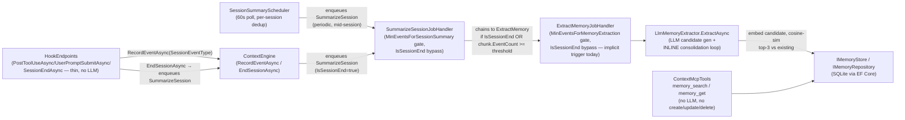

# Context Platform — Memory Pipeline Plan (spec evaluation + phased implementation plan)

**Date:** 2026-09-07
**Scope:** Evaluates a product-owner-supplied "AI memory application" architecture spec (15 numbered
requirements, reproduced in full in the task that produced this document) against Context Platform's
actual memory subsystem — `Context.Memory`, the `SummarizeSession`/`ExtractMemory` job handlers in
`Context.Application`, the MCP tools in `Context.Dashboard.Server`, and the Claude Code hook endpoints.
Every claim below is backed by a direct read of the cited file; nothing is speculative. This document
plans; it does not implement anything.

## Framing (read this before the findings)

The supplied spec was written for a **generic personal-assistant memory app** ("preferences", "habits",
"remember that I like X"). Context Platform is not that: it is a **codebase/session memory system for
Claude Code** — every memory today is extracted from a coding session's summary (files touched,
decisions made, bugs fixed, discoveries made) and stored under `MemoryType.{Decision, Discovery, BugFix,
Feature, Refactor, Change, Exploration, Architecture, Issue}` (`src/Context.Domain/Enums/MemoryType.cs`).
The spec itself anticipates this mismatch and says, in its own Section 7, to extend the existing type
model only if necessary and preserve backwards compatibility — so this plan does **not** recommend
adopting the spec's generic vocabulary (preference/fact/instruction/goal/decision/project_context/
workflow), and does not recommend a JSON extraction schema copied verbatim from the spec's example.
Every recommendation below is translated into this app's actual domain and actual file layout.

The second thing worth saying up front: **this spec is entirely about the write path** (event → trigger
→ extraction → consolidation → storage). It says nothing about retrieval ranking, and implementing it
will not move the needle on retrieval quality at all — that is a separate, already-tracked concern
(`docs/architecture/ARCHITECTURE_ASSESSMENT.md` §RAG-1/RAG-2/RAG-3: hybrid-scorer signal completeness,
reranking, eval harness). If the product owner's question "will it enhance all memory usage" means
"will memories be better ranked/retrieved," the honest answer is **no** — that's a different subsystem.
If it means "will the memory *creation* pipeline become more correct, extensible, and testable," the
answer is **yes, modestly** — see the Executive Summary.

---

## A. Executive Summary

**Most of the spec is already true of this codebase, just not under the names the spec uses.** The
five-stage pipeline (events → trigger → extraction → consolidation → storage) already exists as real,
working code: `HookEndpoints` records events, `SummarizeSessionJobHandler`'s two threshold checks are
already a trigger, `LlmMemoryExtractor` already does LLM-based candidate generation, and the same class
already does a real CREATE/reinforce/supersede consolidation dance bounded to the top-3 nearest existing
memories by cosine similarity — not a naive insert-every-candidate design. MCP already has zero LLM
logic in its handlers, and hooks already do zero extraction — both already comply with the spec's
central architectural rule (Sections 8/9/15) without any change.

**What's genuinely missing is narrower than the spec implies:**
1. The trigger and consolidation *concepts* are real but not *named, separate components* — they're
   conditionals and an inline loop inside `LlmMemoryExtractor.ExtractAsync`. This makes them hard to
   unit-test in isolation (today: **zero** direct tests of consolidation/reinforcement/supersession
   logic) and impossible to reuse from a new entry point.
2. There is no "explicit remember" trigger — nothing today fast-paths a user saying "remember that
   we decided to use SQLite for X" instead of waiting for 20 events to accumulate.
3. Structured, count-based observability (Section 13: trigger fired, candidates extracted, N
   created/M reinforced/K superseded) doesn't exist — only failure-path logging does.

**What this plan does NOT recommend, despite the spec asking for it:** rewriting the extraction prompt
to emit JSON (the current custom `TYPE:`/`TITLE:`/`BODY:`/... format was extensively hardened as
recently as today's own commits and degrades gracefully; JSON would be a real regression risk for
marginal robustness gain — see Gap #7). Replacing the `MemoryType` taxonomy with the spec's generic
one. Adding a confidence/signal dimension to `SessionEventType` speculatively. Building generic MCP
`memory_create`/`memory_update` tools with no current consumer.

**Bottom line:** worth doing, sized much smaller than the spec's language suggests. The real deliverable
is one refactor (extract consolidation into its own component, with real tests for the first time) plus
one genuinely new capability (an explicit-remember MCP tool built on top of that refactor) plus some
cheap observability. Everything else the spec asks for is already satisfied and should be left alone.

---

## B. Current architecture (as verified)



Verified call chain: `HookEndpoints.PostToolUseAsync` → `engine.RecordEventAsync` only (no LLM) —
`apps/host/Context.Dashboard/Context.Dashboard.Server/Hooks/HookEndpoints.cs:86-108`.
`HookEndpoints.SessionEndAsync` → `engine.EndSessionAsync` — `HookEndpoints.cs:110-121`.
`ContextEngine.EndSessionAsync` flips `Session.Status` and enqueues `JobType.SummarizeSession` with
`IsSessionEnd: true` — `src/Context.Application/ContextEngine.cs:148-160`. `SummarizeSessionJobHandler`
gates on `ProjectSettingsDto.MinEventsForSessionSummary` for a session's *first* chunk, then chains into
`JobType.ExtractMemory` when `payload.IsSessionEnd || savedChunk.EventCount >=
settings.MinEventsForMemoryExtraction` —
`src/Context.Application/Jobs/Handlers/SummarizeSessionJobHandler.cs:85-96`. `ExtractMemoryJobHandler`
loads the one `SessionSummaryChunk` just produced and calls `IMemoryExtractor.ExtractAsync` —
`src/Context.Application/Jobs/Handlers/ExtractMemoryJobHandler.cs:33-39`. `LlmMemoryExtractor.ExtractAsync`
(`src/Context.Memory/Extraction/LlmMemoryExtractor.cs:40-113`) does everything from there: LLM call →
`MemoryCandidateParser.Parse` → per-candidate embed → `FindTopMatches` (top-3 cosine similarity via
`src/Context.Memory/Extraction/CosineSimilarity.cs`) → reinforce (>0.92 + consistent) / supersede (>0.92
+ contradictory) / restatement-walk ([0.80,0.92]) / fresh insert (<0.80).

---

## C. Spec section-by-section verdict

| § | Spec ask | Verdict | Evidence |
|---|---|---|---|
| 1 | Pipeline separated into 5 stages, async, cancellation-aware | **Partially satisfied.** The data flow exists end-to-end and every method already takes a trailing `CancellationToken` (repo-wide convention, `CONTRACTS.md` §13). What's missing: "trigger" and "consolidation" aren't named, separately-testable components — they're conditionals in `SummarizeSessionJobHandler` and an inline loop in `LlmMemoryExtractor.ExtractAsync`. | `SummarizeSessionJobHandler.cs:89`, `LlmMemoryExtractor.cs:58-110` |
| 2 | Multiple trigger types (N-events, session-end, explicit-remember, high-signal), extensible abstraction | **Partially satisfied.** N-events (`MinEventsForMemoryExtraction`, default 20) and session-end (`IsSessionEnd` bypass) already exist and are already independent conditions ORed together — that literally *is* two trigger types today, just not reified as objects. Explicit-remember: **not present** (genuine gap). High-signal event: **not present** — `SessionEventType` (`Prompt, ToolCall, FileRead, FileEdit, Command, Error`) has no confidence/signal dimension; per the spec's own "don't require all trigger types if the architecture doesn't support them cleanly," this plan does not force one in. | `ProjectSettingsDto.cs:36`, `SummarizeSessionJobHandler.cs:89`, `SessionEventType.cs` |
| 3 | Extractor input = bounded events, output = candidates only; must not decide updates | **Partially satisfied.** Candidate generation is already cleanly isolated (`ExtractCandidatesViaLlmAsync` → `MemoryCandidateParser.Parse`, returns `IReadOnlyList<MemoryCandidate>` — a strongly-typed record with `Type`/`Title`/`Body`/`Confidence`/`Facts`/`Concepts`/`Topic`). The violation: the *same class* then decides CREATE/reinforce/supersede inline, exactly what this spec section says the extractor must not do. This is the plan's #1 refactor target. | `LlmMemoryExtractor.cs:161-180`, `MemoryCandidate.cs:16-25` |
| 4 | Retrieval-oriented prompt distinguishing durable vs. transient content, structured JSON output | **Already satisfied in substance, adapted to domain; JSON format not recommended.** `MemoryExtractionPromptBuilder.SystemPrompt` already has an extensive, recently-hardened stable/skip taxonomy (skips "routine status narration," "tests passed on their own," "session bookkeeping," "task still in progress with no conclusion") that is the code-memory analogue of the spec's preference/fact/instruction split. Output is a custom `TYPE:`/`TITLE:`/`BODY:`/`TOPIC:`/`FACTS:`/`CONCEPTS:`/`FILES_READ:`/`FILES_MODIFIED:`/`CONFIDENCE:` block format, not JSON — see Gap #7 for the recommendation to keep it. | `MemoryExtractionPromptBuilder.cs:9-125`, `MemoryCandidateParser.cs` |
| 5 | Separate consolidation step: CREATE/UPDATE/MERGE/IGNORE/DELETE-INVALIDATE, deterministic where possible, bounded retrieval, no full-DB load | **Partially satisfied.** The decision logic itself already meets nearly every sub-requirement: bounded to top-3 nearest neighbors (`TopKForDedup = 3`, not the whole memory DB), avoids an LLM call entirely below the 0.80 similarity floor (majority case), only invokes `CheckConsistencyViaLlmAsync` when a candidate is already similarity-flagged, and never deletes — it marks `SupersededById` (this app's DELETE-INVALIDATE equivalent, and the storage model explicitly supports it, per the spec's own qualifier "only when the storage model safely supports it"). What's missing is purely structural: this logic is not its own named component. See Gap #1. | `LlmMemoryExtractor.cs:29-38, 66-110` |
| 6 | Lifecycle Candidate→Evaluated→Stored, preserve existing metadata, no temp results persisted as permanent | **Already satisfied.** `Memory` already carries `Tier`, `Pinned`, `ReinforcementCount`, `LastReinforcedAt`, `SupersededById`, `CreatedFromSessionId`, `Confidence`, `FactsJson`, `ConceptsJson`, `FilesReadJson`, `FilesModifiedJson`, `Topic`. A `MemoryCandidate` is never persisted as its own row — it only becomes a `Memory` row once `NewMemory()` is called inside the consolidation decision. `DecayCalculator` (`src/Context.Memory/Decay/DecayCalculator.cs`) already exists for relevance decay. None of this needs to change. | `src/Context.Domain/Entities/Memory.cs` |
| 7 | Small controlled type set, extend only if necessary | **Already satisfied / not applicable as written.** `MemoryType` is already a small (9-value), domain-fit set. The spec's own generic list does not fit this app and should not replace it. One narrow, additive extension is proposed in §F below for a genuine new case (user-issued "remember this" that isn't a code-session artifact) — see the caution about enum-ordinal storage there. | `MemoryType.cs`, `MemoryConfiguration.cs` (no `HasConversion` — stored as plain int ordinal) |
| 8 | MCP: search/create/update/delete via service layer only, no LLM in handlers, shared service layer with hooks | **Already satisfied for what exists; "create" genuinely absent.** `ContextMcpTools.MemorySearchAsync` → `engine.SearchMemoryAsync` → `IMemoryRepository.SearchAsync`; `MemoryGetAsync` → `IMemoryRepository.GetByIdAsync` directly (an accepted pattern for tools with no 1:1 `IContextEngine` method, per this file's own doc comment). Neither touches an LLM. A REST-only hard delete already exists (`MemoryEndpoints.DeleteAsync` → `IMemoryRepository.DeleteAsync`) but has no MCP equivalent. No `memory_create`/`memory_update` tool exists at all — memories are agent-extracted only today, a deliberate prior design choice, not an oversight. This plan adds exactly one new tool (`memory_remember`, §F) rather than a generic CRUD surface. | `apps/host/Context.Dashboard/Context.Dashboard.Server/Mcp/ContextMcpTools.cs:99-113`, `.../Api/MemoryEndpoints.cs` |
| 9 | Hooks: lifecycle only, no extraction, lightweight per-event | **Already satisfied.** `PostToolUseAsync` calls only `engine.RecordEventAsync` — no LLM call per tool use. `UserPromptSubmitAsync` calls `RecordEventAsync` then a context-*retrieval* call (`SearchContextAsync`, not extraction) wrapped in try/catch that fails open. The N-event config is enforced downstream in `SummarizeSessionJobHandler`, never in the hook itself. | `HookEndpoints.cs:72-108` |
| 10 | Bounded context: max events/messages/chars/tokens/existing-memories-considered | **Already satisfied.** `SessionSummaryChunk` is itself a bounded slice (only events since the last chunk, never full history). `TopKForDedup = 3` bounds consolidation's candidate set. `ProjectSettingsDto.MaxMemoryNotesPerSection` (default 20) bounds retrieval. `Context.Shared.TokenEstimator` + `HookEndpoints`'s `PromptContextTokenBudget`/`MaxContextPackHitsForPrompt`/`MaxRecentMemoriesForSessionStart` bound what reaches the hook's `AdditionalContext`. | `LlmMemoryExtractor.cs:38`, `ProjectSettingsDto.cs:31`, `HookEndpoints.cs:24-27` |
| 11 | Idempotency/concurrency without distributed locking | **Partially satisfied, with one real gap.** `ContextEngine.StartSessionAsync` dedupes by reusing an existing row for the same `claudeSessionId`. `SessionSummaryScheduler` keeps an in-memory `_lastEnqueuedAt` guard specifically to stop re-enqueuing a session whose previous summarize job is still in flight (a bug fixed once already — see its own doc comment). `Job` rows carry `Attempts`/`Status`/`NextRetryAt` for the queue's own retry semantics. The interesting accidental property: because consolidation reinforces on similarity > 0.92, a *retried* `ExtractMemory` job re-processing the same chunk will usually reinforce the already-inserted memory rather than duplicate it — semantic dedup doubles as retry-idempotency. The real gap: this is accidental, not guaranteed (a differently-worded LLM re-sample could land under 0.80 and genuinely duplicate). Not a P0 — no evidence of it happening — but worth an explicit test (§H) rather than relying on luck. | `SessionSummaryScheduler.cs:32-40`, `ContextEngine.cs:101-115` |
| 12 | Failure handling: no crash, no fake memories, no malformed persistence, no corruption | **Already satisfied.** Offline fallback: `chatClient.IsNoOp()` routes to `MemoryCandidateHeuristics.FromSummary` (zero-LLM path). LLM extraction failure: caught, logged, returns `[]` — no exception escapes, no session data lost (`ExtractCandidatesViaLlmAsync`'s catch block). Consistency-check failure: caught, logged, fails open toward reinforcement (never forks/corrupts memory history). `MemoryCandidateParser` skips unrecognized lines and only ever flushes a candidate once `type` and `title` are both set — a malformed block simply doesn't become a candidate, it doesn't become a bad one. | `LlmMemoryExtractor.cs:45-47, 173-177, 197-201`, `MemoryCandidateParser.cs:36-50` |
| 13 | Structured counts/IDs-only observability at each stage | **Partially satisfied — this is a real, cheap gap.** Failure-path logging exists and is already content-safe (`logger?.LogWarning` with provider name/session ID/memory ID, never prompt/response text). `IUsageRecorder` already tracks token spend per purpose (`"MemoryExtraction"`, `"MemoryConsistencyCheck"`). Missing: no success-path structured log for "trigger fired / which trigger," "N candidates extracted," "N created / M reinforced / K superseded" — today the only signal a created/reinforced/superseded memory leaves is the DB row itself. | `LlmMemoryExtractor.cs:204-228` |
| 14 | Specific test matrix (14 cases) | **Partially satisfied — see §H for the full mapping.** Several cases are already covered by `SummarizeSessionJobHandlerTests` (zero-events, below-threshold, at-threshold, session-end-independent-of-threshold). Zero cases touching `LlmMemoryExtractor`'s consolidation/reinforcement/supersession logic exist today — genuine, pre-existing gap independent of this spec. | `tests/Context.Application.Tests/SummarizeSessionJobHandlerTests.cs`; no `LlmMemoryExtractorTests.cs` exists |
| 15 | No rewrite, reuse existing interfaces, no duplicate extraction system, no direct LLM/DB coupling from MCP/hooks | **Already satisfied as a standing discipline**, confirmed by every row above — this plan's every recommendation extends an existing file/class rather than adding a parallel one. | — |

---

## D. Concrete gap list, ranked by value vs. effort

### 1. Extract `IMemoryConsolidator` out of `LlmMemoryExtractor.ExtractAsync` — High value, Low effort
**What:** Move the `FindTopMatches` → reinforce/supersede/restatement-walk/fresh-insert block (currently
`LlmMemoryExtractor.cs:58-110` plus its private helpers `FindRestatedMatchAsync`, `IsRestatementAsync`,
`ReinforceAsync`, `CheckConsistencyViaLlmAsync`, `NewMemory`) into a new `IMemoryConsolidator` /
`MemoryConsolidator` in `src/Context.Memory/Extraction/` (or a new `Consolidation/` subfolder, matching
the "feature subfolder" convention in `CONTRACTS.md` §13). `LlmMemoryExtractor.ExtractAsync` shrinks to:
get candidates → get existing memories → call `consolidator.ConsolidateAsync` per candidate.
**Touches:** `LlmMemoryExtractor.cs` (shrinks), new file(s) in `src/Context.Memory/Extraction/`, DI
registration in `Context.Memory`'s `ServiceCollectionExtensions`.
**Risk of not doing it:** consolidation stays untestable in isolation and unreusable — blocks Gap #2 and
Gap #3 both directly.
**Risk of doing it:** near-zero if done as a mechanical, behavior-preserving extraction with
characterization tests written *first* against the current inline behavior (Phase 1, §I). This is a
pure refactor — no schema change, no interface break for `IMemoryExtractor` callers.

### 2. Add real unit tests for consolidation — High value, Low effort
**What:** `tests/Context.Memory.Tests/MemoryConsolidatorTests.cs` (new) covering: fresh insert below
0.80, reinforce above 0.92 + consistent, supersede above 0.92 + contradictory, restatement-walk in
[0.80, 0.92], and promotion to `MemoryTier.LongTerm` at 2 reinforcements or when `Pinned`. This directly
closes the single biggest hole in spec §14 (zero tests exist today for this logic) and is only possible
cleanly after Gap #1.
**Touches:** new test file only.
**Risk of not doing it:** the exact bug class ARCHITECTURE_ASSESSMENT.md already found by other systems
(good design, untested) stays true of memory too — the next refactor of this logic ships unverified.

### 3. Explicit trigger abstraction for the existing two triggers — Medium value, Medium effort
**What:** Reify "N-events" and "session-end" as named, independently testable trigger checks, per §E
below. This does not change behavior — it names what `SummarizeSessionJobHandler:89` already computes.
**Touches:** `SummarizeSessionJobHandler.cs` (the one `if` line becomes a loop over injected triggers),
new `src/Context.Application/Memory/Triggers/` folder.
**Risk of not doing it:** explicit-remember (Gap #4) has to be bolted on as a third special case in an
already-dense job handler instead of slotting into a real extension point.
**Risk of doing it:** low — it's a wrapper, not new logic; regression risk is caught directly by the
existing `SummarizeSessionJobHandlerTests`, which already exercise every branch this touches.

### 4. Explicit-remember MCP tool (`memory_remember`) — Medium value, Medium effort
**What:** A new MCP tool that lets Claude Code store something *right now* when a user says "remember
that..." — see §E/§F for the full design. Recommended mechanism: an MCP tool, not a hook-side keyword
scan (reasoning in §E).
**Touches:** new tool method in `ContextMcpTools.cs`, one new `IContextEngine.RememberExplicitlyAsync`
method, depends on Gap #1's `IMemoryConsolidator` being extractable and (ideally) public.
**Risk of not doing it:** the one test case in spec §14 that's a genuine, user-visible capability gap
("explicit-remember doesn't require waiting for N events") stays unmet.
**Risk of doing it:** the one real design risk is `MemoryType` fit for user-stated content that isn't a
code-session artifact — addressed explicitly in §F with a single additive enum value and an explicit
ordinal-safety caution (`MemoryConfiguration.cs` has no `HasConversion`, so `MemoryType` is a plain int
ordinal in SQLite — a new value MUST be appended last).

### 5. Structured success-path observability — Medium value, Low effort
**What:** `LogInformation` (not `LogDebug`/`LogWarning`) calls for: trigger fired + which one (once Gap
#3 lands, this is a one-line log per fire), candidates-extracted count, and a single consolidation
summary line ("N created, M reinforced, K superseded") once per `ExtractAsync` call. IDs/counts/types
only, never prompt/response text — matching the existing failure-path logging's own discipline.
**Touches:** `LlmMemoryExtractor.cs`, `ExtractMemoryJobHandler.cs`.
**Risk of not doing it:** low urgency, but every future debugging session for "why didn't this get
remembered" currently requires reading DB rows directly; this is genuinely cheap to add.

### 6. Document the retry/idempotency behavior; do not build new locking — Low value as code, worth doing as a test + comment
**What:** No structural change recommended (per spec §11's own "no distributed locking unless actually
required" and §15's "no unnecessary abstractions"). Add one test asserting that reprocessing the same
`SessionSummaryChunk` twice through `ExtractMemory` does not produce two near-identical `Memory` rows for
clearly-identical content (it should reinforce, per the existing >0.92 path), and add a code comment on
`ExtractMemoryJobHandler`/`LlmMemoryExtractor` noting this is retry-safety-by-side-effect, not a designed
guarantee — so a future change to the similarity thresholds doesn't accidentally remove it unknowingly.
**Risk of not doing it:** negligible today (no reported duplicate-memory incidents); the value here is
documentation and one regression test, not new production code.

### 7. Do NOT switch the extraction prompt/parser to JSON — recommendation, not a gap
The spec asks for structured JSON with no prose. The current format
(`MemoryExtractionPromptBuilder`/`MemoryCandidateParser`) is a custom line-oriented block format that:
already degrades gracefully (unrecognized lines are skipped, not fatal), already defaults confidence/type
on parse gaps, and — critically — was extensively hardened in this repo *today* across several commits
(`Memory extraction prompt hardened against manufacturing low-signal memories`, `Added structured FACTS
extraction to memory prompts`, `Add topic tag to extracted memories`). Every one of those hardening
passes would need to be re-verified against a new JSON schema and a new parser. **Recommendation: keep
the current format.** The honest cost/benefit: JSON buys marginal schema robustness (a well-formed JSON
document is easier to validate than a line format) at the cost of re-litigating a parser that has just
been tuned three times in a row with no reported production parsing failures. Revisit only if real
parsing failures start showing up in the new observability from Gap #5 — that data point doesn't exist
yet, so switching now would be optimizing against a problem not yet observed.

### 8. Do NOT add a confidence/high-signal dimension to `SessionEventType` speculatively
`SessionEventType.Error` is the closest existing candidate for a "high-signal" trigger (a session that
hit an error and then resolved it is plausibly memory-worthy), but there is no current consumer scoring
event significance, and the spec itself says not to force a trigger type the architecture doesn't support
cleanly. Consistent with `ARCHITECTURE_ASSESSMENT.md`'s own precedent on `MEM-2` (episodic/semantic
split) — don't add speculative structure without a concrete need. Revisit if/when a real "sessions that
hit N errors get under-summarized" complaint shows up.

### 9. Do NOT add generic `memory_create`/`memory_update`/`memory_delete` MCP tools
Spec §8 says "optionally." Nothing in the current Dashboard or MCP surface needs user-authored memory
mutation beyond the REST-only hard delete that already exists (`MemoryEndpoints.DeleteAsync`). Building a
generic CRUD surface with no consumer is exactly the "unnecessary abstraction" spec §15 warns against.
The one new capability this plan does add (`memory_remember`, Gap #4) is narrowly scoped to the
explicit-remember trigger, not a general editing API.

---

## E. Proposed trigger abstraction

Two genuinely different shapes are needed here, and forcing them into one interface would be dishonest
about how they actually fire — worth stating plainly rather than papering over:

- **N-events and session-end** are gates evaluated *after* a `SessionSummaryChunk` already exists (they
  decide whether that already-produced chunk is worth running extraction on). They share one shape.
- **Explicit-remember** must fire *before* any chunk exists — the whole point (per spec's own test case
  "doesn't require waiting for N events") is that it bypasses the chunking pipeline entirely. It cannot
  be expressed as "another check on a chunk" without defeating its purpose.

### E.1 — In-pipeline triggers (wraps existing behavior, zero behavior change)

```csharp
namespace Context.Application.Memory.Triggers;

/// <summary>One named condition that can independently justify running memory extraction for a
/// just-produced SessionSummaryChunk. SummarizeSessionJobHandler fires extraction once ANY
/// registered trigger returns true — today that's exactly the two arms of the existing
/// `payload.IsSessionEnd || savedChunk.EventCount >= minEventsForExtraction` check, now named and
/// independently testable instead of inlined.</summary>
public interface IMemoryExtractionTrigger
{
    /// <summary>Logged verbatim when this trigger fires — keep stable, it's an observability key (spec §13).</summary>
    string Name { get; }

    bool ShouldFire(MemoryExtractionTriggerContext context);
}

public sealed record MemoryExtractionTriggerContext(
    bool IsSessionEnd,
    int ChunkEventCount,
    Context.Application.Settings.ProjectSettingsDto Settings);

public sealed class EventThresholdExtractionTrigger : IMemoryExtractionTrigger
{
    public string Name => "EventThreshold";
    public bool ShouldFire(MemoryExtractionTriggerContext ctx) =>
        ctx.ChunkEventCount >= ctx.Settings.MinEventsForMemoryExtraction;
}

public sealed class ConversationEndExtractionTrigger : IMemoryExtractionTrigger
{
    public string Name => "ConversationEnd";
    public bool ShouldFire(MemoryExtractionTriggerContext ctx) => ctx.IsSessionEnd;
}
```

`SummarizeSessionJobHandler`'s constructor gains `IEnumerable<IMemoryExtractionTrigger> extractionTriggers`
(DI collection registration — standard .NET idiom, no new infrastructure). Line 89's `if` becomes:

```csharp
var triggerContext = new MemoryExtractionTriggerContext(payload.IsSessionEnd, savedChunk.EventCount, settings);
var fired = extractionTriggers.FirstOrDefault(t => t.ShouldFire(triggerContext));
if (fired is not null)
{
    logger?.LogInformation("Memory extraction triggered by {Trigger} for session {SessionId} ({EventCount} events).",
        fired.Name, payload.SessionId, savedChunk.EventCount);
    await jobQueue.EnqueueAsync(JobType.ExtractMemory, new ExtractMemoryPayload(payload.SessionId, savedChunk.Id), session?.ProjectId, ct: ct)
        .ConfigureAwait(false);
}
```

Default DI registration: `[EventThresholdExtractionTrigger, ConversationEndExtractionTrigger]` — the
exact two conditions already ORed today, just reified. This is Gap #3 and Gap #5's log line together.

### E.2 — Explicit-remember: recommended mechanism and why

**Recommendation: an MCP tool (`memory_remember`), not a hook-side keyword scan.** Reasoning:

- Claude Code already has an installed, working precedent for teaching it to *prefer a specific tool for
  a specific situation* — the `context-memory` skill (`IClaudeIntegrationInstaller.InstallSkillAsync`,
  per `CONTRACTS.md` §12) already teaches proactive use of `context_search`/`memory_search`/etc. Adding
  "call `memory_remember` when the user explicitly asks you to remember something" to that same skill
  document is a small, natural extension of an already-working pattern.
- A keyword/regex scan over `Prompt` events ("remember that", "note for later", ...) is guessable and
  unreliable on natural language — it will both miss phrasings and false-positive on unrelated text
  ("I don't want to forget to mention..."). An explicit tool call has no such ambiguity: the agent
  decides, in context, whether this is really a durable-memory request, which is exactly the judgment
  call spec §3/§4 already delegates to an LLM for the periodic path.
- It keeps hooks exactly as thin as spec §9 demands — no new logic in `HookEndpoints` at all, since the
  detection now lives entirely in the agent's own judgment plus one new tool, not in a hook-side scan.
- The alternative (keyword scan on `Prompt` events, evaluated where `HookEndpoints.UserPromptSubmitAsync`
  already records the event) is not wrong, and could be added later as a *second*, complementary signal
  if the tool-call approach proves under-used in practice — but shipping both in Phase 1 is unnecessary
  scope for an unproven need.

Concrete shape — see §F for how it plugs into consolidation directly (skipping the "extract candidates
from a chunk via LLM" step entirely, since the content is already given by the user).

---

## F. Proposed consolidation extraction + explicit-remember's direct use of it

```csharp
namespace Context.Memory.Abstractions;

/// <summary>Given one candidate memory and the project's existing memories, decides what to do
/// with it — reinforce an existing memory, insert fresh, or insert-and-supersede. Extracted out of
/// LlmMemoryExtractor (previously inline in ExtractAsync's foreach loop) so it is unit-testable in
/// isolation and reusable by a caller that already has a ready-made candidate and does not need
/// the LLM candidate-generation step at all (see ContextEngine.RememberExplicitlyAsync).</summary>
public interface IMemoryConsolidator
{
    Task<Context.Domain.Entities.Memory> ConsolidateAsync(
        Guid projectId,
        Guid? sessionId,
        Context.Memory.Extraction.MemoryCandidate candidate,
        IReadOnlyList<ExistingMemoryWithEmbedding> existing,
        CancellationToken ct);
}
```

`MemoryConsolidator` (new class) contains exactly the logic currently at `LlmMemoryExtractor.cs:66-110`
plus its private helpers, moved verbatim (Phase 1 is a pure move, not a rewrite — see §I).
`LlmMemoryExtractor.ExtractAsync` becomes:

```csharp
foreach (var candidate in candidates)
{
    var result = await consolidator.ConsolidateAsync(projectId, chunk.SessionId, candidate, existing, ct).ConfigureAwait(false);
    results.Add(result);
    // existing embeddings list still needs the new entry for subsequent candidates in this same loop —
    // ConsolidateAsync returns enough (the Memory + its embedding) for the caller to append it, or
    // ConsolidateAsync itself takes/returns the running `existing` list — pick whichever keeps
    // ExtractAsync simplest; either is a small, low-risk signature detail to settle during implementation.
}
```

Two changes needed to make `MemoryCandidate` usable outside `Context.Memory.Extraction`'s current
`internal` visibility: promote `MemoryCandidate` (`src/Context.Memory/Extraction/MemoryCandidate.cs`) and
`IMemoryConsolidator`/`MemoryConsolidator` to `public`. `NewMemory()`'s `sessionId` parameter needs to
become `Guid?` (currently `Guid sessionId`, always non-null from the chunk path) since an MCP-originated
explicit remember has no session in scope — `Memory.CreatedFromSessionId` is already nullable
(`Guid?`), and its FK (`MemoryConfiguration.cs:37-40`) already tolerates null, so this is a safe,
additive signature change with exactly one existing call site to update.

**Explicit-remember's direct use** (Gap #4), skipping candidate-extraction-via-LLM entirely:

```csharp
// IContextEngine — one new method
Task<Context.Domain.Entities.Memory> RememberExplicitlyAsync(Guid projectId, string content, MemoryType? type, CancellationToken ct);

// ContextEngine implementation
public async Task<Memory> RememberExplicitlyAsync(Guid projectId, string content, MemoryType? type, CancellationToken ct)
{
    var candidate = new MemoryCandidate(
        Type: type ?? MemoryType.Instruction,   // see enum note below
        Title: BuildTitleFrom(content),          // first sentence / first ~80 chars, same spirit as existing TITLE guidance
        Body: content,
        Confidence: 0.95,                        // user explicitly asked — high confidence by construction, not LLM-judged
        Facts: [], Concepts: [], FilesRead: [], FilesModified: [], Topic: null);

    var existing = await memoryStore.GetExistingWithEmbeddingsAsync(projectId, ct).ConfigureAwait(false);
    return await consolidator.ConsolidateAsync(projectId, sessionId: null, candidate, existing, ct).ConfigureAwait(false);
}
```

> **Update (job-based writes).** As built, `memory_remember` and `memory_forget` no longer do their work inside the tool
> call. They return `{ status: "saving" | "deleting" | "not_found", jobId }` as soon as a `RememberMemory` /
> `ForgetMemory` job is durably queued; the embedding, judging and consolidation run in the job, which retries while the
> embedding provider is down (up to 10 attempts for `RememberMemory`). No memory id is returned and `jobId` is not one.
> The consolidator described below now also merges more than two memories at once and never cuts text: past the
> per-project body/fact limits (settings `MergedMemoryMaxBodyChars` / `MergedMemoryMaxFacts`, online merge limit
> `OnlineMergeMaxSources`) the new memory stays separate, and a model-written merge that drops a fact or a concrete name
> falls back to a lossless concatenation. Reconsolidation group size, cluster similarity and source excerpt size are
> settings too, and periodic reconsolidation defaults to every six hours.

```csharp
// ContextMcpTools.cs — one new tool, same thin-wrapper shape as every other tool in this file
[McpServerTool(Name = "memory_remember")]
[Description("Explicitly stores something the user just asked to be remembered, bypassing the normal " +
    "N-event/session-end extraction triggers. Call this the moment a user says things like 'remember " +
    "that...', 'note for later...', or gives a standing instruction — do not wait for enough events to accumulate.")]
public async Task<Context.Domain.Entities.Memory> MemoryRememberAsync(
    [Description("What to remember, in the user's own words or lightly cleaned up.")] string content,
    [Description("One of Decision, Discovery, BugFix, Feature, Refactor, Change, Exploration, Architecture, Issue, Instruction. Defaults to Instruction.")] string? type = null,
    CancellationToken ct = default)
    => await engine.RememberExplicitlyAsync(currentProject.ProjectId, content, ParseMemoryType(type), ct).ConfigureAwait(false);
```

**A single, narrow, additive `MemoryType` extension is proposed here**, not a taxonomy rewrite: a
`MemoryType.Instruction` value for user-stated standing preferences/rules that don't fit the existing
code-session-artifact types (Decision/Discovery/BugFix/etc. all describe something that happened *in* a
session; "always use tabs, not spaces" describes neither). **Critical constraint, verified against
`MemoryConfiguration.cs`:** there is no `HasConversion` on `Memory.Type` — EF Core stores `MemoryType` as
a plain integer ordinal in SQLite. `Instruction` **must** be appended as the last value in the enum,
never inserted before `Issue`, or every existing stored `Memory.Type` value silently becomes wrong.

---

## G. Config shape (additive to `ProjectSettingsDto`)

`src/Context.Application/Settings/ProjectSettingsDto.cs` already follows the right convention for this
project (a flat record persisted as JSON into `Project.ConfigJson`, new fields appended with defaults
that preserve today's behavior with zero migration). One new field, appended last per that same
convention (positional-record backward compatibility, matching how `MinEventsForMemoryExtraction` itself
was added most recently):

```csharp
public sealed record ProjectSettingsDto(
    string EmbeddingProvider,
    string LlmProvider,
    string? OllamaBaseUrl,
    string? OllamaEmbeddingModel,
    string? OllamaChatModel,
    bool ReindexEnabled,
    int ReindexIntervalMinutes,
    DateTimeOffset? LastReindexScheduledAt,
    int SessionSummaryIntervalMinutes = 0,
    int MinEventsForSessionSummary = 15,
    int MaxMemoryNotesPerSection = 20,
    int MinEventsForMemoryExtraction = 20,
    // NEW: lets a project opt out of the memory_remember MCP tool entirely if its owner doesn't
    // want agent-initiated memory writes outside the normal extraction pipeline. Defaults to
    // enabled since the tool only ever fires on an explicit agent tool call, never automatically.
    bool ExplicitRememberEnabled = true);
```

No other new config surface is recommended — the spec's literal nested-JSON trigger-config shape (e.g. a
`triggers: { eventThreshold: {...}, conversationEnd: {...} }` object) does not fit this project's existing
flat-DTO convention and would be pure ceremony: there are only two in-pipeline triggers today and neither
needs its own sub-config beyond the thresholds that already exist.

---

## H. Testing plan, mapped to the spec's 14 cases

| # | Spec test case | Status | Where |
|---|---|---|---|
| 1 | Zero events → no extraction | **Already covered** — `HandleAsync_writes_no_summary_for_a_session_with_zero_events_even_at_session_end` | `tests/Context.Application.Tests/SummarizeSessionJobHandlerTests.cs` |
| 2 | Fewer than N events → no periodic extraction | **Already covered** — `HandleAsync_writes_no_summary_when_a_short_session_ends_below_the_MinEventsForSessionSummary_bar` | same file |
| 3 | N events → extraction triggered | **Already covered** — `HandleAsync_persists_a_summary_once_the_first_chunk_clears_the_MinEventsForSessionSummary_bar` (asserts the summary path; the chained `ExtractMemory` enqueue at the extraction threshold is exercised by `HandleAsync_still_persists_a_small_trailing_chunk_when_the_session_already_has_a_real_summary`, which explicitly asserts the `ExtractMemory` job is enqueued) | same file |
| 4 | Extraction may return zero/multiple memories | **Net-new.** Needs a direct `LlmMemoryExtractorTests`/`MemoryConsolidatorTests` case feeding a multi-candidate LLM response through `MemoryCandidateParser` and asserting the result count matches, plus a zero-candidate ("MEMORY_COUNT: 0") case. | `tests/Context.Memory.Tests/MemoryConsolidatorTests.cs` (new), `LlmMemoryExtractorTests.cs` (new) |
| 5 | Duplicate candidate → no duplicate memory | **Net-new** — feed the same candidate content twice against a seeded existing-memory list, assert the second call reinforces (>0.92 path) rather than inserting. | `MemoryConsolidatorTests.cs` (new) |
| 6 | Candidate updates existing memory when clearly appropriate | **Net-new** — the reinforce and supersede paths, both currently untested. | `MemoryConsolidatorTests.cs` (new) |
| 7 | Provider unavailable → app continues | **Partially covered in spirit** (the `chatClient.IsNoOp()` fallback path exists and is exercised indirectly by tests using `NoOpChatClient`), but no test explicitly asserts "LLM throws mid-call → extraction returns empty, no exception propagates." | Net-new case in `LlmMemoryExtractorTests.cs` |
| 8 | Invalid LLM response → no malformed memory stored | **Partially covered** — `MemoryCandidateParserTests` already covers several malformed/partial input shapes for the parser itself (see `Parse_leaves_Topic_null_when_the_TOPIC_line_is_omitted` and neighboring cases). Not yet covered: a fully garbage response reaching `LlmMemoryExtractor.ExtractAsync` end-to-end and confirming zero memories are persisted. | `tests/Context.Memory.Tests/MemoryCandidateParserTests.cs` (existing, parser-level); net-new end-to-end case in `LlmMemoryExtractorTests.cs` |
| 9 | Conversation-end trigger works independently of N-event trigger | **Already covered** — every `SummarizeSessionJobHandlerTests` case that passes `isSessionEnd: true` with an event count below `MinEventsForMemoryExtraction` and still asserts the `ExtractMemory` enqueue (`HandleAsync_still_persists_a_small_trailing_chunk_when_the_session_already_has_a_real_summary`). | `SummarizeSessionJobHandlerTests.cs` |
| 10 | Explicit-remember/high-signal doesn't require waiting for N events | **Net-new**, and only meaningful once Gap #4 ships — test that `ContextEngine.RememberExplicitlyAsync` calls the consolidator directly with zero dependency on event counts or chunk state. | `tests/Context.Application.Tests/ContextEngineTests.cs` (extend) |
| 11 | Hooks contain no memory business logic | **Already effectively covered by inspection** (verified in §C row 9); recommend one lightweight assertion-style test if not already present — e.g. a test that `HookEndpoints.PostToolUseAsync`'s only side effect is `RecordEventAsync`, via a mock `IContextEngine` with no other setup. | `Context.IntegrationTests` (per existing hook test conventions) or `Context.Dashboard.Server` test project if one exists |
| 12 | MCP uses the same memory service layer as hooks | **Already true by construction** (both go through `IContextEngine`/`IMemoryRepository`) — worth one explicit test asserting `memory_remember` and the hook path both ultimately reach the same `IMemoryConsolidator`, once Gap #4 ships. | `ContextMcpTools` test coverage (new/extended) |
| 13 | Concurrent/repeated processing doesn't unnecessarily duplicate | **Net-new** — see Gap #6: a test reprocessing the same `SessionSummaryChunk` twice through `ExtractMemoryJobHandler` and asserting no duplicate `Memory` row for identical content. | `tests/Context.Application.Tests/ExtractMemoryJobHandlerTests.cs` (new — this handler currently has zero tests) |
| 14 | (Implicit, from spec §13) Observability doesn't leak content | Covered by code review discipline today (`logger?.LogWarning` calls already pass IDs/provider names only); add an explicit test once Gap #5's new `LogInformation` calls land, asserting the log message templates only interpolate counts/IDs/names. | New test alongside Gap #5's implementation |

---

## I. Phasing

Sized for independent subagent tasks, each small enough to review and merge on its own — consistent
with how this session has been merging work today (see recent commits: topic-tag feature, empty-summary
fix, each landed as its own reviewable change).

**Phase 1 — Extract consolidation, zero behavior change.**
Move the dedup/reinforce/supersede block out of `LlmMemoryExtractor.ExtractAsync` into
`IMemoryConsolidator`/`MemoryConsolidator` (Gap #1). Write `MemoryConsolidatorTests.cs` characterizing
current behavior *before* the move lands, so the extraction is provably behavior-preserving (Gap #2,
partial — the reinforce/supersede/duplicate cases from §H). No public API changes beyond what's
needed to make `MemoryCandidate`/`IMemoryConsolidator` reachable from `Context.Application` later.
**Definition of done:** all existing `Context.Memory.Tests` still pass unchanged; new consolidator tests
pass; `LlmMemoryExtractor.ExtractAsync` is now a thin orchestrator.

**Phase 2 — Name the existing triggers.**
Introduce `IMemoryExtractionTrigger`/`EventThresholdExtractionTrigger`/`ConversationEndExtractionTrigger`
(§E.1) and wire them into `SummarizeSessionJobHandler`, replacing the inline `if`. Add the
`LogInformation` trigger-fired line (part of Gap #5). **Definition of done:** all existing
`SummarizeSessionJobHandlerTests` pass unchanged (they assert on the enqueue call, not on how the
decision was reached, so this should require no test edits — only new trigger-unit tests get added).

**Phase 3 — Explicit-remember.**
Depends on Phase 1. Add `MemoryType.Instruction` (appended last), `IContextEngine.RememberExplicitlyAsync`,
`ContextMcpTools.MemoryRememberAsync`, the `ExplicitRememberEnabled` config flag, and the `context-memory`
skill document update teaching Claude Code to call the new tool. Add the §H test cases 10/12.
**Definition of done:** a manual test — asking Claude Code "remember that we always use X" against a
project with this build — produces a `Memory` row with `Type=Instruction` and no wait for N events.

**Phase 4 — Remaining observability + idempotency test.**
Candidates-extracted-count and consolidation-outcome-summary logging (rest of Gap #5); the
double-processing regression test from Gap #6/§H case 13 (`ExtractMemoryJobHandlerTests.cs`, currently
nonexistent). **Definition of done:** a `dotnet test` run shows the new log-content test and the
duplicate-processing test both passing; manual log inspection during a real extraction shows the new
structured lines.

**Phase 5 — Close the remaining §H test gaps.**
`LlmMemoryExtractorTests.cs` for the provider-unavailable and malformed-response
end-to-end cases (§H cases 7/8), plus the hooks-have-no-business-logic assertion test (§H case 11) if not
already covered by an existing integration test. Lowest urgency, can interleave with any other phase.

Each phase above is independently mergeable: Phase 2 does not require Phase 3, Phase 4/5 do not block
each other, and Phase 1 is the only hard prerequisite (for Phases 3 and, partially, 4).

---

## J. Explicitly rejected spec asks, with reasoning

- **JSON extraction prompt/schema (§4).** Regression risk against a recently, repeatedly hardened
  working parser, for unproven benefit. See Gap #7.
- **Generic memory type taxonomy (§7).** Doesn't fit a code-session-memory domain; existing 9-value enum
  is the correct domain adaptation and should not be replaced, only extended once (`Instruction`, Phase 3).
- **High-confidence/high-signal event trigger as a hard requirement (§2).** No event-confidence dimension
  exists today and no concrete consumer needs one; spec explicitly permits skipping trigger types the
  architecture doesn't support cleanly.
- **Generic MCP create/update/delete tools (§8).** No current consumer beyond the one narrowly-scoped
  `memory_remember` tool this plan does add; a full CRUD surface would be exactly the kind of unnecessary
  abstraction spec §15 itself warns against.
- **A nested JSON trigger-config block (§2's implied config shape).** Doesn't match this project's flat
  `ProjectSettingsDto` convention and isn't warranted by only two in-pipeline trigger types.
- **Distributed locking / new dedup-key infrastructure for idempotency (§11).** The existing
  similarity-based consolidation already provides adequate accidental protection for the failure mode
  described (retry-duplication of near-identical content); building new locking infra for an
  unobserved failure mode contradicts the spec's own "no distributed locking unless actually required."
