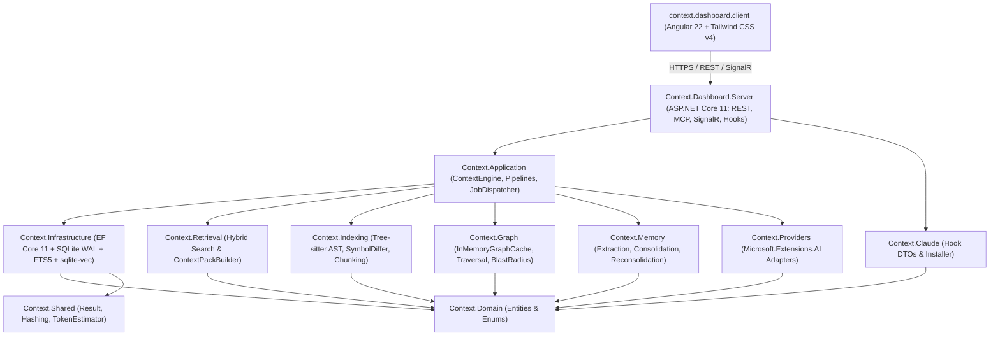
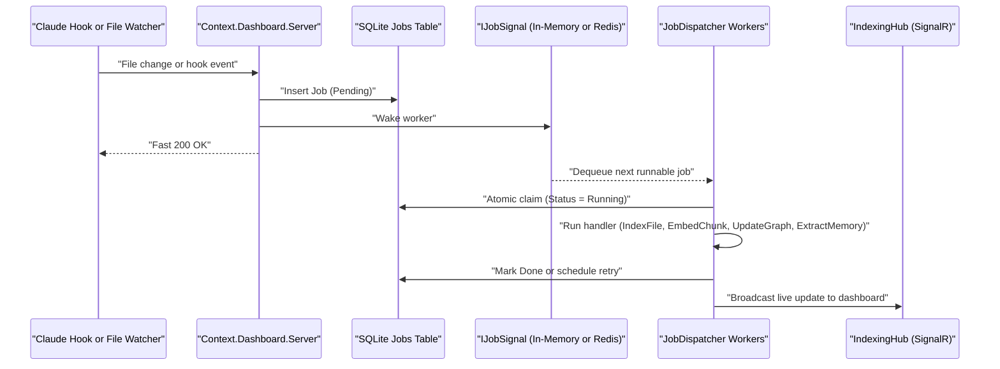
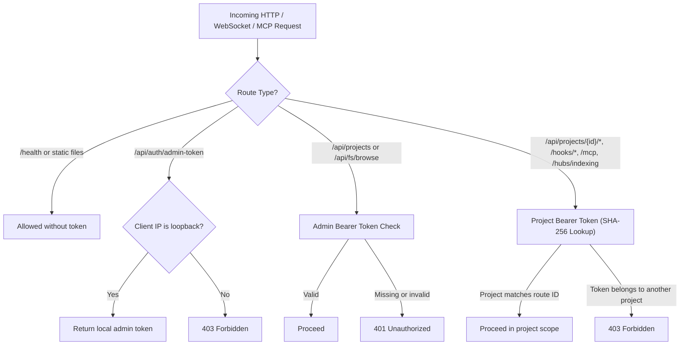

# Architecture

**Language:** English | [Українська](../uk/ARCHITECTURE.md)

This document explains how Context Platform is split into layers, how data is stored in SQLite, how background jobs and SignalR updates work, and how project authentication is enforced.

---

## 1. Layers and Project Structure

The .NET 11 solution (`ContextPlatform.slnx`) follows Clean Architecture with clear boundaries. Core domain entities and module abstractions have no dependencies on ASP.NET Core or database drivers.

### Projects Overview

| Project | Role |
| :--- | :--- |
| **`Context.Domain`** | Plain entities (`Project`, `File`, `Symbol`, `Chunk`, `Embedding`, `GraphNode`, `GraphEdge`, `Session`, `SessionSummary`, `Memory`, `Job`, `UsageRecord`, `HookInvocation`) and enums |
| **`Context.Shared`** | Shared utilities: `Result<T>`, `TokenEstimator`, `DisclosureLevel`, `Hashing` (streaming SHA-256), `BearerTokenGenerator` |
| **`Context.Indexing`** | Repository file scanning (`.gitignore`-aware), Tree-sitter parsers (`C#`, `TS`, `TSX`, `JS`, `Python`), incremental symbol diffing, and chunking |
| **`Context.Graph`** | Thread-safe in-memory graph cache, database persistence adapter, shortest-path search, and impact/blast-radius traversal |
| **`Context.Providers`** | Unified AI client adapters (`NoOp`, `Ollama`, `Foundry Local`, `OpenAI`, `Anthropic`), secret redaction, retries, and lexical overlap reranking |
| **`Context.Retrieval`** | Multi-signal search engine (`HybridSearchEngine`), scoring (`HybridScorer`), and token-budgeted context packing (`ContextPackBuilder`) |
| **`Context.Memory`** | Session summary building, memory extraction, online deduplication/merging, batch reconsolidation, and code verification |
| **`Context.Claude`** | Claude Code hook models and installer that safely configures `.mcp.json`, `.claude/settings.json`, scripts, and project skill docs |
| **`Context.Infrastructure`** | `ContextDbContext` (SQLite WAL), FTS5 search indexes, `sqlite-vec` vector tables, and repository implementations |
| **`Context.Application`** | Application facade (`IContextEngine`), indexing pipeline, maintenance/storage services, background schedulers, and `JobDispatcher` |
| **`Context.Dashboard.Server`** | Thin ASP.NET Core host exposing REST endpoints, MCP tools, Claude hook handlers, and SignalR hubs |
| **`context.dashboard.client`** | Angular 22 standalone SPA built with Signals, `OnPush` change detection, and Tailwind CSS v4 |

---

## 2. Backend Decomposition & Reliability

Instead of large monolithic services, orchestration is split into small focused components:

- **`ContextEngine` (`Context.Application/Engine/`):** delegates work to four focused coordinators (`ContextPackDeliveryCoordinator`, `NodeExpansionCoordinator`, `MemoryCoordinator`, `SessionCoordinator`) plus `MemorySearchHelper`.
- **Indexing pipeline (`Context.Application/Indexing/`):**
  - `ParsedFileIndexer` extracts AST symbols, formats XML documentation into plain text chunks, reuses unchanged chunk IDs so existing embeddings survive edits, and defers cross-file graph resolution during project-wide reindexing.
  - `UnparsedFileIndexer` indexes Markdown, JSON, YAML, and config files with streaming SHA-256 hashing.
  - `IndexingPipeline` batches all changed files first, then queues `UpdateGraph` and `ResolveRelations` so callers appearing earlier alphabetically than their targets are still resolved cleanly.
- **Job queue (`Context.Application/Jobs/`):** `JobDispatcher` pairs per-project fairness lanes (`JobLane`) with bounded worker execution (`JobExecutionRunner`), exponential retry backoff (`JobRetryPolicy`), clean `IDisposable` shutdown, and health reporting (`IJobDispatcherHealth`).
- **Host decoupling (`Context.Dashboard.Server`):** HTTP endpoints, maintenance, and SignalR hubs talk to `Context.Application` interfaces (`IStorageMaintenanceService`, `ISessionRepository`, `IProjectRepository`) rather than querying `ContextDbContext` directly.

---

## 3. Frontend Architecture (Angular 22 + Tailwind CSS v4)

The web UI has zero Angular Material / CDK / animation runtime dependencies and uses **Tailwind CSS v4** utilities on top of custom standalone primitives:

- **Shared UI (`src/app/shared/ui/`):** accessible `ModalShellComponent` (`aria-labelledby`, Escape/backdrop dismissal), SVG `IconComponent`, `ToastContainerComponent`, `ConfirmDialogService` (FIFO-queued confirmation promises), `DonutChartComponent`, `ActivityBarChartComponent`, and `CollapsibleSectionComponent`.
- **Concurrency & live updates:**
  - `authInterceptor` coalesces concurrent `401` token refreshes per project into a single reissue request instead of triggering a refresh storm.
  - `AdminTokenService` caches valid bootstrap tokens while clearing errors so temporary startup races recover automatically.
  - `SignalrService` serializes group `joinProject` / `leaveProject` calls, reconnects with unbounded backoff across host restarts, and triggers state reconciliation via `reconnected$`.
  - Feature panels (`Dashboard`, `Search`, `Memories`, `Graph`, `Settings`) use `OnPush`, cancel in-flight requests on project switches, and preserve unsaved form edits during background reloads.

---

## 4. Storage, Vectors, and Background Jobs

All project data lives in one local SQLite file (`context.db` in `CONTEXT_PLATFORM_DATA_DIR`) configured with WAL mode and foreign keys enabled:

- **`Embeddings` cache:** keyed by `(ContentHash, Provider)` so unchanged code snippets are not re-embedded across restarts.
- **`sqlite-vec` tables:** stored per provider as `chunk_vectors_{provider}` so switching models with different vector dimensions never collides.
- **FTS5 trigram index:** powers fast substring and CamelCase/snake_case code matching alongside `LIKE` fallback for short 1–2 character tokens.

---

## 5. Security Model

The server fails closed by default and isolates every project token:

- **Local convenience vs. remote safety:** binding to `127.0.0.1` auto-generates an admin token for the local browser; binding to `0.0.0.0` requires `CONTEXT_PLATFORM_ADMIN_TOKEN`.
- **Per-project isolation:** only the SHA-256 hash of each project's bearer token is stored in SQLite (`BearerTokenHash`). One project's token can never access another project.
- **Secret scrubbing:** `SecretRedactor` strips API keys, private tokens, and password-like strings before any payload is sent to OpenAI or Anthropic.
