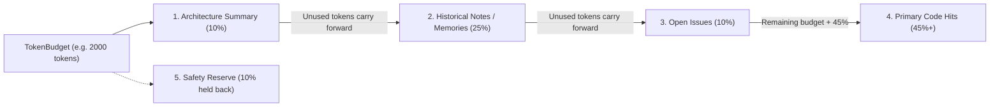
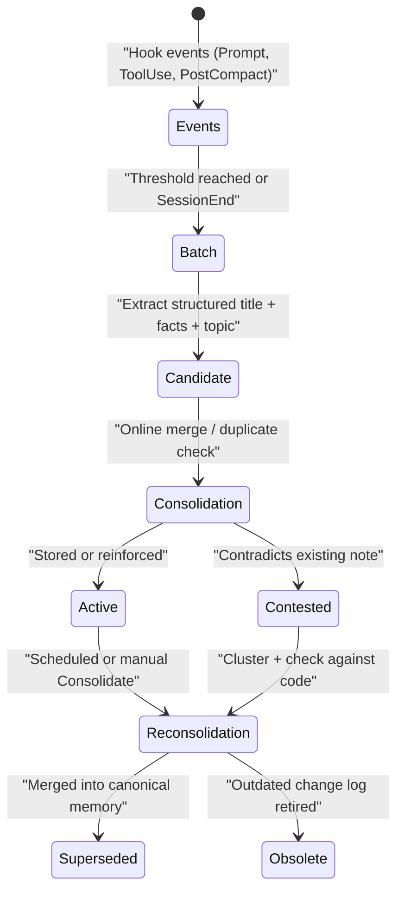

# Features, Search Quality & Analysis

**Language:** English | [Українська](../uk/FEATURES.md)

This page explains how Context Platform indexes code, ranks search hits, builds token-budgeted context packs, manages memories, and where it performs best (plus its practical limits).

---

## 1. Hybrid Code Search (`HybridSearchEngine`)

Relying on embeddings alone often misses exact method or symbol names, while plain text matching misses synonyms. Context Platform blends multiple signals normalized to `[0, 1]`:

```text
score = 0.235 * lexical(FTS5) + 0.529 * vector(sqlite-vec) + 0.235 * graph_proximity
```

*(Internal default unnormalized weights: `LexicalWeight = 0.20`, `VectorWeight = 0.45`, `GraphWeight = 0.20`, `RecencyWeight = 0.0`, `MemoryWeight = 0.0`.)*

Key retrieval behaviors:

1. **CamelCase & short token support:** `SqliteSearchIndex` splits `camelCase` / `PascalCase` / `snake_case` terms (e.g. searching `"validateToken"` finds `"validate"` and `"token"`), strips common noise words, falls back to bounded `LIKE` queries for 1–2 character tokens (`id`, `db`), and centers snippets around the actual match.
2. **Test noise reduction:** unscoped searches gently downrank `tests/` / `*Tests.cs` hits so implementation code surfaces first, while scoped searches (e.g., `scope: ["tests/"]`) keep full test ranking.
3. **Graph warm-up & reranking:** `HybridSearchEngine` warms the in-memory graph cache when needed, expands top candidates across 1-hop neighbors, and reranks the top candidates (`LexicalOverlapReranker` by default) while propagating reordered scores cleanly into `ContextPackBuilder`.

---

## 2. Token Budget Packing (`ContextPackBuilder`)

Every call to `context_search` or a substantive `UserPromptSubmit` hook respects a fixed `TokenBudget` (default `2000` tokens):



- **Unused budget carry-forward:** if there are few memories or open issues, their leftover tokens roll directly into `PrimaryHits` so no budget is wasted.
- **Knapsack stability:** `ContextPackBuilder` guarantees the highest-scoring hit fits first without letting tiny 1-token matches push primary results out of the pack.
- **Session deduplication:** unchanged files/hits already sent earlier in the same Claude Code session are skipped to avoid paying twice for identical context.
- **Chatter filtering on hooks:** short acknowledgements (`ok`, `thanks`, `looks good`, `/compact`) still log the hook event in the background, but skip retrieval so irrelevant code snippets are never injected.

---

## 3. Tree-sitter AST & Blast Radius (`graph_impact`)

Indexing uses native Tree-sitter grammars with zero LLM calls:

- **Supported languages:** `C#`, `TypeScript`, `TSX`, `JavaScript`, `JSX`, `Python` (plus non-AST indexing for Markdown, JSON, YAML, scripts, and configs).
- **Modern syntax & relations:** parses classes, records (`record`, `record struct`), structs, interfaces, methods, constructors, properties (including expression-bodied getters), calls, type references, inheritance/implementation, imports/exports, and test coverage (`[Fact]`, `[Theory]`, `[Test]`).
- **Incremental preservation:** `SymbolDiffer` hashes both signatures and bodies (`SignatureHash` / `BodyHash`). Unchanged symbols keep their existing chunks and vectors when a file is edited; graph updates preserve incoming cross-file edges targeting surviving symbols.
- **Blast radius (`BlastRadiusAsync`):** querying either a specific method or its parent class/interface rolls up **Callers**, **Implementers**, and **Covering tests** across files.

---

## 4. Multi-Tier Memory Lifecycle & Consolidation

Context Platform turns raw session activity into checked engineering notes:



- **Offline + online deduplication:** even without a chat model (`noop` or offline fallback), `MemoryRelationJudge` combines embedding similarity with content token Jaccard overlap and shared strong entities (file paths, symbols, config keys) to avoid saving duplicate facts.
- **Code verification (`MemoryCodeChecker`):** flags referenced symbols/files against the current index (`Verified`, `Refuted`, `Unknown`) so stale notes are caught instead of silently misleading the agent.

---

## 5. Honest Code-Intelligence Assessment

We evaluated the platform against real end-to-end integration benchmarks (`RetrievalQualityHarnessTests` in `Context.IntegrationTests`, running local SQLite WAL + FTS5 + `sqlite-vec` + Tree-sitter in offline `noop` mode with zero mocked search components):

### Measured Benchmark Results (Offline Mode)

| Benchmark | What it tests | Observed result |
| :--- | :--- | :--- |
| **Golden natural-language suite** (21 queries across 12 C# modules) | Paraphrased English queries vs XML doc summaries & method names | **`hit-rate@5 = 1.000` (21/21)**, **`MRR = 1.000`** |
| **Modern C# feature suite** (5 queries + graph impact + packing) | `record` (`TokenValidationResult`), `record struct` (`TokenScope`), camelCase query split, unscoped vs `tests/` ranking, `ContextPackBuilder` ordering | **`hit-rate@5 = 1.000` (5/5)**, **`MRR = 0.867`**, production file ranked #1 ahead of unit test; `ContextPack` returned 12 hits (571 est. tokens) in descending score order |
| **Cross-file Blast Radius** (`AlphaController` -> `BillingTokenValidator` -> tests) | `A -> B` alphabetical cross-file calls, expression-bodied property callers, `[Fact]` test links, class container roll-up | Method target: **`4` callers, `1` covering test**; Class container target: **`6` callers, `1` covering test** |

### Where Context Platform Is Most Useful (and Honest Limits)

**Strongest value today:**
- **Large multi-file repositories:** locating exact definitions, callers, implementers, and tests via `code_search`, `symbol_search`, and `graph_impact` avoids reading dozens of unrelated files and gives deterministic AST dependency facts that raw grep cannot verify cleanly.
- **Cross-session memory & checkpoints:** preserving structured `Completed / Decisions / OpenIssues / NextSteps` across `/compact` boundaries and separate workdays saves repeated onboarding prompts.
- **Privacy & predictable cost:** full code structure, graph traversal, and keyword/trigram search work 100% locally with zero API calls (`noop`), and `McpSavingsTracker` deduplicates repeat file hits within a 10-minute cooldown (or until a file changes) so savings metrics stay realistic rather than inflated.

**Practical limits to keep in mind:**
- **Synonyms need real embeddings:** in `noop` mode, vectors carry no semantic meaning; finding conceptually similar code whose words do not appear in the query requires configuring **Ollama**, **Foundry Local**, or **OpenAI**.
- **Memory extraction needs a chat LLM:** structural indexing, graph impact, and search need no LLM, while automatic extraction/summarization of session transcripts requires a local or cloud chat model.
- **Savings numbers are estimates:** `SavedTokens` measures full files avoided via snippet search minus returned tokens (`TokenEstimator` at ~4 chars/token) — useful as a directional signal, not an exact provider billing invoice.
