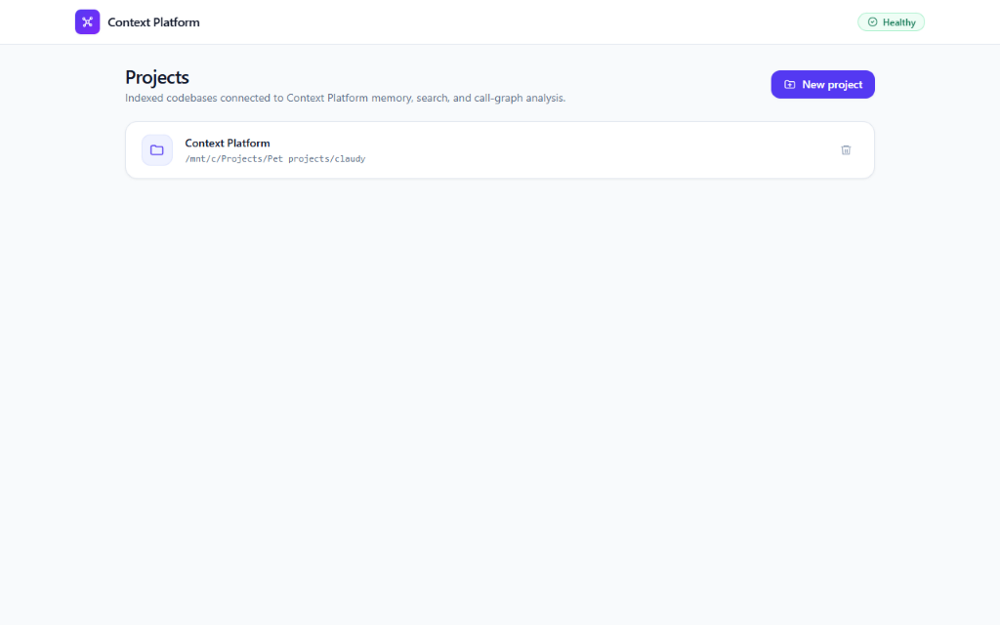
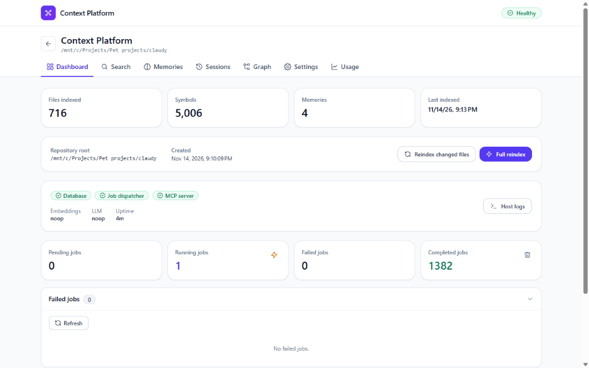
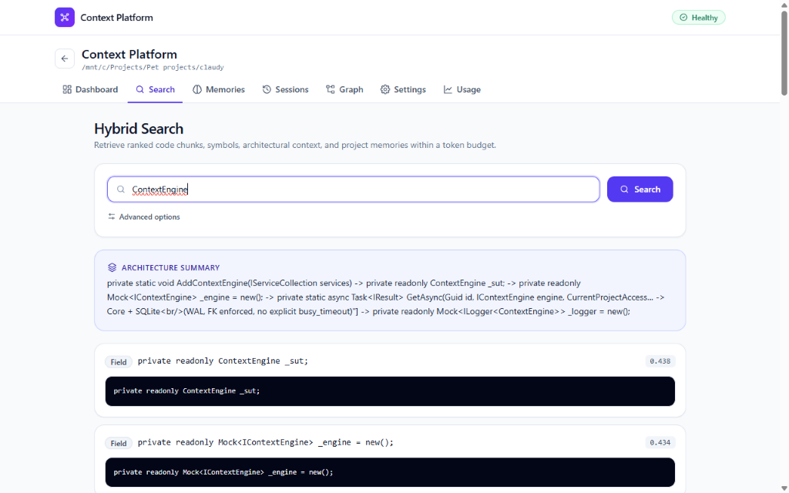
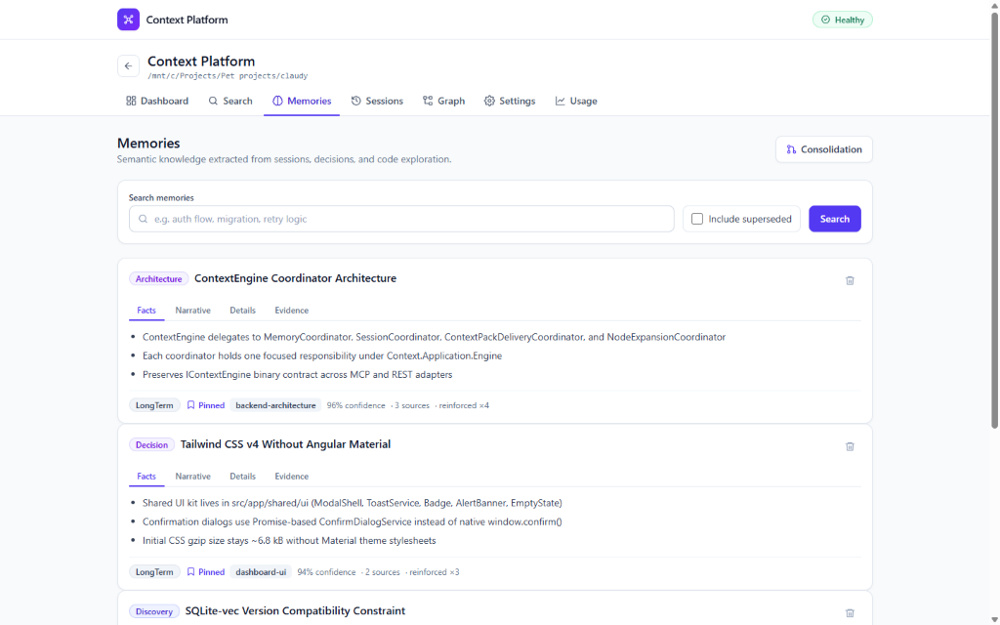
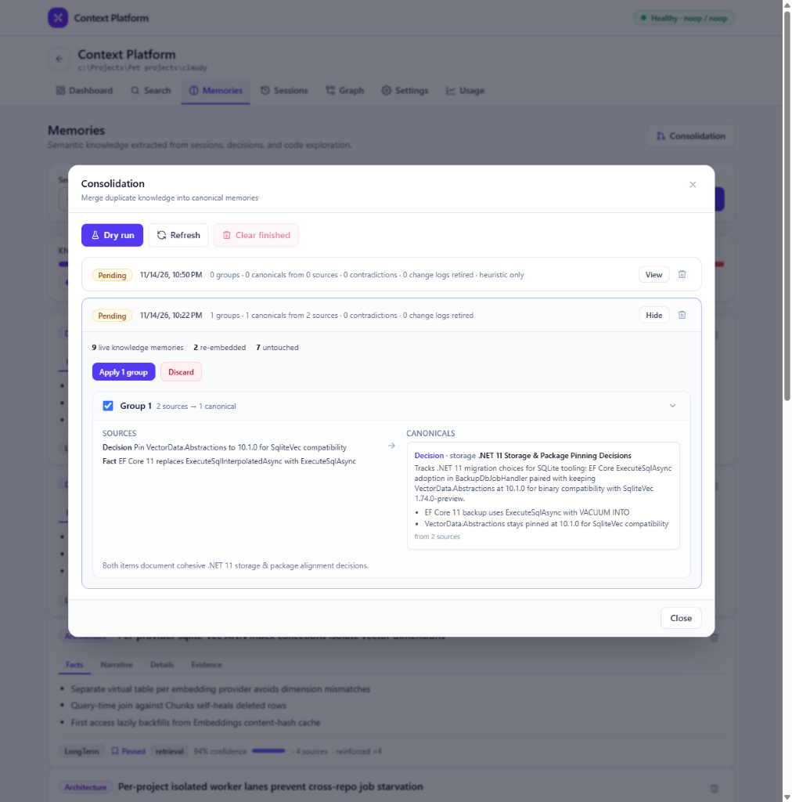
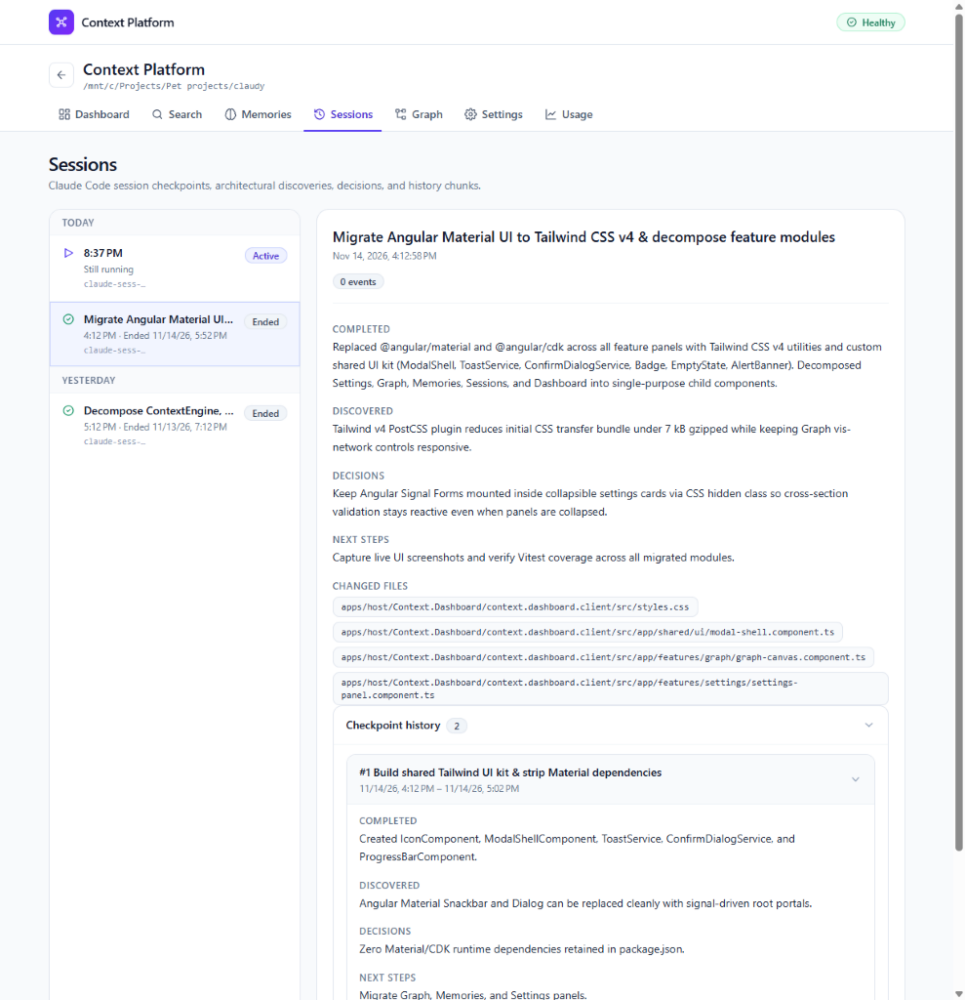
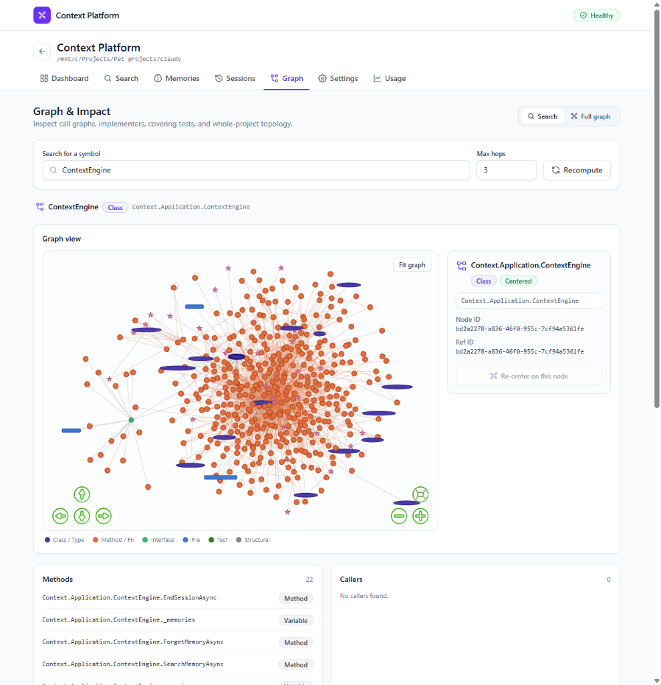
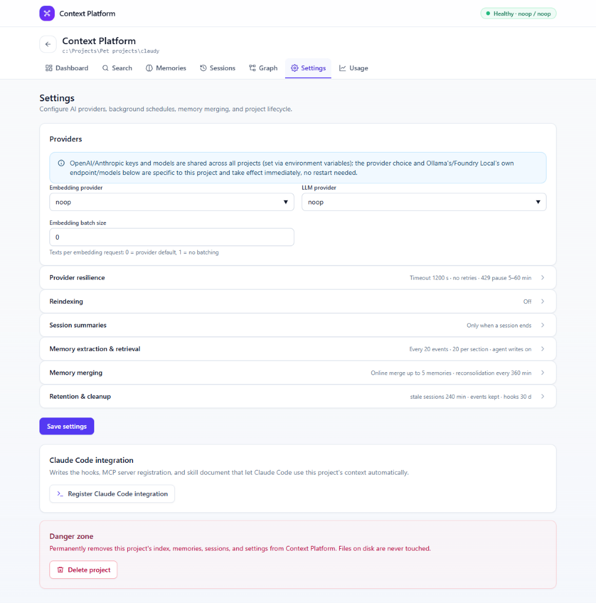
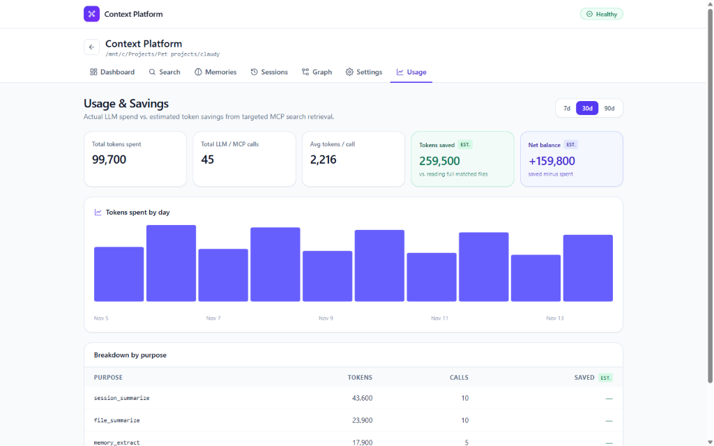

# Context Platform User Guide

**Language:** English | [Українська](../uk/USER_GUIDE.md)

This guide shows how to install Context Platform, explore your projects in the web dashboard, choose AI providers, and connect Claude Code.

---

## Contents

1. [Requirements](#1-requirements)
2. [How to Install and Run](#2-how-to-install-and-run)
3. [Dashboard Tour](#3-dashboard-tour)
4. [Choosing AI Providers](#4-choosing-ai-providers)
5. [Connecting Claude Code (MCP & Hooks)](#5-connecting-claude-code-mcp--hooks)
6. [Running Tests](#6-running-tests)
7. [Common Issues](#7-common-issues)

---

## 1. Requirements

| Tool | Minimum version | What it is used for |
| :--- | :--- | :--- |
| **.NET SDK** | `11.0.100` (`global.json`) | Building and running the backend server and tests |
| **Node.js & npm** | Node 22+ / npm 11+ | Building the Angular 22 + Tailwind CSS v4 frontend |
| **Ollama / Foundry Local** *(optional)* | Latest | Free local embeddings and chat models (`embeddinggemma`, `qwen2.5-coder:1.5b`) |
| **OpenAI / Anthropic API key** *(optional)* | — | Cloud models if you do not want to run local models |
| **Docker & Docker Compose** *(optional)* | 24+ | Running the app in a container (with optional Redis) |

---

## 2. How to Install and Run

### Option A: Local Development (Auto Reload)

1. Install frontend packages:
   ```bash
   cd apps/host/Context.Dashboard/context.dashboard.client
   npm ci
   ```
2. Start the backend in development mode:
   ```bash
   cd ../Context.Dashboard.Server
   dotnet run
   ```
   ASP.NET Core starts the Angular dev server (`ng serve`) automatically via `SpaProxy` and proxies API, hook, SignalR, and MCP requests.

### Option B: Standalone Production Build

Build the frontend and bundle it with the .NET server:

```bash
# 1. Build the Angular client
cd apps/host/Context.Dashboard/context.dashboard.client
npm ci
npm run build
cd ../../../..

# 2. Publish the server and copy static assets into wwwroot/
dotnet publish apps/host/Context.Dashboard/Context.Dashboard.Server -c Release -o ./publish/host
cp -r apps/host/Context.Dashboard/context.dashboard.client/dist/dashboard/browser/* ./publish/host/wwwroot/

# 3. Choose where SQLite data is stored and start the server
export CONTEXT_PLATFORM_DATA_DIR="$HOME/.local/share/context-platform"
dotnet exec ./publish/host/Context.Dashboard.Server.dll
```

For `systemd` or Windows Service setup scripts, see [deploy/README.md](../../deploy/README.md).

### Option C: Docker Compose

```bash
export CONTEXT_PLATFORM_ADMIN_TOKEN="$(openssl rand -base64 32)"
export HOST_PROJECT_PATH="/path/to/your/repo"

docker compose up -d --build
```

> **Note for Docker + Ollama:** In a container, `OllamaHostFallbackHandler` tries `host.docker.internal` and `172.17.0.1` automatically. If your host firewall blocks port `11434` from containers, run `Context.Dashboard.Server` directly on your machine or inside WSL2 instead.

---

## 3. Dashboard Tour

Open [http://127.0.0.1:47923](http://127.0.0.1:47923) in your browser. On localhost (`127.0.0.1`), the dashboard fetches an admin token automatically, so there is no login step.

### 3.1. Projects

The home page shows your registered repositories with quick access to add or remove a project.



- Click **New project** and use the built-in folder browser to pick any local repository.
- Creating a project prints a per-project setup link and bearer token if you need to configure external tools manually.

---

### 3.2. Project Dashboard

The **Dashboard** tab gives a live overview of indexing status, background jobs, server health, and recent Claude Code hook activity.



- **Summary cards:** files indexed, symbols mapped, memories stored, and last index time.
- **Quick actions:**
  - **Reindex changed files** — updates only files modified since the last run.
  - **Full reindex** — scans every file and rebuilds symbols and graph links.
  - **Rebuild vectors** — recreates vector embeddings (useful after switching embedding models).
  - **Cancel running index** — stops an active reindex job cleanly.
- **Server & job queue:** live health checks for the database, job dispatcher, and MCP endpoint, an interactive donut chart of `Pending`, `Running`, `Failed`, and `Completed` jobs, a **Host logs** modal, and **Retry failed** / **Clear completed** buttons.
- **Recent hooks:** real-time stream of Claude Code hooks as they run.

---

### 3.3. Search

The **Search** tab lets you run the exact same queries Claude Code uses via MCP tools.



- **Context Pack (`context_search`)** builds a token-budgeted bundle with code hits, relevant memories, open issues, and a short architecture overview.
- **Code Search (`code_search`)** returns raw ranked code matches without memory sections.
- **Advanced options** let you filter by path or language scope and adjust the token budget.

---

### 3.4. Memories & Consolidation

The **Memories** tab stores long-term notes extracted from your coding sessions.



- **Filter by type or keyword:** quickly filter by `Decision`, `Architecture`, `Constraint`, `Behavior`, `Configuration`, `Discovery`, `Procedure`, `Issue`, or `Fact`, or include older superseded records.
- Each card separates short bullet **Facts** from the longer **Narrative**, tracks confidence and source count, shows file/symbol **Evidence** verified against your code, and lets you **Pin** or **Delete** a memory.

#### Merging Similar Memories (`Consolidate`)



1. Click **Consolidate** and run a **Dry preview** first — nothing in the database changes yet.
2. Review each group (`Sources -> Canonicals`), detected **Contradictions**, outdated **Change logs to retire**, and code verification tags (`Verified`, `Refuted`, `Unknown`).
3. Uncheck any group you want to skip, then click **Apply** or **Discard**.

---

### 3.5. Sessions

The **Sessions** tab groups Claude Code sessions by date and shows structured summaries (`Completed`, `Discovered`, `Decisions`, `OpenIssues`, `NextSteps`, and `ChangedFiles`), plus periodic/compaction **Checkpoints**.



---

### 3.6. Code Graph & Blast Radius

The **Graph** tab draws symbol dependencies using Tree-sitter AST data and `vis-network`.



- Search for any class, record, interface, property, or method and set **Max hops** (default `3`).
- Inspect **Callers**, **Implementers**, and **Covering tests** below the graph, click any node to inspect or re-center on it, or switch to **Full graph** to view the whole project.

---

### 3.7. Settings

The **Settings** tab updates provider choices, retry limits, schedules, memory rules, and Claude Code registration on the fly — **no server restart needed**.



---

### 3.8. Usage & Savings

The **Usage** tab tracks real LLM token costs separately from estimated tokens saved when Claude fetches targeted code snippets instead of reading full files.



- Switch time windows (`7d`, `30d`, `90d`), toggle **Daily activity** series (`Both`, `Spent`, `Saved est.`), and inspect costs and estimated savings grouped by purpose.

---

## 4. Choosing AI Providers

| Provider | Default models | Good for |
| :--- | :--- | :--- |
| **`noop`** | Built-in deterministic | Zero setup, offline testing, FTS5 search, and call-graph impact analysis |
| **`ollama`** | `embeddinggemma` + `qwen2.5-coder:1.5b` | Private local semantic search and automatic memory extraction |
| **`foundry`** | `qwen3-embedding-0.6b` + `phi-3.5-mini` | Local Windows/cross-platform inference via Microsoft Foundry Local |
| **`openai`** / **`anthropic`** | `text-embedding-3-small` / `claude-3-5-sonnet-20241022` | Highest extraction quality (API keys read from env vars; secrets redacted before sending) |

---

## 5. Connecting Claude Code (MCP & Hooks)

Open **Settings** for your project and click **Register Claude Code integration** (or call `POST /api/projects/{id}/claude/install`). Context Platform backs up any existing config and writes:

- `.mcp.json` — registers 13 MCP tools (`context_search`, `code_search`, `symbol_search`, `memory_search`, `memory_get`, `memory_remember`, `memory_forget`, `graph_neighbors`, `graph_path`, `graph_impact`, `session_search`, `session_get`, `project_info`).
- `.claude/settings.json` & `.claude/hooks/*` — wires 6 lifecycle hooks (`SessionStart`, `UserPromptSubmit`, `PostToolUse`, `PostCompact`, `Stop`, `SessionEnd`).
- `.claude/skills/context-memory/SKILL.md` — tells Claude when to prefer MCP search and impact tools over scanning files manually.

---

## 6. Running Tests

Backend (.NET 11):
```bash
dotnet test ContextPlatform.slnx --no-restore
```

Frontend (Angular 22 / Vitest):
```bash
cd apps/host/Context.Dashboard/context.dashboard.client
npm test -- --watch=false
npm run build
```

---

## 7. Common Issues

- **Dashboard returns `404` on `/` in Release mode:** make sure you built the Angular app (`npm run build`) and copied `dist/dashboard/browser/*` into `wwwroot/` next to `Context.Dashboard.Server.dll`. In development, run `dotnet run` so `SpaProxy` serves the SPA.
- **`401 Unauthorized` when bound to `0.0.0.0`:** auto admin-token bootstrap is restricted to localhost (`127.0.0.1`). Set `CONTEXT_PLATFORM_ADMIN_TOKEN` explicitly when exposing non-loopback addresses.
- **No vector matches after changing embedding providers:** click **Rebuild vectors** on the **Dashboard** tab so `sqlite-vec` indexes vectors matching the new model dimensions.
- **Docker container cannot reach local Ollama:** check firewall rules on port `11434` or run `Context.Dashboard.Server` directly on the host OS / WSL2.
