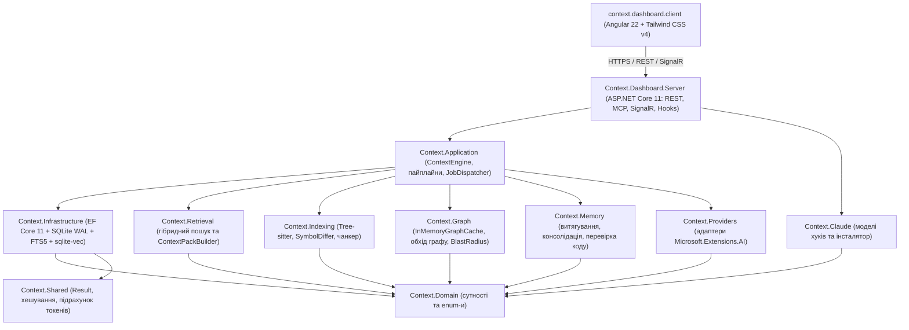
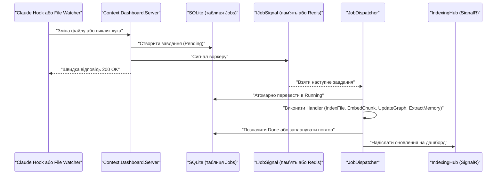
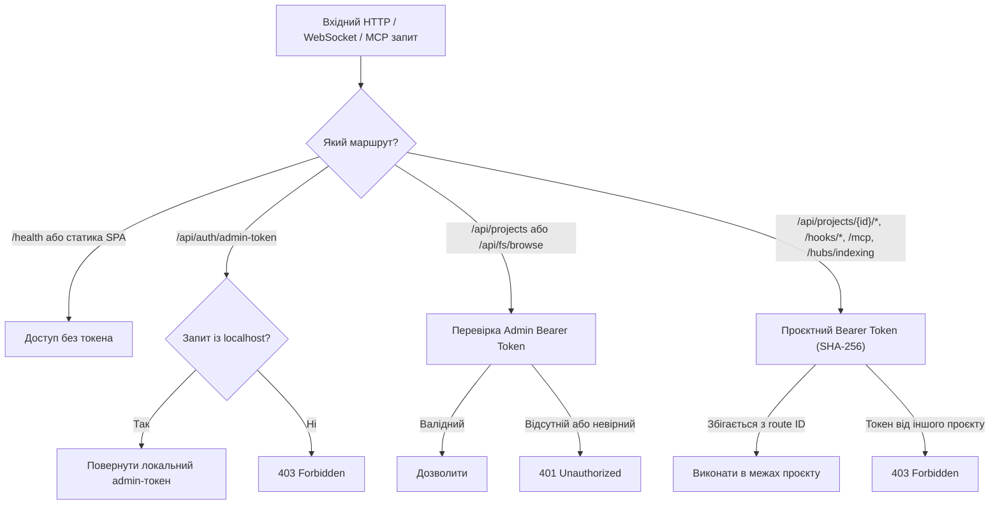

# Архітектура системи Context Platform

**Мова / Language:** Українська | [English](../en/ARCHITECTURE.md)

Цей документ просто й по суті пояснює шари системи, зберігання даних у SQLite, роботу фонових черг, SignalR-події та модель безпеки.

---

## 1. Модулі та шари

Рішення `ContextPlatform.slnx` (.NET 11) побудоване за принципом чистої архітектури: базові сутності та інтерфейси не залежать від ASP.NET Core чи конкретного драйвера бази даних.

### Призначення проєктів

| Проєкт | Відповідальність |
| :--- | :--- |
| **`Context.Domain`** | Чисті сутності (`Project`, `File`, `Symbol`, `Chunk`, `Embedding`, `GraphNode`, `GraphEdge`, `Session`, `SessionSummary`, `Memory`, `Job`, `UsageRecord`, `HookInvocation`) та enums |
| **`Context.Shared`** | Спільні утиліти: `Result<T>`, `TokenEstimator`, `DisclosureLevel`, потокове SHA-256 хешування (`Hashing`), генератор токенів |
| **`Context.Indexing`** | Сканер файлів (з урахуванням вкладених `.gitignore`), парсери Tree-sitter (`C#`, `TS`, `TSX`, `JS`, `Python`), diff символів і розбиття на чанки |
| **`Context.Graph`** | Потокобезпечний кеш графу в памʼяті, адаптер збереження в БД, найкоротші шляхи та оцінка впливу змін (`BlastRadius`) |
| **`Context.Providers`** | Клієнти AI (`NoOp`, `Ollama`, `Foundry Local`, `OpenAI`, `Anthropic`), редагування секретів, ретраї й лексичний реранкер |
| **`Context.Retrieval`** | Гібридний пошук (`HybridSearchEngine`), зважування сигналів (`HybridScorer`) і збірка контексту в межах бюджету (`ContextPackBuilder`) |
| **`Context.Memory`** | Підсумки сесій, витягування знань, онлайн-дедуплікація, пакетна реконсолідація й перевірка фактів по коду |
| **`Context.Claude`** | DTO 6 хуків Claude Code та безпечний інсталятор `.mcp.json`, `.claude/settings.json`, скриптів і skill-інструкції |
| **`Context.Infrastructure`** | `ContextDbContext` (SQLite WAL), повнотекстовий FTS5, векторні індекси `sqlite-vec` і репозиторії |
| **`Context.Application`** | Фасад `IContextEngine`, індексування, фонові планувальники, сервіси обслуговування БД та `JobDispatcher` |
| **`Context.Dashboard.Server`** | Minimal API, MCP-сервер, ендпоїнти хуків і SignalR-хаб без прямих запитів до `DbContext` |
| **`context.dashboard.client`** | Односторінковий додаток Angular 22 (Signals + `OnPush`) зі стилями Tailwind CSS v4 |

---

## 2. Розподіл відповідальностей та надійність

Складні вузли розділені на невеликі сервіси з чіткими контрактами:

- **`ContextEngine` (`Context.Application/Engine/`):** делегує запити чотирьом координаторам (`ContextPackDeliveryCoordinator`, `NodeExpansionCoordinator`, `MemoryCoordinator`, `SessionCoordinator`) та `MemorySearchHelper`.
- **Пайплайн індексації (`Context.Application/Indexing/`):**
  - `ParsedFileIndexer` витягує символи й звʼязки, очищає XML-коментарі для пошукових чанків, зберігає ID незмінених чанків (щоб не втрачати готові вектори) і при пакетному оновленні відкладає побудову ребер графу.
  - `UnparsedFileIndexer` індексує конфіги й документацію з потоковим хешуванням без зайвих алокацій памʼяті.
  - `IndexingPipeline` спочатку зберігає символи всіх змінених файлів, а потім запускає `UpdateGraph` і `ResolveRelations` — завдяки цьому виклики між файлами незалежно від алфавітного порядку імен знаходять свої цілі.
- **Черга завдань (`Context.Application/Jobs/`):** `JobDispatcher` поєднує per-project черги (`JobLane`), пул воркерів (`JobExecutionRunner`), експоненціальні повтори (`JobRetryPolicy`), коректне завершення (`IDisposable`) і моніторинг стану (`IJobDispatcherHealth`).
- **Ізоляція хоста (`Context.Dashboard.Server`):** ендпоїнти та SignalR-хаби працюють лише через абстракції `Context.Application` та репозиторії (`IStorageMaintenanceService`, `ISessionRepository`, `IProjectRepository`).

---

## 3. Архітектура фронтенду (Angular 22 + Tailwind CSS v4)

Клієнт не використовує `@angular/material`, `@angular/cdk` чи важкі анімаційні бібліотеки — лише **Tailwind CSS v4** та легкі standalone-компоненти:

- **Спільні елементи (`src/app/shared/ui/`):** доступні модальні вікна `ModalShellComponent` (`aria-labelledby`, `Escape`), SVG-іконки (`IconComponent`), сповіщення (`ToastContainerComponent`), черга діалогів підтвердження (`ConfirmDialogService`) і графіки (`DonutChartComponent`, `ActivityBarChartComponent`).
- **Надійність та живі оновлення:**
  - `authInterceptor` обʼєднує одночасні відповіді `401` для одного проєкту в один запит оновлення токена без зайвих ротацій.
  - `AdminTokenService` не кешує помилки назавжди — після тимчасової недоступності сервера наступний запит повториться нормально.
  - `SignalrService` серіалізує `joinProject` / `leaveProject`, автоматично відновлює зʼєднання після перезапуску сервера і повідомляє панелі про перепідключення через `reconnected$`.
  - Компоненти використовують `OnPush`, скасовують старі HTTP-запити при перемиканні проєктів і не перезаписують незбережені зміни форми в `Settings`.

---

## 4. Зберігання даних і фонові завдання

Усі проєктні дані знаходяться в одному SQLite-файлі (`context.db` у `CONTEXT_PLATFORM_DATA_DIR`) із режимом WAL та зовнішніми ключами:

- **Кеш `Embeddings`:** привʼязаний до `(ContentHash, Provider)`, щоб не перераховувати вектори для незміненого коду.
- **Таблиці `sqlite-vec`:** розділені по провайдерах (`chunk_vectors_{provider}`), щоб моделі з різною розмірністю векторів не конфліктували.
- **Повнотекстовий індекс FTS5 (trigram):** підтримує пошук по підрядках, `CamelCase`/`snake_case` і доповнюється fallback-пошуком `LIKE` для коротких 1–2-символьних токенів.

---

## 5. Модель безпеки

Сервер працює за принципом *fail closed* і суворо розділяє доступи між проєктами:

- **Локальна зручність і безпека на сервері:** на `127.0.0.1` адмін-токен створюється автоматично; при запуску на `0.0.0.0` потрібно явно задати `CONTEXT_PLATFORM_ADMIN_TOKEN`.
- **Ізоляція проєктів:** у базі зберігається лише SHA-256 хеш токена (`BearerTokenHash`); токен одного проєкту не має доступу до іншого.
- **Очищення секретів:** `SecretRedactor` приховує API-ключі й токени перед передачею текстів у OpenAI або Anthropic.
