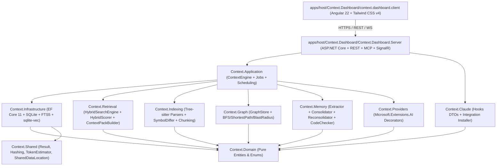
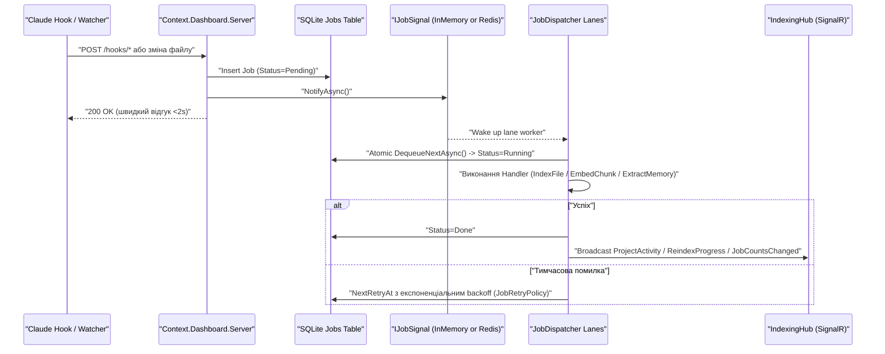
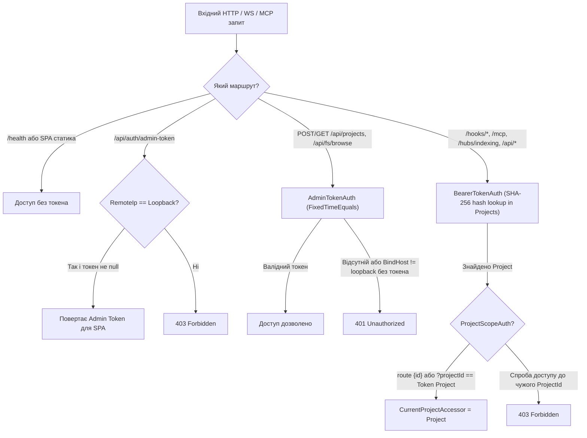

# Архітектура системи Context Platform

Цей документ детально описує архітектурні рішення, модульну декомпозицію backend-рішення `.NET 11` та клієнта `Angular 22 + Tailwind CSS v4`, модель зберігання даних, асинхронну чергу завдань, SignalR-події та дворівневу модель безпеки.

---

## 1. Модульна структура та правило залежностей

Рішення `ContextPlatform.slnx` побудоване за принципом чистої багатошарової архітектури з чіткими межами абстракцій (`Abstractions/` у кожному модулі):

### Огляд проєктів у `src/` та `apps/`

| Проєкт | Відповідальність |
| :--- | :--- |
| **`Context.Domain`** | Чисті POCO-сутності (`Project`, `File`, `Symbol`, `Chunk`, `Embedding`, `GraphNode`, `GraphEdge`, `Session`, `SessionSummary`, `Memory`, `MemoryEvidence`, `MemoryConsolidationReport`, `Job`, `UsageRecord`, `HookInvocation`) та enums без зовнішніх залежностей |
| **`Context.Shared`** | Базові утиліти: `Result<T>`, `TokenEstimator`, `DisclosureLevel`, `BearerTokenGenerator`, `Hashing` (SHA-256), `SharedDataLocation` |
| **`Context.Indexing`** | Сканування файлової системи (`FileSystemScanner`, `.gitignore`), **Tree-sitter** парсери (`C#`, `TS`, `TSX`, `JS`, `Python`), інкрементальний diff символів (`SymbolDiffer`) та чанкер |
| **`Context.Graph`** | Збереження графових вузлів/ребер і алгоритми обходу (`NeighborsAsync`, `NeighborhoodAsync`, `FullGraphAsync`, `ShortestPathAsync`, `BlastRadiusAsync`) |
| **`Context.Providers`** | Адаптери поверх `Microsoft.Extensions.AI` (`IEmbeddingGenerator`, `IChatClient`) для `NoOp`, `Ollama` (з `OllamaHostFallbackHandler` і ретраями), `Foundry Local`, `OpenAI` та `Anthropic` + `SecretRedactor` та `LexicalOverlapReranker` |
| **`Context.Retrieval`** | 5-сигнальний `HybridScorer`, `HybridSearchEngine` і токенний бюджетувальник `ContextPackBuilder` |
| **`Context.Memory`** | Витягування памʼяті з подій/компакт-саммарі, онлайн-консолідація, кластерна реконсолідація, верифікація тверджень у коді (`MemoryCodeChecker`) |
| **`Context.Claude`** | Типізовані вхідні/вихідні DTO 6 хуків, інсталятор `.mcp.json`, hook-скриптів (`.ps1`/`.sh`), `settings.json` із бекапами |
| **`Context.Infrastructure`** | `ContextDbContext` (SQLite WAL), FTS5-індекси, `SqliteChunkVectorIndex` (`Microsoft.SemanticKernel.Connectors.SqliteVec`), реалізації репозиторіїв |
| **`Context.Application`** | Фасад `IContextEngine`, координатори, пайплайн індексації, `JobDispatcher` із чергами по проєктах та фонові планувальники |
| **`Context.Dashboard.Server`** | Minimal API ендпоїнти (`Api/`), SignalR-хаб (`Hubs/`), MCP-сервер (`Mcp/`), хостинг SPA і двошарова автентифікація (`Security/`) |
| **`context.dashboard.client`** | Односторінковий додаток Angular 22 (standalone-компоненти + Signals) зі стилізацією на Tailwind CSS v4 |

---

## 2. Декомпозиція складних backend-підсистем

У процесі рефакторингу монолітні класи у `Context.Application`, `Context.Memory` та `Context.Dashboard.Server` були розбиті на вузькоспеціалізовані класи (один тип на файл із чіткими межами абстракцій):

### А. `Context.Application`: `ContextEngine`, `IndexingPipeline`, `JobDispatcher`
- **`ContextEngine` (`Engine/`):** замість 500+ рядків змішаної логіки фасад делегує роботу пʼяти координаторам:
  - `ContextPackDeliveryCoordinator` — збірка `ContextPack` + дедуплікація в межах активної сесії (`SessionDeliveryCache`);
  - `NodeExpansionCoordinator` — прогресивне розкриття (`L0` / `L1` / `L2`) та графовий blast radius;
  - `MemoryCoordinator` + `MemorySearchHelper` — гібридний пошук спогадів, перегляд доказів і явні `Remember` / `Forget`;
  - `SessionCoordinator` — старт/завершення сесій, облік подій, тригер батчів та семантичний пошук по `SessionSummaryChunk`.
- **`IndexingPipeline` (`Indexing/`):** декомпозований на:
  - `ParsedFileIndexer` — парсинг підтримуваних мов через Tree-sitter, оновлення символів і графу;
  - `UnparsedFileIndexer` — індексація конфігів/документації без AST;
  - `ChunkEmbedScheduler` — хеш-дедуплікація та планування батч-завдань `EmbedChunk`.
- **`JobDispatcher` (`Jobs/`):** розділений на `JobLane` (керування квотою слотів на проєкт та shared-воркерів), `JobExecution` (ізольований контекст запуску та cancellation) і `JobExecutionRunner` (політики `JobRetryPolicy`, `JobDeferredException` та транзакційне оновлення статусів).

### Б. `Context.Memory/Consolidation`
- **Онлайн-консолідація (`MemoryConsolidator`):** розбита на `IncomingMemory`, `ConsolidationNeighbourFinder` (пошук близьких векторів + лексичних кандидатів), `CandidateRelationAssessor` (класифікація `Same`/`Updates`/`Contradicts`/`Unrelated`), `OnlineMergeExecutor` і `ConsolidationOutcomeWriter`.
- **Пакетна реконсолідація (`MemoryReconsolidator`):** розбита на `DisjointSets` (Union-Find кластеризація), `ReconsolidationItem`, `ReconsolidationGroupPlan`, `ReconsolidationClusterer`, `ReconsolidationPlanner` (генерація dry-run плану + перевірка по коду) та `ReconsolidationApplier` (атомарне застосування або відкат).

### В. `Context.Dashboard.Server`
- **`Startup/`:** `Program.cs` скорочено до точки входу в 47 рядків, винісши бутстрап у `HostBootstrap`, DI-конфігурацію в `DashboardServiceCollectionExtensions`, міграцію БД та маршрутизацію у `DashboardApplicationExtensions`, і таймер аптайму в `HostStartTime`.
- **`Mcp/`:** монолітний `ContextMcpTools` розділений за доменами на `CodeSearchMcpTools`, `MemoryMcpTools`, `GraphMcpTools` і `SessionMcpTools` зі спільними хелперами `McpNodeResolver` та `McpSavingsTracker`.
- **`Hooks/`:** `HookEndpoints` делегує побудову fail-open додаткового контексту у `HookContextBuilder`.

---

## 3. Архітектура фронтенду (Angular 22 + Tailwind CSS v4)

Фронтенд повністю позбувся `@angular/material`, `@angular/cdk` та `@angular/animations`, зменшивши початковий бандл до ~97 kB gzip і перейшовши на чисту утилітарну дизайн-систему **Tailwind CSS v4** (`@tailwindcss/postcss`).

### Дизайн-система `src/app/shared/`
У `shared/ui/` створено легковаговий набір доступних компонентів на Angular Signals:
- **`IconComponent`** — інлайновані SVG-іконки (`heroicons`/`custom`) без зовнішніх іконкових шрифтів;
- **`ModalShellComponent`** — універсальна оболонка модалок із `Escape`-закриттям, backdrop blur та керуванням фокусом;
- **`ToastService` + `ToastContainerComponent`** — сигнал-керовані сповіщення (`info`, `success`, `warning`, `error`);
- **`ConfirmDialogService` + `ConfirmDialogComponent`** — декларативні діалоги підтвердження через Promise/Signal;
- **`BadgeComponent`, `AlertBannerComponent`, `EmptyStateComponent`, `ProgressBarComponent`, `SpinnerComponent`, `CollapsibleSectionComponent`**.

### Декомпозиція фіч (`src/app/features/`)
Великі панелі розбиті на вузькі presentational/feature-підкомпоненти:
- **Graph:** `graph-impact-panel` -> `symbol-autocomplete`, `graph-canvas` (`vis-network`), `graph-node-inspector`, `graph-impact-results`, `graph-styles.ts`;
- **Memories:** `memories-panel` -> `memory-card`, `consolidation-dialog` -> `consolidation-group-card`;
- **Settings:** `settings-panel` + `settings-form.model.ts` (Angular Signal Forms) -> `settings-providers-card`, `settings-section-card`, `settings-toggle`, `settings-actions-cards`;
- **Dashboard:** `dashboard-panel` -> `dashboard-jobs-card`, `dashboard-hooks-card`, `logs-dialog`;
- **Sessions:** `sessions-panel` -> `session-summary-fields`.

---

## 4. Зберігання даних та асинхронна черга завдань

Усі дані платформи зберігаються в єдиному багатопроєктному файлі SQLite (`context.db` у `CONTEXT_PLATFORM_DATA_DIR`) з режимом `PRAGMA journal_mode=WAL` та увімкненими зовнішніми ключами:

- **Таблиця `Embeddings` (content-addressable кеш):** ключ `(ContentHash, Provider)` запобігає повторним мережевим викликам для незмінених чанків і ізолює вектори різних провайдерів.
- **Колекції `sqlite-vec` (`SqliteChunkVectorIndex`):** окремі таблиці `chunk_vectors_{provider}` гарантують сумісну розмірність векторів. Завдяки join-перевірці до актуальних таблиць `Chunks`/`Files` видалені або переіндексовані чанки не потрапляють у результати пошуку, а нова векторна колекція автоматично дозаповнюється з кешу `Embeddings` або завданням `RepairVectors`.
- **Повнотекстовий пошук FTS5:** BM25-ранжування по фрагментах коду, іменах символів та файлових описах.

### Конвеєр завдань `JobDispatcher` + SignalR

---

## 5. Модель безпеки

Context Platform розрахований на безпечну локальну та контейнерну експлуатацію з принципом *fail closed* та ізоляцією проєктів (*multi-tenant defense-in-depth*):

1. **Admin Token (`AdminTokenProvider` + `AdminTokenAuth`):**
   - Керує створенням/переліком проєктів і переглядом серверної файлової системи.
   - На `127.0.0.1` генерується автоматично при старті (або читається з `CONTEXT_PLATFORM_ADMIN_TOKEN`) та передається клієнту через loopback-захищений `/api/auth/admin-token`.
   - При бінді на не-loopback адресу (`0.0.0.0`) без заданої змінної `CONTEXT_PLATFORM_ADMIN_TOKEN` сервер відмовляє у всіх адмін-запитах (*fail closed*).
2. **Пер-проєктний Bearer Token (`BearerTokenAuth` + `ProjectScopeAuth`):**
   - Кожен проєкт отримує унікальний криптографічний токен, у БД зберігається лише його SHA-256 хеш (`Project.BearerTokenHash`).
   - Фільтри `RequireOwnProjectFilter` та `RequireMatchingProjectIdFilter` перевіряють, щоб токен проєкту A ніколи не міг зчитати чи змінити налаштування, памʼять або граф проєкту B.
   - Для WebSocket-зʼєднань SignalR (`/hubs/indexing`) використовується `HubBearerTokenAuthMiddleware` (`?access_token=...`) без логування сирих query-рядків у Serilog.
3. **Захист секретів (`SecretRedactor`):** перед відправкою фрагментів коду чи промптів до зовнішніх хмарних провайдерів (`openai`, `anthropic`) декоратори автоматично редагують підрядки, схожі на API-ключі, токени й паролі.
