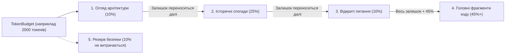
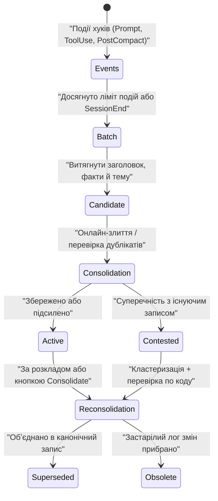

# Можливості, якість пошуку та чесна оцінка

**Мова / Language:** Українська | [English](../en/FEATURES.md)

Цей документ описує, як Context Platform індексує код, ранжує пошукові результати, формує бюджетні пакети контексту, працює з памʼяттю та де дає найбільшу практичну користь (включно з обмеженнями).

---

## 1. Гібридний пошук по коду (`HybridSearchEngine`)

Самі лише вектори часто гублять точні назви методів, а простий текстовий пошук не розуміє синонімів. Context Platform поєднує сигнали, масштабовані до `[0, 1]`:

```text
score = 0.235 * lexical(FTS5) + 0.529 * vector(sqlite-vec) + 0.235 * graph_proximity
```

*(Базові ненормалізовані ваги: `LexicalWeight = 0.20`, `VectorWeight = 0.45`, `GraphWeight = 0.20`, `RecencyWeight = 0.0`, `MemoryWeight = 0.0`.)*

Основні деталі пошуку:

1. **Підтримка CamelCase і коротких токенів:** `SqliteSearchIndex` розбиває ідентифікатори на слова (запит `"validateToken"` знаходить `validate` і `token`), відкидає службові слова, має fallback `LIKE` для коротких 1–2-символьних токенів (`id`, `db`) та вирізає сніпети навколо знайденого місця.
2. **Зниження шуму від тестів:** без фільтра `scope` робочий код отримує вищий пріоритет за тестові файли (`tests/` / `*Tests.cs`), а при явному скоупі `tests/` тести повертаються без зниження рангу.
3. **Прогрів графу і реранкінг:** `HybridSearchEngine` за потреби прогріває кеш графу, розширює результати сусідами по графу викликів і оновлює фінальний порядок для `ContextPackBuilder`.

---

## 2. Пакети контексту в межах бюджету (`ContextPackBuilder`)

Кожен виклик `context_search` або змістовний хук `UserPromptSubmit` вкладається у заданий `TokenBudget` (за замовчуванням `2000` токенів):



- **Перенесення бюджету:** невикористані токени зі спогадів або відкритих питань автоматично передаються у секцію `PrimaryHits`.
- **Захист головного збігу:** найкращий за релевантністю фрагмент коду гарантовано потрапляє першим — дрібні 1-токенні збіги не витісняють його.
- **Сесійна дедуплікація та фільтр хуків:** незмінені фрагменти не надсилаються двічі в межах однієї сесії Claude Code, а короткі репліки на кшталт `"ok"`, `"thanks"`, `"/compact"` фіксуються в журналі без зайвого запуску пошуку.

---

## 3. Tree-sitter AST та радіус ураження змін (`graph_impact`)

Індексація коду працює локально без участі LLM:

- **Підтримувані мови:** `C#`, `TypeScript`, `TSX`, `JavaScript`, `JSX`, `Python` (плюс текстове індексування Markdown, JSON, YAML і конфігів).
- **Сучасний синтаксис і звʼязки:** розпізнає класи, `record` і `record struct`, структури, інтерфейси, методи, властивості (зокрема expression-bodied `=>`), виклики між файлами, посилання на типи, успадкування/реалізацію та тести (`[Fact]`, `[Theory]`, `[Test]`).
- **Інкрементальне збереження векторів:** `SymbolDiffer` порівнює сигнатури й тіла функцій, зберігаючи наявні ID чанків і ембединги для незміненого коду та вхідні ребра графу при переіндексації файлу.
- **Blast Radius (`BlastRadiusAsync`):** повертає три списки — **Callers**, **Implementers** і **CoveringTests** як для окремого методу, так і сумарно по класу/інтерфейсу.

---

## 4. Багаторівнева памʼять та консолідація

Платформа перетворює події сесій на структуровані інженерні знання:



- **Офлайн- і онлайн-дедуплікація:** навіть без чат-LLM `MemoryRelationJudge` поєднує векторну схожість із перетином змістовних слів і спільними ключовими сутностями (файли, символи, конфіги), щоб не плодити однакові спогади.
- **Перевірка по коду (`MemoryCodeChecker`):** звіряє згадані символи та шляхи з поточним індексом (`Verified`, `Refuted`, `Unknown`).

---

## 5. Чесний аналіз ефективності та реальні виміри

Ми перевірили платформу на реальних інтеграційних бенчмарках (`RetrievalQualityHarnessTests` у `Context.IntegrationTests` поверх реальних SQLite WAL, FTS5, `sqlite-vec` і Tree-sitter в офлайн-режимі `noop` без моків пошуку):

### Спостережені результати тестів (офлайн-режим)

| Бенчмарк | Що перевіряється | Результат |
| :--- | :--- | :--- |
| **Набір запитів природною мовою** (21 запит, 12 модулів C#) | Пошук за перефразуванням описів методів | **`hit-rate@5 = 1.000` (21/21)**, **`MRR = 1.000`** |
| **Сучасний C# набір** (5 запитів + граф + ContextPack) | `record` (`TokenValidationResult`), `record struct` (`TokenScope`), camelCase-запит, пріоритет коду над `tests/`, порядок `ContextPackBuilder` | **`hit-rate@5 = 1.000` (5/5)**, **`MRR = 0.867`**, робочий файл на 1-му місці вище за тест; `ContextPack` повернув 12 збігів (~571 токен) у порядку спадання скору |
| **Міжфайловий Blast Radius** (`AlphaController` -> `BillingTokenValidator` -> тести) | Виклики з файлів раніше за алфавітом (`A -> B`), property getters, `[Fact]` звʼязки, агрегація по класу | Для методу: **`4` callers, `1` covering test**; для класу: **`6` callers, `1` covering test** |

### Коли Context Platform дає найбільше користі (та які є обмеження)

**Найбільша практична користь:**
- **Великі багатофайлові кодові бази:** точний пошук символів, їхніх викликів і покриття тестами через `code_search`, `symbol_search` і `graph_impact` позбавляє агента необхідності читати десятки зайвих файлів.
- **Довготривалий контекст між сесіями:** структуровані контрольні точки та факти (`Completed / Decisions / OpenIssues / NextSteps`) після `/compact` і між робочими днями реально економлять час на повторне введення агента в курс справи.
- **Приватність та передбачуваність:** AST-індексація, граф викликів і FTS5 працюють локально без LLM, а `McpSavingsTracker` не зараховує повторні звернення до того самого незміненого файлу протягом 10-хвилинного вікна.

**Чесні обмеження:**
- **Синоніми потребують ембединг-моделі:** у режимі `noop` вектори не несуть смислу; для семантичного пошуку без точного збігу слів потрібні **Ollama**, **Foundry Local** або **OpenAI**.
- **Авто-памʼять потребує чат-моделі:** пошук і граф не вимагають LLM, але автоматичне підсумовування сесій і витягування фактів із подій залежать від якості вибраної чат-моделі.
- **Економія токенів є оцінкою:** `SavedTokens` показує різницю між повним розміром знайдених файлів і розміром відданих фрагментів — це корисний орієнтир, а не точний білінг провайдера.
