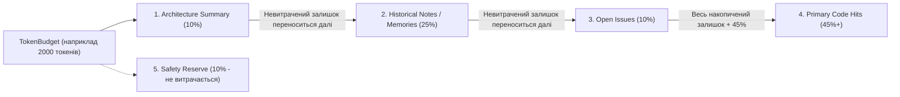
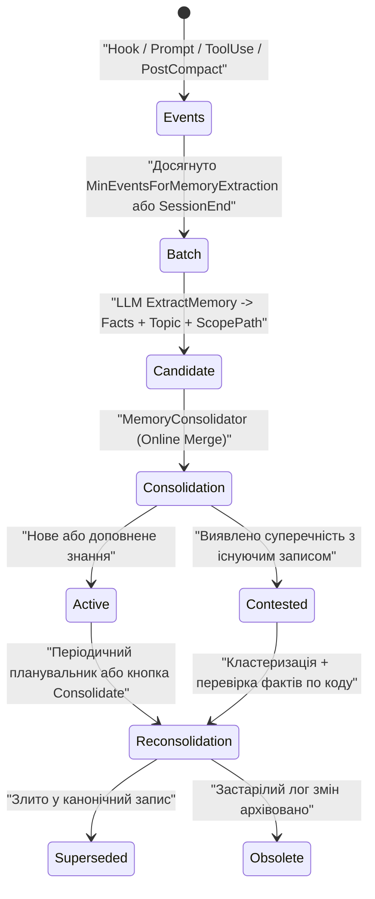

# Головні можливості та алгоритми Context Platform

Цей документ розкриває ключові інженерні механізми Context Platform: гібридне ранжування пошуку, бюджетування контекстних пакетів, AST-аналіз графу коду, багаторівневу памʼять із верифікацією та оцінку економії токенів.

---

## 1. Гібридний пошук (`HybridSearchEngine`) та 5-сигнальне ранжування (`HybridScorer`)

Замість покладання на єдиний метод (лише векторний пошук часто пропускає точні імена символів, а лише текстовий — не розуміє синонімів), пошуковий рушій комбінує нормалізовані до `[0, 1]` сигнали через min-max масштабування у `HybridScorer`:

$$\text{score} = w_{\text{lex}} \cdot S_{\text{lex}} + w_{\text{vec}} \cdot S_{\text{vec}} + w_{\text{graph}} \cdot S_{\text{graph}} + w_{\text{rec}} \cdot S_{\text{rec}} + w_{\text{mem}} \cdot S_{\text{mem}}$$

| Сигнал | Вага за замовчуванням | Джерело та призначення |
| :--- | :--- | :--- |
| **`LexicalWeight` ($w_{\text{lex}}$)** | `0.20 / 0.85` ($\approx 0.2353$) | Повнотекстовий пошук SQLite **FTS5 (BM25)** по коду, іменах символів та файлових резюме |
| **`VectorWeight` ($w_{\text{vec}}$)** | `0.45 / 0.85` ($\approx 0.5294$) | Семантична косинусна близькість через **ANN-індекс `sqlite-vec`** у колекції поточного провайдера |
| **`GraphWeight` ($w_{\text{graph}}$)** | `0.20 / 0.85` ($\approx 0.2353$) | Графова близькість до топових насіннєвих результатів (розширення на `GraphExpansionHops`) |
| **`RecencyWeight` ($w_{\text{rec}}$)** | `0.0` | Свідомо занулено в базовому кодовому пошуку, щоб bulk-переіндексація не вносила часовий шум |
| **`MemoryWeight` ($w_{\text{mem}}$)** | `0.0` | Памʼять бере участь окремо через бюджет `ContextPackBuilder` та пріоритезацію типів `MemoryTypeBonus` |

Після первинного скорингу:
1. Топ-кандидати проходять через `IRerankerProvider` (`LexicalOverlapReranker` за замовчуванням).
2. Семантичний буст (`SemanticBoostEnabled`, поріг `0.80`, фактор `+0.12`) додатково підіймає сильні смислові збіги.
3. При пошуку спогадів застосовується бонус за типом знань (`MemoryTypeBonus`): `Decision`, `Constraint`, `Architecture` мають `+0.15`, оперативні технічні знання (`Behavior`, `Discovery`, `Configuration`, `Procedure`, `Issue`) — `+0.10`, загальні `Fact` — `+0.05`.
4. Визначається намір запиту (`QueryIntent`): запити про відкриті проблеми/незавершені задачі автоматично перенаправляють акцент у відповідні секції.

---

## 2. Токенне бюджетування контекстних пакетів (`ContextPackBuilder`)

Коли Claude Code викликає `context_search` (або спрацьовує хук `UserPromptSubmit`), формується `ContextPack` у межах заданого `TokenBudget` (за замовчуванням 2000 токенів, оцінка через `TokenEstimator`).

- **Carry-Forward бюджету:** якщо історичні нотатки чи відкриті питання порожні або короткі, їхні невикористані токени не згорають, а автоматично додаються до бюджету секції `PrimaryHits` — так агент завжди отримує максимально інформативний пакет.
- **Дедуплікація в межах сесії (`SessionDeliveryCache`):** повторно доставлені незмінені фрагменти коду позначаються сигнатурою й не витрачають токени повторно впродовж однієї сесії.
- **Прогресивне розкриття (`DisclosureLevel`):** `L0_Metadata` (лише ідентифікатори та сигнатури) -> `L1_Summary` (опис + звʼязки) -> `L2_Full` (повний фрагмент коду).

---

## 3. Tree-sitter AST, інкрементальний diff символів і Blast Radius

Пайплайн індексації працює детерміністськи без LLM для побудови структурного каркасу коду:

1. **Нативний парсинг через Tree-sitter (`Parsers/TreeSitter/`):** підтримуються `.cs`, `.ts`, `.tsx`, `.js`, `.jsx`, `.py`. Парсер витягує класи, інтерфейси, методи, функції, властивості, коментарі документації та точні звʼязки (`Calls`, `References`, `Extends`, `Implements`, `Imports`, `Exports`, `Tests`) включно з викликами методів екземпляра (`this.Foo()`, `obj.Bar()`) та посиланнями на групи методів (`.Select(Foo)`).
2. **Інкрементальне порівняння (`SymbolDiffer`):** для кожного символу обчислюються два SHA-хеші: `SignatureHash` та `BodyHash`. Якщо змінилося лише тіло приватної функції, не потрібно ламати всі вхідні звʼязки графу.
3. **Непарсовані файли та File Wiki (`IFileSummarizer`):** файли документації/конфігурації індексуються через `UnparsedFileIndexer`, а при увімкненому LLM для кожного файлу генерується коротке семантичне резюме (`Chunk.SymbolId = null`), доступне в загальному пошуку.
4. **Аналіз впливу змін (`graph_impact` / `BlastRadiusAsync`):** за заданий символ і глибину `maxHops` граф обчислює три списки: прямі й транзитивні **Callers**, **Implementers** інтерфейсів/базових класів і **CoveringTests**.

---

## 4. Життєвий цикл багаторівневої памʼяті та реконсолідація

Context Platform перетворює потік сирих інструментальних подій у перевірену довготривалу базу знань:

### Ключові механізми якості памʼяті:
- **Контрольні точки сесій (`SessionSummaryChunk`):** тривале обговорення автоматично розбивається на хронологічні чанки при спрацьовуванні `/compact` (`PostCompact`) або за таймером (`SessionSummaryScheduler`), зберігаючи структуру `Completed / Discovered / Decisions / OpenIssues / NextSteps`.
- **Атомарні факти + наратив (`FactsJson` + `Body`):** поруч із розгорнутим текстом кожен спогад зберігає 2–5 стислих фактів, що радикально скорочує розмір секції `HistoricalNotes`.
- **Онлайн-злиття (`OnlineMergeExecutor`):** при збереженні нового знання система знаходить до `OnlineMergeMaxSources` семантично близьких сусідів і вирішує: створити новий запис, підсилити існуючий (`ReinforcementCount++`), обʼєднати факти або зафіксувати конфлікт (`Contested`).
- **Перевірка по реальному коду (`MemoryCodeChecker`):** під час пакетної реконсолідації планувальник перевіряє згадані у фактах символи та файли на наявність у поточному індексі проєкту, позначаючи результат як `Verified`, `Refuted` або `Unknown`.
- **Прямий контроль агента (`memory_remember` / `memory_forget`):** за згодою в налаштуваннях (`ExplicitRememberEnabled`) Claude може миттєво записувати критичні рішення чи видаляти хибні нотатки, які одразу потрапляють до черги фонових завдань.

---

## 5. Перемикання провайдерів на льоту та телеметрія економії токенів

### Live-конфігурація без рестарту (`ProjectProviderResolver`)
Кожен проєкт має ізольовану конфігурацію в `Project.ConfigJson` (опціонально дзеркалиться в `.claude/context-platform.local.json`). `ProjectProviderResolver` зчитує актуальні налаштування проєкту перед викликом і кешує клієнти `Microsoft.Extensions.AI` за ключем `(provider, baseUrl, model, resilience, batchLimits)`. Перемикання між `noop`, `ollama`, `foundry` або хмарними провайдерами на будь-якому проєкті набуває чинності негайно.

### Облік витрат та економії (`McpSavingsTracker` + `UsageRecord`)
Для обʼєктивної оцінки користі платформа веде два чітко розділених показники:
1. **Фактичні витрати LLM (`TotalTokens`):** токени, витрачені фоновими завданнями саммаризації, витягування та консолідації памʼяті.
2. **Контрфактуальна економія MCP (`SavedTokens`):** коли `code_search` або `context_search` віддає агенту точні фрагменти коду, `McpSavingsTracker` порівнює їхній розмір із сумарним обсягом повних файлів, з яких походять збіги (`max(0, fullFileTokens - returnedTokens)`). Різниця відображається в реальному часі на вкладці **Usage & Savings**.
