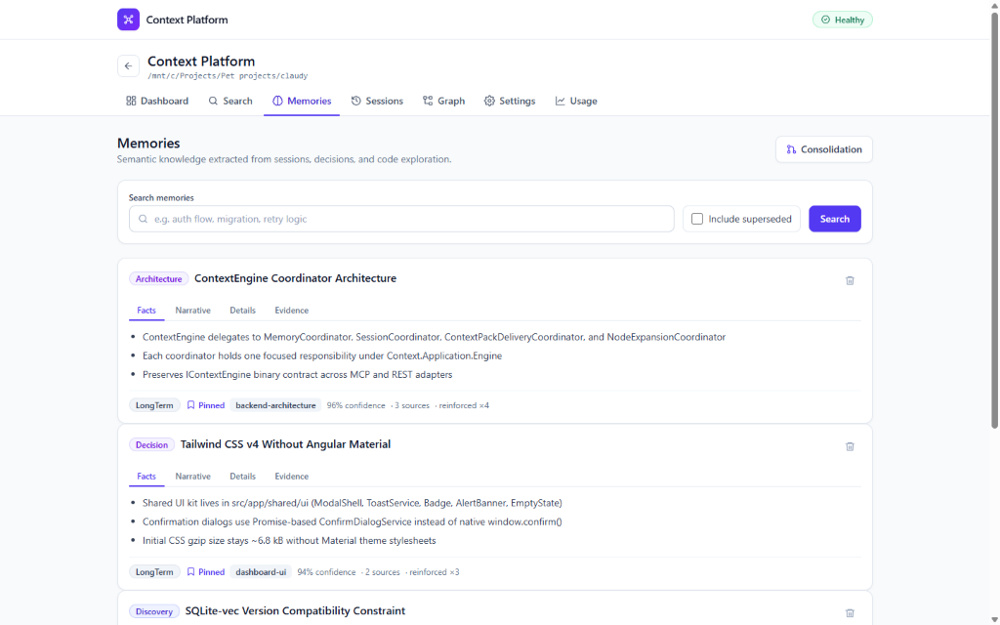
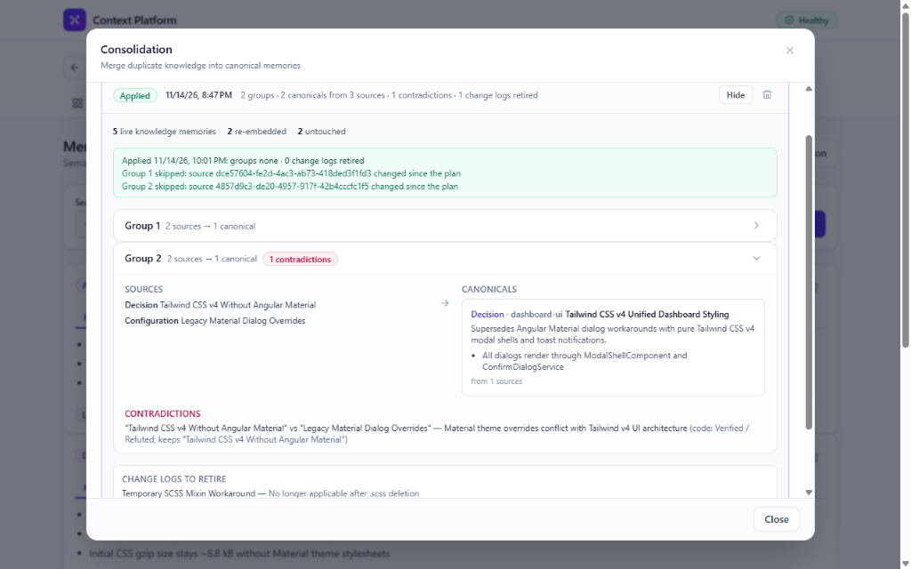

# Посібник користувача Context Platform

Цей посібник описує розгортання, первинне налаштування, щоденну роботу у вебдашборді та інтеграцію Context Platform із Claude Code.

---

## Зміст

1. [Передумови](#1-передумови)
2. [Варіанти встановлення та запуску](#2-варіанти-встановлення-та-запуску)
3. [Тур вебдашбордом (зі скриншотами)](#3-тур-вебдашбордом-зі-скриншотами)
4. [Налаштування AI-провайдерів](#4-налаштування-ai-провайдерів)
5. [Інтеграція з Claude Code: MCP-інструменти та хуки](#5-інтеграція-з-claude-code-mcp-інструменти-та-хуки)
6. [Тестування та перевірка кодової бази](#6-тестування-та-перевірка-кодової-бази)
7. [Усунення типових проблем](#7-усунення-типових-проблем)

---

## 1. Передумови

| Компонент | Мінімальна версія | Для чого потрібен |
| :--- | :--- | :--- |
| **.NET SDK** | `10.0.100` (`global.json`) | Збірка та запуск `Context.Dashboard.Server` і тестів |
| **Node.js & npm** | Node 22+ / npm 11+ | Збірка Angular 22 + Tailwind CSS v4 фронтенду |
| **Ollama / Foundry Local** *(опціонально)* | Актуальна | Локальні ембединги (`embeddinggemma`) та LLM (`qwen2.5-coder:1.5b`) |
| **OpenAI / Anthropic API Key** *(опціонально)* | — | Хмарні провайдери ембедингів / чату з автоматичним редагуванням секретів |
| **Docker & Docker Compose** *(опціонально)* | 24+ | Контейнеризований запуск хоста та Redis |

---

## 2. Варіанти встановлення та запуску

### А. Локальна розробка (Hot Reload через SpaProxy)

1. Установіть npm-залежності клієнта:
   ```bash
   cd apps/host/Context.Dashboard/context.dashboard.client
   npm ci
   ```
2. Запустіть backend у середовищі `Development`:
   ```bash
   cd ../Context.Dashboard.Server
   dotnet run
   ```
   `Context.Dashboard.Server` автоматично підніме `ng serve` (через `Microsoft.AspNetCore.SpaProxy`) та налаштує двостороннє проксування запитів `/api/*`, `/hooks/*`, `/hubs/*` і `/mcp`.

### Б. Автономна production-збірка (Bare-Metal)

Для production-хостингу ASP.NET Core роздає зібраний статичний бандл із `wwwroot/`:

```bash
# 1. Зберіть Angular-клієнт
cd apps/host/Context.Dashboard/context.dashboard.client
npm ci
npm run build
cd ../../../..

# 2. Опублікуйте .NET-сервер та скопіюйте SPA
dotnet publish apps/host/Context.Dashboard/Context.Dashboard.Server -c Release -o /opt/context-platform
cp -r apps/host/Context.Dashboard/context.dashboard.client/dist/dashboard/browser/* /opt/context-platform/wwwroot/

# 3. Задайте каталог даних (якщо інсталяційна папка read-only) і запустіть
export CONTEXT_PLATFORM_DATA_DIR="$HOME/.local/share/context-platform"
dotnet exec /opt/context-platform/Context.Dashboard.Server.dll
```

Для фонових служб у Linux (`systemd`) та Windows Service скористайтеся скриптами у [deploy/README.md](../../deploy/README.md).

### В. Docker Compose

```bash
export CONTEXT_PLATFORM_ADMIN_TOKEN="$(openssl rand -base64 32)"
# Опціонально: шлях до індексованого проєкту (за замовчуванням ".")
export HOST_PROJECT_PATH="/path/to/your/repo"

docker compose up -d --build
```

> **Примітка для WSL2 та Docker + Ollama:** У режимі контейнера `OllamaHostFallbackHandler` автоматично перевіряє `host.docker.internal` та `172.17.0.1`, якщо налаштований URL недоступний. Якщо файрвол хоста блокує порт Ollama `11434` із мережі Docker (наприклад, на Windows із Rancher Desktop), запускайте `Context.Dashboard.Server` локально (bare-metal або в WSL2).

---

## 3. Тур вебдашбордом (зі скриншотами)

### 3.1. Список проєктів (`Projects`)

Стартова сторінка відображає всі зареєстровані проєкти, їхній кореневий шлях, кількість проіндексованих файлів і символів.


- **Add project** — створення нового проєкту з вбудованим провідником папок (**Folder Picker**) на серверній файловій системі (`GET /api/fs/browse`).
- На локальному хості (`127.0.0.1`) адмін-токен завантажується автоматично без екрана логіну.
- Якщо створюється проєкт на віддаленому/не-loopback хості, введіть `CONTEXT_PLATFORM_ADMIN_TOKEN` один раз у панелі адміністратора.

---

### 3.2. Головна панель проєкту (`Dashboard`)

Вкладка **Dashboard** показує оперативний стан конкретного проєкту: прогрес індексації в реальному часі, активні черги фонових завдань і потік викликів Claude-хуків.


- **Статус-картки:** кількість файлів, символів, графових вузлів, активних/історичних спогадів, час останньої індексації.
- **Швидкі дії:**
  - `Reindex` — інкрементальна переіндексація змінених файлів;
  - `Full reindex` — повне пересканування та перебудова графу;
  - `Rebuild Vectors` — повторне створення векторних колекцій `sqlite-vec` (корисно після зміни моделі або провайдера ембедингів);
  - `Cancel running index` — скасування активної індексації.
- **Job Queue Card:** моніторинг завдань у станах `Pending`, `Running`, `Done`, `Failed`, кнопки **Retry failed**, **Force unstuck** та **View logs** (хвіст поточного Serilog-логу у модальному вікні).
- **Hook Activity Card:** жива стрічка викликів хуків (`SessionStart`, `UserPromptSubmit`, `PostToolUse`, `PostCompact`, `Stop`, `SessionEnd`), що оновлюється через SignalR.

---

### 3.3. Гібридний пошук (`Search`)

Вкладка **Search** дозволяє тестувати пошуковий пайплайн точно так, як його бачить Claude Code через MCP-інструменти.


Доступні два режими пошуку:
- **Context Pack (`context_search`)** — повертає структурований пакет із урахуванням токенного бюджету (`TokenBudget`): архітектурне резюме (`ArchitectureSummary`), первинні фрагменти коду (`PrimaryHits`), історичні нотатки памʼяті (`HistoricalNotes`) та відкриті питання (`OpenIssues`).
- **Code Search (`code_search`)** — сирий ранжований список збігів по коду та файлових саммарі без обрізання секцій бюджетувальником.

---

### 3.4. База знань та реконсолідація (`Memories`)

Вкладка **Memories** керує довготривалою памʼяттю проєкту.



Кожна картка памʼяті показує:
- **Тип (`MemoryType`):** `Decision`, `Architecture`, `Constraint`, `Behavior`, `Configuration`, `Discovery`, `Procedure`, `Issue`, `Fact`;
- **Статус (`MemoryStatus`) та рівень (`MemoryTier`):** `Active` / `Contested` / `Superseded` / `Obsolete` та `Working` / `LongTerm`;
- **Тему (`Topic`), скоуп (`ScopePath`), впевненість (`Confidence`) та кількість підтверджень (`Reinforcements`, `Sources`)**;
- **Атомарні факти (`Facts`)** — стислий список тез для швидкої інʼєкції в контекст із мінімумом токенів;
- **Повʼязані файли та докази (`Evidence`)** — розкривається натисканням, показуючи першоджерела (сесії, злиття, ручні записи) або позначки перевірки коду (`Verify against code`).
- **Дії над карткою:** `Pin` (закріпити від згасання), `Delete`, фільтрація за текстом і статусом (`Include inactive`), а також `Refresh` / `Cleanup empty`.

#### Інтерактивна реконсолідація (`Consolidate Memories`)

Кнопка **Consolidate** запускає аналіз кластерів повʼязаних спогадів або відкриває історію dry-run звітів:



У модальному вікні **Memory consolidation** можна:
1. Запустити безпечний попередній перегляд (**Run dry preview**), який групує семантично близькі спогади без зміни БД.
2. Переглянути кожну групу (`Sources -> Canonicals`), запропоновані оновлення тексту, виявлені **суперечності (`Contradictions`)**, застарілі **change-логи для архівації (`Change logs to retire`)** та результати верифікації тверджень по реальному коду (`CodeCheckResult`: `Verified` / `Refuted` / `Unknown`).
3. Виключити небажані групи чекбоксами, застосувати план (`Apply`) або відхилити звіт (`Discard`).

---

### 3.5. Історія сесій (`Sessions`)

Вкладка **Sessions** групує сесії Claude Code по днях і показує детальний підсумок роботи агента.


- У лівій панелі — список активних і завершених сесій із назвою (`Title`), часом старту/завершення та коротким ідентифікатором сесії.
- У правій панелі — структуровані поля `SessionSummary`:
  - `Completed`, `Discovered`, `Decisions`, `OpenIssues`, `NextSteps`, `ChangedFiles`;
  - Розкривна секція **Checkpoint history** із хронологічними `SessionSummaryChunk`-ами, згенерованими при `/compact` або за періодичним розкладом.

---

### 3.6. Граф символів та радіус ураження (`Graph`)

Вкладка **Graph** візуалізує AST-граф символів і звʼязків проєкту на базі `vis-network`.


- **Режим пошуку (Blast Radius):** знайдіть будь-який символ (`ContextEngine`, клас, метод, інтерфейс) через автодоповнення, задайте `Max hops` (за замовчуванням `3`) і досліджуйте вузли інтерактивно.
- **Права панель-інспектор (`Node Inspector`):** показує повне кваліфіковане імʼя вузла, `Node ID`, `Ref ID`, та дозволяє перецентрувати граф (`Re-center on this node`) або перейти до blast radius конкретного вузла.
- **Списки під графом:** структуровані бакети `Methods`, `Callers`, `Implementers` та `Covering tests` (такі ж дані отримує агент через MCP-інструмент `graph_impact`).
- **Перемикач `Full graph`:** завантажує топологію всього репозиторію (`GET /api/graph/full`) з автоматичним спрощенням рендерингу для великих графів (>300 вузлів).

---

### 3.7. Налаштування проєкту (`Settings`)

Вкладка **Settings** керує параметрами провайдерів, політиками стійкості, розкладами та інтеграціями **безпосередньо в рантаймі (без рестарту сервера)**.


Основні секції:
- **Providers:** вибір `Embedding provider` (`noop`, `openai`, `ollama`, `foundry`) та `LLM provider` (`noop`, `anthropic`, `ollama`, `foundry`), розмір батчу ембедингів (`EmbeddingBatchSize`), URL та назви моделей для локальних провайдерів.
- **Provider resilience:** загальний таймаут запиту (`LlmTimeoutSeconds`), експоненціальні повтори (`LlmMaxRetries`, `LlmRetryBaseDelaySeconds`) та пауза після HTTP 429 (`RateLimitCooldownMinutes`, `RateLimitMaxCooldownMinutes`).
- **Reindexing / Session summaries / Memory extraction & retrieval / Memory merging / Retention & cleanup:** гнучкі пороги подій, інтервали фонових планувальників, параметри групового злиття та політики очищення старих подій/хуків.
- **Claude Code integration & Danger zone:** одно-клікова реєстрація інтеграції у репозиторій та безпечне видалення проєкту.

---

### 3.8. Використання токенів та економія (`Usage`)

Вкладка **Usage & Savings** розділяє фактичні витрати на LLM та контрфактуальну економію від роботи MCP.


- Перемикач вікна: `7d`, `30d`, `90d`.
- **KPI-картки:** `Total tokens spent`, `Total LLM / MCP calls`, `Avg tokens / call`, `Tokens saved EST.` (зелений акцент — оцінка токенів, які не довелося читати повністю з файлів), та `Net balance EST.` (`saved - spent`).
- Графік денних витрат (`Tokens spent by day`) і таблиця розбивки за призначенням (`session_summarize`, `file_summarize`, `memory_extract`, `context_pack`, `code_search`).

---

## 4. Налаштування AI-провайдерів

| Провайдер | Рекомендовані моделі за замовчуванням | Особливості |
| :--- | :--- | :--- |
| **`noop`** | Вбудований детерміністський | Нульові зовнішні виклики; ідеально для тестів, офлайн-огляду графа та FTS5-пошуку |
| **`ollama`** | `embeddinggemma` + `qwen2.5-coder:1.5b` | Локальний інференс; є автообробка лімітів контексту і 429 cooldown; фолбек-хости у Docker |
| **`foundry`** | `qwen3-embedding-0.6b` + `phi-3.5-mini` | Локальний OpenAI-сумісний сервер Microsoft Foundry Local (`foundry model load <alias>`) |
| **`openai`** / **`anthropic`** | `text-embedding-3-small` / `claude-3-5-sonnet-20241022` | API-ключі задаються централізовано через змінні середовища; вихідний текст сканується на секрети (`SecretRedactor`) |

---

## 5. Інтеграція з Claude Code: MCP-інструменти та хуки

Після реєстрації Claude Code у проєкті агент отримує доступ до:

1. **13 MCP-інструментів (`/mcp`):**
   - Пошук: `context_search`, `code_search`, `symbol_search`
   - Памʼять: `memory_search`, `memory_get`, `memory_remember`, `memory_forget`
   - Граф: `graph_neighbors`, `graph_path`, `graph_impact`
   - Сесії та метадані: `session_search`, `session_get`, `project_info`
2. **6 життєвих хуків (`/hooks/*`):**
   - `SessionStart` — реєструє або відновлює сесію й інʼєктує стартовий контекст проєкту;
   - `UserPromptSubmit` — підтягує релевантний `ContextPack` під поточний запит;
   - `PostToolUse` — зберігає події редагування/команд/читання (при накопиченні `MinEventsForMemoryExtraction` автоматично запускає пакетне витягування памʼяті);
   - `PostCompact` — фіксує контрольну точку саммарі та витягує памʼять із компакт-резюме;
   - `Stop` — записує фінальну відповідь ходу;
   - `SessionEnd` — закриває сесію, скидає невитрачені події на витягування і формує фінальне `SessionSummary`.

---

## 6. Тестування та перевірка кодової бази

У WSL / Linux:
```bash
dotnet test ContextPlatform.slnx --no-restore
```

Frontend unit-тести (Vitest) та production-збірка:
```bash
cd apps/host/Context.Dashboard/context.dashboard.client
npm test -- --watch=false
npm run build
```

---

## 7. Усунення типових проблем

- **Дашборд повертає 404 на кореневому `/` у production-режимі:** переконайтеся, що Angular SPA зібрано (`npm run build`) і вміст `dist/dashboard/browser` скопійовано в `wwwroot/` поряд із `Context.Dashboard.Server.dll` (у `Development` використовуйте `dotnet run` зі `SpaProxy`).
- **Помилка `401 Unauthorized` на `/api/projects` при розгортанні на `0.0.0.0`:** хост свідомо не генерує admin-токен на зовнішніх інтерфейсах — явно задайте `CONTEXT_PLATFORM_ADMIN_TOKEN`.
- **Порожні результати векторного пошуку після зміни провайдера ембедингів:** натисніть **Rebuild Vectors** у картці швидких дій на `Dashboard`, щоб заповнити колекцію `chunk_vectors_{provider}` для нової розмірності векторів.
- **Зникло підключення Ollama з Docker-контейнера:** перевірте правила файрволу для порту `11434` на машині-хості або запустіть сервер напряму в хостовій ОС / WSL2.
