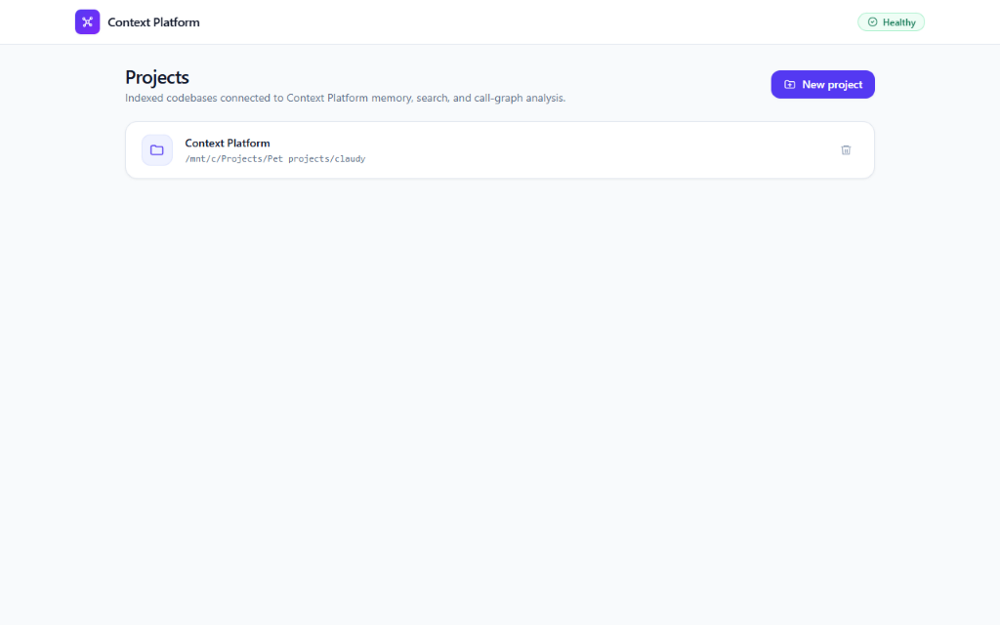
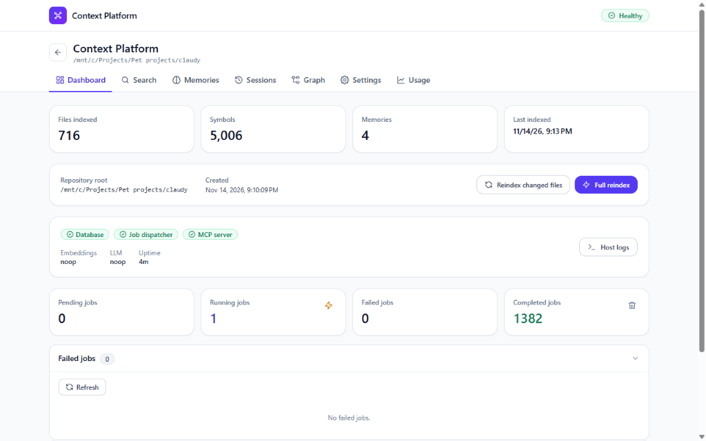
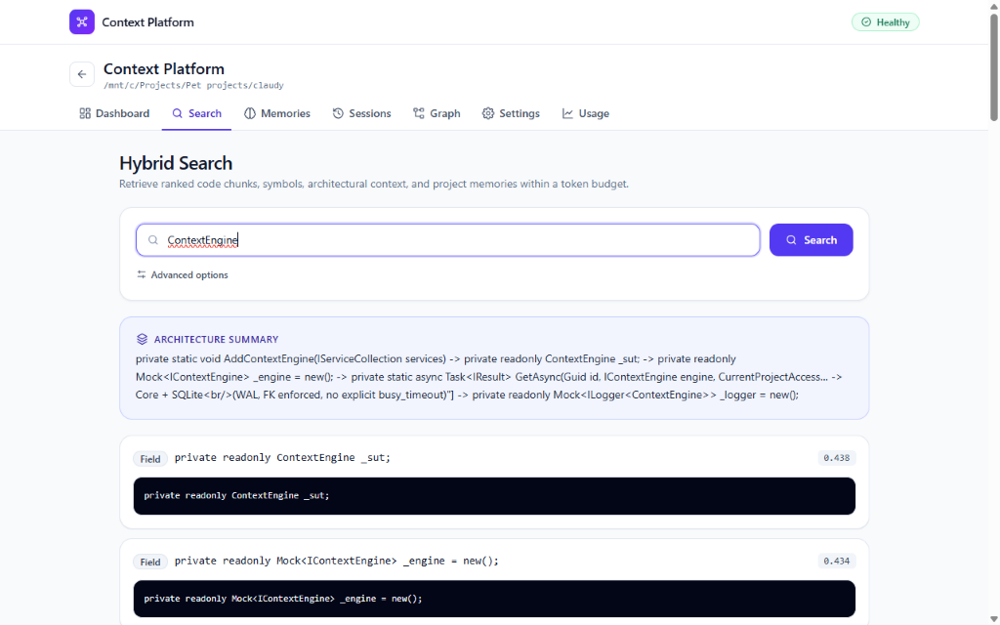
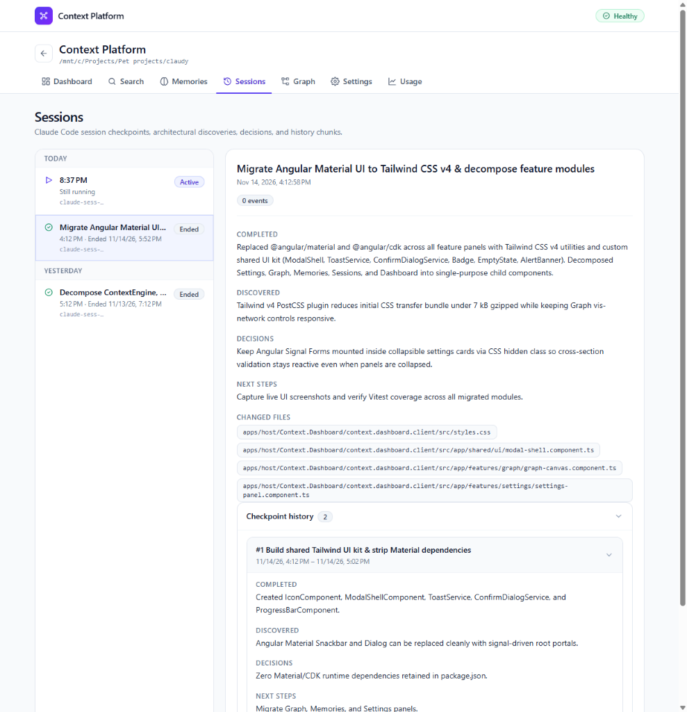
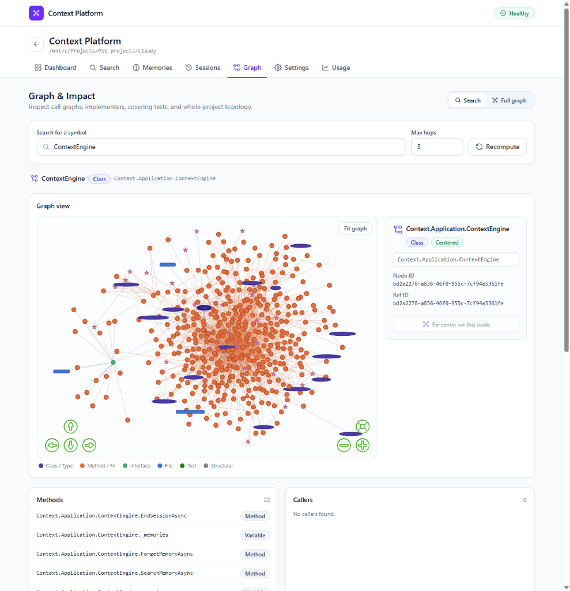
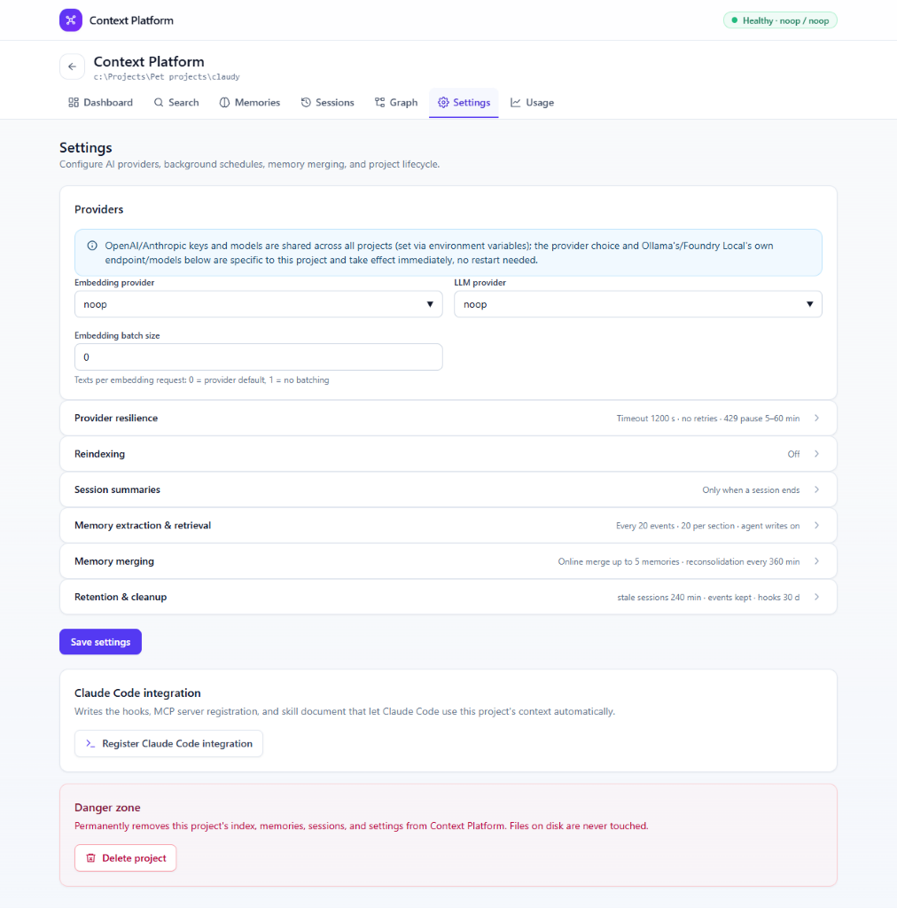
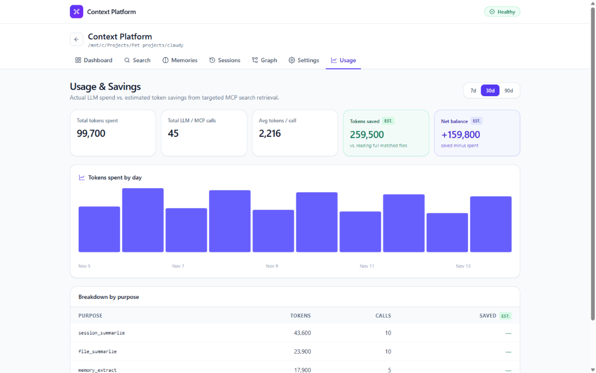

# Посібник користувача Context Platform

**Мова / Language:** Українська | [English](../en/USER_GUIDE.md)

Цей посібник пояснює, як розгорнути Context Platform, працювати у вебдашборді, вибрати AI-провайдерів і підключити Claude Code.

---

## Зміст

1. [Передумови](#1-передумови)
2. [Варіанти встановлення та запуску](#2-варіанти-встановлення-та-запуску)
3. [Тур вебдашбордом (зі скриншотами)](#3-тур-вебдашбордом-зі-скриншотами)
4. [Вибір AI-провайдерів](#4-вибір-ai-провайдерів)
5. [Підключення Claude Code (MCP та хуки)](#5-підключення-claude-code-mcp-та-хуки)
6. [Запуск тестів](#6-запуск-тестів)
7. [Типові проблеми](#7-типові-проблеми)

---

## 1. Передумови

| Компонент | Мінімальна версія | Навіщо потрібен |
| :--- | :--- | :--- |
| **.NET SDK** | `11.0.100` (`global.json`) | Збірка та запуск сервера і тестів |
| **Node.js & npm** | Node 22+ / npm 11+ | Збірка фронтенду Angular 22 + Tailwind CSS v4 |
| **Ollama / Foundry Local** *(опціонально)* | Актуальна | Локальні ембединги та чат-моделі (`embeddinggemma`, `qwen2.5-coder:1.5b`) |
| **OpenAI / Anthropic API Key** *(опціонально)* | — | Хмарні моделі, якщо не запускаєте моделі локально |
| **Docker & Docker Compose** *(опціонально)* | 24+ | Запуск сервера в контейнері (з опціональним Redis) |

---

## 2. Варіанти встановлення та запуску

### А. Локальна розробка (з автоперезавантаженням)

1. Встановіть залежності клієнта:
   ```bash
   cd apps/host/Context.Dashboard/context.dashboard.client
   npm ci
   ```
2. Запустіть backend у режимі розробки:
   ```bash
   cd ../Context.Dashboard.Server
   dotnet run
   ```
   ASP.NET Core автоматично запустить `ng serve` через `SpaProxy` і проксуватиме запити API, хуків, SignalR та MCP.

### Б. Окрема production-збірка

```bash
# 1. Зберіть Angular-клієнт
cd apps/host/Context.Dashboard/context.dashboard.client
npm ci
npm run build
cd ../../../..

# 2. Опублікуйте .NET-сервер та скопіюйте фронтенд у wwwroot/
dotnet publish apps/host/Context.Dashboard/Context.Dashboard.Server -c Release -o ./publish/host
cp -r apps/host/Context.Dashboard/context.dashboard.client/dist/dashboard/browser/* ./publish/host/wwwroot/

# 3. Задайте каталог для SQLite-бази та запустіть сервер
export CONTEXT_PLATFORM_DATA_DIR="$HOME/.local/share/context-platform"
dotnet exec ./publish/host/Context.Dashboard.Server.dll
```

Скрипти для запуску як фонового сервісу (`systemd` / Windows Service) знаходяться у [deploy/README.md](../../deploy/README.md).

### В. Docker Compose

```bash
export CONTEXT_PLATFORM_ADMIN_TOKEN="$(openssl rand -base64 32)"
export HOST_PROJECT_PATH="/path/to/your/repo"

docker compose up -d --build
```

> **Примітка для Docker + Ollama:** у контейнері `OllamaHostFallbackHandler` сам перевіряє `host.docker.internal` та `172.17.0.1`. Якщо файрвол хоста блокує порт `11434`, запустіть `Context.Dashboard.Server` безпосередньо в ОС або у WSL2.

---

## 3. Тур вебдашбордом (зі скриншотами)

Відкрийте [http://127.0.0.1:47923](http://127.0.0.1:47923). На локальному хості (`127.0.0.1`) дашборд автоматично отримує адмін-токен без екрана входу.

### 3.1. Список проєктів (`Projects`)

Головна сторінка показує підключені репозиторії та дає змогу додати або видалити проєкт.



- Натисніть **New project** і виберіть локальну папку через вбудований файловий оглядач.
- Після створення зʼявиться проєктний Bearer-токен і готове посилання, якщо ви хочете налаштувати зовнішні інструменти вручну.

---

### 3.2. Панель проєкту (`Dashboard`)

Вкладка **Dashboard** показує актуальний стан індексації, черги завдань, стан сервера та стрічку останніх хуків Claude Code.



- **Лічильники:** проіндексовані файли, знайдені символи, збережені спогади та час останнього оновлення.
- **Швидкі дії:**
  - **Reindex changed files** — оновлює лише змінені файли;
  - **Full reindex** — перескановує весь репозиторій та перебудовує граф;
  - **Rebuild vectors** — перераховує векторні індекси після зміни моделі ембедингів;
  - **Cancel running index** — коректно зупиняє поточну переіндексацію.
- **Черга завдань та хост:** індикатори стану БД, `JobDispatcher` та MCP, діаграма завдань (`Pending`, `Running`, `Failed`, `Completed`), модальне вікно **Host logs** і кнопки **Retry failed** / **Clear completed**.
- **Hook Activity:** живий потік викликів хуків.

---

### 3.3. Пошук (`Search`)

Вкладка **Search** дозволяє запускати ті самі запити, якими користується Claude Code через MCP.



- **Context Pack (`context_search`)** збирає пакет у межах токенного бюджету: фрагменти коду, доречні спогади, відкриті питання та короткий опис архітектури.
- **Code Search (`code_search`)** повертає ранжований список збігів у коді без секцій памʼяті.
- **Advanced options** дозволяють обмежити шлях/мову пошуку та змінити ліміт токенів.

---

### 3.4. Памʼять та реконсолідація (`Memories`)

Вкладка **Memories** зберігає довготривалі нотатки, витягнуті з ваших робочих сесій.


- Фільтруйте записи за типом (`Decision`, `Architecture`, `Constraint`, `Behavior`, `Configuration`, `Discovery`, `Procedure`, `Issue`, `Fact`) або ключовими словами.
- Кожна картка показує короткі **Facts**, довший **Narrative**, рівень впевненості, кількість підтверджень, файлові докази (**Evidence**) і кнопки **Pin** / **Delete**.

#### Обʼєднання схожих записів (`Consolidate`)


1. Натисніть **Consolidate** і спершу запустіть **Dry preview** — план створюється без змін у базі.
2. Перегляньте групи злиття (`Sources -> Canonicals`), знайдені суперечності (`Contradictions`), застарілі change-логи й позначки перевірки в коді (`Verified`, `Refuted`, `Unknown`).
3. Зніміть прапорці з небажаних груп і натисніть **Apply** або **Discard**.

---

### 3.5. Сесії (`Sessions`)

Вкладка **Sessions** групує сесії за датами та показує структурований підсумок (`Completed`, `Discovered`, `Decisions`, `OpenIssues`, `NextSteps`, `ChangedFiles`), а також проміжні контрольні точки (**Checkpoints**).



---

### 3.6. Граф символів (`Graph`)

Вкладка **Graph** малює залежності коду на основі Tree-sitter та `vis-network`.



- Знайдіть клас, record, інтерфейс, властивість або метод і задайте глибину (`Max hops`, за замовчуванням `3`).
- Під графом показані **Callers**, **Implementers** та **Covering tests**; натискайте будь-який вузол для перегляду деталей або увімкніть **Full graph**.

---

### 3.7. Налаштування (`Settings`)

Вкладка **Settings** змінює AI-провайдерів, політики повторів, розклади фонових задач та інтеграцію з Claude Code одразу під час роботи — **без перезапуску сервера**.



---

### 3.8. Використання та економія (`Usage`)

Вкладка **Usage** показує окремо фактичні витрати токенів LLM і оцінку зекономлених токенів завдяки цільовому MCP-пошуку замість читання цілих файлів.



- Перемикайте вікно (`7d`, `30d`, `90d`), серії графіка (`Both`, `Spent`, `Saved est.`) та таблицю за призначенням запитів.

---

## 4. Вибір AI-провайдерів

| Провайдер | Моделі за замовчуванням | Коли використовувати |
| :--- | :--- | :--- |
| **`noop`** | Вбудований детерміністський | Нуль налаштувань, тести, точний FTS5-пошук і аналіз графу викликів |
| **`ollama`** | `embeddinggemma` + `qwen2.5-coder:1.5b` | Локальний семантичний пошук і автоматичне витягування памʼяті без хмари |
| **`foundry`** | `qwen3-embedding-0.6b` + `phi-3.5-mini` | Локальний запуск моделей через Microsoft Foundry Local |
| **`openai`** / **`anthropic`** | `text-embedding-3-small` / `claude-3-5-sonnet-20241022` | Максимальна якість витягування знань (секрети редагуються перед відправкою) |

---

## 5. Підключення Claude Code (MCP та хуки)

Відкрийте **Settings** у своєму проєкті й натисніть **Register Claude Code integration** (або `POST /api/projects/{id}/claude/install`). Після створення резервної копії інсталятор запише:

- `.mcp.json` — 13 MCP-інструментів (`context_search`, `code_search`, `symbol_search`, `memory_search`, `memory_get`, `memory_remember`, `memory_forget`, `graph_neighbors`, `graph_path`, `graph_impact`, `session_search`, `session_get`, `project_info`).
- `.claude/settings.json` та `.claude/hooks/*` — 6 хуків життєвого циклу (`SessionStart`, `UserPromptSubmit`, `PostToolUse`, `PostCompact`, `Stop`, `SessionEnd`).
- `.claude/skills/context-memory/SKILL.md` — інструкція для Claude щодо використання MCP-інструментів.

---

## 6. Запуск тестів

Backend (.NET 11):
```bash
dotnet test ContextPlatform.slnx --no-restore
```

Frontend (Angular 22 / Vitest):
```bash
cd apps/host/Context.Dashboard/context.dashboard.client
npm test -- --watch=false
npm run build
```

---

## 7. Типові проблеми

- **404 на `/` у Release-режимі:** переконайтеся, що виконано `npm run build`, а файли з `dist/dashboard/browser/*` скопійовано в `wwwroot/` поруч із `Context.Dashboard.Server.dll`. Для локальної розробки запускайте `dotnet run`.
- **`401 Unauthorized` при привʼязці до `0.0.0.0`:** автоматична видача адмін-токена працює лише на `127.0.0.1`; для зовнішніх адрес задайте `CONTEXT_PLATFORM_ADMIN_TOKEN`.
- **Немає векторних результатів після зміни моделі ембедингів:** натисніть **Rebuild vectors** у вкладці **Dashboard**, щоб створити колекцію з новою розмірністю векторів.
- **Контейнер Docker не бачить локальний Ollama:** перевірте файрвол на порту `11434` або запустіть `Context.Dashboard.Server` на хості / у WSL2.
